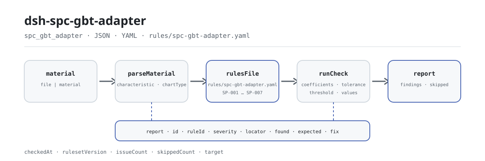

<div align="center">

<picture>
  <source media="(prefers-color-scheme: dark)" srcset="docs/assets/dsh-spc-gbt-adapter-flow-dark.svg">
  
</picture>

# dsh-spc-gbt-adapter

**Check a control-chart register before it reaches review — which row, which column, what differs, item by item.**

A conventional control-chart register checker for DeepSeek Harness: it reads one control-chart register, applies 7 rules to the arithmetic and constant-table consistency of its limits, centre line and Cp/Cpk, and lists differences only — it never decides whether a process is in control.

[Install](#three-step-setup) · [Configuration](#configuration) · [FAQ](#faq) · [简体中文](README.md) · [English](README.en.md) · [Español](README.es.md) · [Português](README.pt.md) · [हिन्दी](README.hi.md)

[](LICENSE)
[](#compatibility)
[](https://www.npmjs.com/package/dsh-spc-gbt-adapter)
[](https://github.com/PerryLink/dsh-spc-gbt-adapter/actions/workflows/ci.yml)
[](#compatibility)

[](https://github.com/PerryLink/dsh-spc-gbt-adapter/stargazers)
[](https://www.npmjs.com/package/dsh-spc-gbt-adapter)
[](https://dshfind.com/plugins/PerryLink/dsh-spc-gbt-adapter?ref=badge)
[](https://securityscorecards.dev/viewer/?uri=github.com/PerryLink/dsh-spc-gbt-adapter)
[](https://dsh.market/)
[](https://gitee.com/perrylink/dsh-spc-gbt-adapter)

```sh
dsh plugin --profile <name> add dsh-spc-gbt-adapter
```

</div>

<sub>Community plugin, not affiliated with DeepSeek. Canonical repository: <https://github.com/PerryLink/dsh-spc-gbt-adapter> (Gitee is a mirror).</sub>

## What it is

`dsh-spc-gbt-adapter` reads one control-chart register — rows keyed by the register's own column names, in Chinese or English — and checks that register's own arithmetic and constant-table consistency: that the characteristic and the chart type are recorded, that the control limits follow from the centre line, the dispersion statistic and the chart constants the pack freezes, that the centre line sits between the limits, that the stored Cp and Cpk follow their definitions, that the subgroup size is one the constant table covers, and that the header names the product and the process.

The material is JSON or YAML; the tool reads the `file` or `material` you pass and never modifies the original. Excel can be converted to JSON/YAML first, in chat if the platform supports it.

## Three-step setup

1. **Install** (pick one channel):

   ```sh
   # git channel (latest main)
   dsh plugin --profile <name> add github:PerryLink/dsh-spc-gbt-adapter
   # npm channel (published releases)
   dsh plugin --profile <name> add dsh-spc-gbt-adapter
   # tarball channel: pnpm pack in this repo, then
   dsh plugin --profile <name> add ./dsh-spc-gbt-adapter-<version>.tgz
   ```

   Working from a source checkout? Run `pnpm install && pnpm run build` first (`prepare` runs `tsdown` to produce `lib/`).

2. **Minimal config** (sane defaults; this example runs three rules only):

   ```yaml
   - insert:
       - id: dsh-spc-gbt-adapter
         name: dsh-spc-gbt-adapter
         config:
           onlyRules: [SP-001, SP-002, SP-004]
   ```

3. **Verify it mounts**:

   ```sh
   dsh --profile <name> --dump-config | grep 'dsh-spc-gbt-adapter'
   ```

   Then have the model call the `spc_gbt_adapter` tool once with the minimal input:

   ```json
   {"rows":[{"mean":"10.00","stdDev":"0.215","usl":"10.60","lsl":"9.40","cp":"0.9302","cpk":"1.50"}]}
   ```

   The report carries `issueCount`, `summary` and `skippedCount`; the item-by-item findings live in `markdown` and `reportJson`. From a source checkout you can run the bundled sample (after a build): `node samples/quickstart/run.mjs --check`, with its input and expected output under `samples/quickstart/`; the terminal screenshot is at [`docs/assets/quickstart.png`](docs/assets/quickstart.png).

**Uninstall**: `dsh plugin --profile <name> remove dsh-spc-gbt-adapter`.

<details>
<summary>Material format (JSON / YAML)</summary>

```yaml
productNo: P-2026-001
processName: 精车外圆
rows:
  - { 控制图编号: Xbar-R-001, 特性名称: 外径, 控制图类型: Xbar-R, 子组大小: '5',
      均值: '10.00', 极差: '0.50', 标准差: '0.215', 中心线: '10.00',
      上控制限: '10.2885', 下控制限: '9.7115', 上规格限: '10.60', 下规格限: '9.40',
      Cp: '0.9302', Cpk: '0.9302' }
```

Column names are matched case-insensitively and ignoring spaces, underscores and hyphens, so `UCL` and `ucl` resolve to the same field; the register's own column names are kept, so a finding names the column it read. Numeric cells may carry units. Both the header and the rows accept Chinese and English aliases.

</details>

## Core capabilities

`dsh-spc-gbt-adapter` turns one control-chart register into a difference list a human can check item by item:

- **Register-level checking** — it reads only the register you pass; every finding carries `locator` (row/column), `found`, `expected` and `fix`, pointing at one specific row and column.
- **Seven rules, the rule pack is data** — every check is declared in `rules/spc-gbt-adapter.yaml`; replacing the YAML switches rule-set versions without touching TypeScript.
- **No silent pass** — checks that are unconfigured, disabled or impossible to run go into `skipped` with their reason; an empty issue list can never be read as "nothing is wrong".
- **Differences only** — no compliance verdict, no liability finding, no replacement for the reviewer; the conclusion stays with whoever is authorised to make it.
- **Local, side-effect free** — no network, no model calls, no writes to the material; parsing and checking are local pure functions.

| Rule | What it checks | Severity | Basis |
|---|---|---|---|
| `SP-001` | the characteristic and chart type are recorded | warn | principle |
| `SP-002` | the limits follow from the centre, dispersion and constants | warn | principle |
| `SP-003` | the centre line sits between the limits | warn | principle |
| `SP-004` | Cp and Cpk follow their definitions | warn | principle |
| `SP-005` | capability meets your acceptance criterion (off by default) | info | local |
| `SP-006` | the chart names its product and process | warn | principle |
| `SP-007` | the subgroup size is one the constant table covers | warn | principle |

### A real run

**Tool** `spc_gbt_adapter`

**Input**

~~~json
{"rows":[{"均值":"10.00","标准差":"0.215","上规格限":"10.60","下规格限":"9.40","Cp":"0.9302","Cpk":"1.50"}]}
~~~

**Output**

~~~json
{
  "id": "dsh-spc-gbt-adapter.SP-004.de09b5a6",
  "ruleId": "SP-004",
  "severity": "warn",
  "locator": {
    "row": 1,
    "field": "cpk"
  },
  "found": "第 1 行 Cpk 填报 1.5，按 min(USL − X̄, X̄ − LSL) / 3σ 应为 0.9302",
  "expected": "Cpk = min(USL − X̄, X̄ − LSL) / 3σ",
  "fix": "核对标准差口径与均值；本条只做算术核对，不判断能力是否足够"
}
~~~

*Observed from `dsh-spc-gbt-adapter/tests/fixtures/SP-004/SP-004-unsafe.json`*

### Six questions it answers

| You ask | What it answers |
|---|---|
| A chart row leaves both the characteristic and the chart type blank. Is that reported? | Yes. `SP-001` requires at least one of `characteristic` and `chartType` to be filled on every row that carries either column, and reports the row when both are empty. It checks that one of them is recorded, not whether that characteristic ought to be charted or whether the chart type was chosen correctly. |
| The stored control limits do not match what the centre line, the range and the chart constants give. | `SP-002` recomputes `ucl` and `lcl` from `centerLine`, `range` and the coefficient entry for that `sampleSize`, within a tolerance of 0.005, and reports the row with the stored pair and the expected pair. It checks only that those numbers agree with one another — not that the limits or the range are correct, and never whether the process is in control. The frozen table is the X̄-R one: an X̄-s, I-MR, p or c chart has different coefficients, so disable the rule or replace `coefficients`. |
| The centre line is stored above the upper control limit. | `SP-003` requires `lcl` ≤ `centerLine` ≤ `ucl` on every row that fills all three, and reports the row where that order fails. It checks the order of the three numbers only, not whether they were computed correctly. A lower limit of 0 is a normal shape for the range chart and is not reported on that account. |
| Cp and Cpk are in the register, but the report says nothing about them. Why? | `SP-004` runs only on rows that carry `cp` or `cpk` together with `usl`, `lsl`, `stdDev` and `mean`; when no row carries all of them, the rule reports `skipped` rather than passing silently. Where it runs it tests the two definitions, Cp = (USL − LSL) / 6σ and Cpk = min(USL − X̄, X̄ − LSL) / 3σ, within a tolerance of 0.02. A difference usually means the σ convention is mixed up: Cp/Cpk take the within-subgroup standard deviation, Pp/Ppk the overall one. It does not decide whether capability is sufficient. |
| Is the process capability good enough? | The check does not answer that. `SP-005` only reports a stored `cpk` that falls below the criterion you configure, and it ships with `threshold: 0`, meaning not configured, so it goes to `skipped` instead of inventing a criterion; the usual 1.33 and 1.67 depend on the industry, the customer and how critical the characteristic is. A finding under this rule means the value is below your own criterion, not that the process is unqualified, and the rule is reported at `info` severity. |
| Our subgroups hold 15 measurements each. What happens? | `SP-007` reports the row: the constant table frozen into the pack covers subgroup sizes 2 to 10 only. With no entry for that size, `SP-002` cannot look the coefficients up either, so it reports that rather than staying silent. The rule checks whether the size is a listed tier, not whether that subgroup size suits the process. To work with larger subgroups, add the tier to `SP-002`'s `coefficients` and widen this rule's `values` — a rule-pack edit, not a code change. |

## Configuration

All tunables are Schemastery `Config` fields in `src/config.ts`, changeable from `cordis.yml` without touching code; per-rule thresholds live in the rule pack under `rules/`.

| Key | Type | Default | Meaning |
|---|---|---|---|
| `rulesFile` | string | `rules/spc-gbt-adapter.yaml` | Rule-pack path, relative to the package root |
| `disabledRules` | string[] | `[]` | Rule ids to stop running; each appears in `skipped` |
| `onlyRules` | string[] | `[]` | Run only these rule ids; empty runs every rule |
| `skipNotes` | string | `""` | Note appended to every `skipped` reason |
| `timeoutMs` | number | `120000` | Cooperative tool timeout budget |

Rule-level parameters worth knowing:

- `SP-002` `coefficients` — the constant table, keyed by subgroup size, with `a2` for a mean chart and `d3` / `d4` for a dispersion chart. The default covers n = 2…10 for X̄-R; extend it or swap it for another chart type's table. `tolerance` defaults to `0.005`.
- `SP-004` `tolerance` — defaults to `0.02`, enough for rounding in a ledger.
- `SP-005` `threshold` — your Cpk acceptance criterion. `0` means the rule does not run.
- `SP-007` `values` — the subgroup sizes your register may use.

Example override in your profile patch:

```yaml
- insert:
    - id: dsh-spc-gbt-adapter
      name: dsh-spc-gbt-adapter
      config:
        rulesFile: rules/spc-gbt-adapter.yaml
        onlyRules: [SP-002, SP-004, SP-006]
        skipNotes: institutional SPC rules, 2026 edition
        timeoutMs: 60000
```

## FAQ

<details>
<summary>Is the material uploaded or sent over the network?</summary>

No. `dsh-spc-gbt-adapter` is a local checker: it reads only the material passed to the tool (`file` or `material`) and uploads nothing; it makes no network requests and carries no telemetry, analytics or background reporting; it writes no data beyond the tool result and the DSH host's own session/log storage. The host controls that storage and its retention policy; this package keeps no second copy.

</details>

<details>
<summary>An empty issue list — does that mean nothing is wrong?</summary>

Not necessarily. Checks that could not run go into `skipped` one by one with their reason — for example `SP-005` ships with `threshold: 0` and reports itself in `skipped` instead of passing silently, and `SP-004` does the same when any of its six fields is missing. An empty issue list only means the rules that did run found no differences; read `skippedCount` and `skipped` before `issueCount`.

</details>

<details>
<summary>Does it fight other plugins over tool names, services or slots?</summary>

No. It registers one `spc_gbt_adapter` tool, provides no service key, registers no client slot and no `webServer` prefix, listens to no shared events, and mutates no globals. Tool registration is a Cordis effect, removed on stop or hot reload.

</details>

<details>
<summary>How big is the performance overhead? Will it time out?</summary>

Parsing and checking are local — no network requests, no model calls. The tool carries a cooperative `timeoutMs` budget (120000 ms by default), and checking is a linear scan. Cost grows with the number of register rows, not with the model.

</details>

<details>
<summary>Can it replace the reviewer?</summary>

No. It only lists differences that can be pointed at inside the register itself; it does not judge compliance, assign liability, or decide whether a process is in control or capability is sufficient. Those depend on the customer's acceptance criterion, your institutional SPC rules and the reviewer's judgement.

</details>

## Standards it follows

| Document | Number | Cited by rules |
|---|---|---|
| Conventional control charts | GB/T 17989.2—2020 (Control charts — Part 2: Shewhart control charts; adopts ISO; replaces the abolished GB/T 4091—2001; clause numbers not obtained this round) | SP-001, SP-002, SP-003, SP-004, SP-005, SP-006, SP-007 |

**Boundary:** this plugin checks a **control-chart register** for arithmetic and constant-table consistency — that the characteristic and chart type are recorded, that the control limits follow from the centre line, the dispersion statistic and the chart constants, that the centre line sits between the limits, that Cp and Cpk follow their definitions, that the subgroup size is one the constant table covers, and that the chart names its product and process. It does **not** decide whether a process is in control, whether a trend is present, or whether capability is sufficient. **Reading a chart needs the pattern rules; sufficiency depends on the customer's acceptance criterion.**

> ### ⚠️ What this pack can and cannot cite
>
> The control-limit coefficients (A₂, D₃, D₄) and the capability-index definitions do have a home: **GB/T 17989.2—2020, *Control charts — Part 2: Shewhart control charts*** (adopts ISO; the same subject as the ISO 7870 series; replaces the abolished GB/T 4091—2001). Those coefficients are *mathematical constants* that vary only with subgroup size, which is why they can be frozen into the rule pack. **But the verification pass did not obtain that standard's verbatim text** (it adopts ISO/IEC, and the public platform does not offer online reading for copyright reasons), so every rule's `excerpt` says so plainly and every rule stays at `warn` or `info` rather than claiming a quotation.
>
> Three limits are worth knowing before trusting a finding:
>
> - **`SP-002` assumes the X̄-R chart.** An X̄-s, I-MR, p or c chart uses entirely different coefficients, so the rule will report differences. Disable it, or replace `coefficients` with the right table — a rule-pack edit, not a code change.
> - **The coefficient table covers n = 2…10.** `SP-007` reports any subgroup size outside that range, so "cannot look it up" is never silently read as "no problem".
> - **`SP-005`'s criterion ships as `0`, meaning "not configured".** Typical values are 1.33 and 1.67, but the right one depends on the industry, the customer and how critical the characteristic is, so the rule reports that it could not run rather than inventing one.
>
> The σ convention matters too: Cp/Cpk use the **within-subgroup** standard deviation while Pp/Ppk use the **overall** one. A mismatch between a ledger's σ and its index is the commonest cause of a `SP-004` finding, which is why the finding says so.

**Rule data is separate from code.** The rule data lives in `rules/spc-gbt-adapter.yaml`. Its header records the correction made on 2026-10-07: the standard number was changed from the abolished GB/T 4091—2001 to the current GB/T 17989.2—2020, with `kind` and `severity` left untouched because the coefficients are mathematical constants. The load-time guard still requires a document, number, clause, excerpt and source per rule (an excerpt shorter than eight characters fails at load), and still forbids a `derived-from-principle` or locally configured check from being `error`. The per-clause verification record is in `rules/evidence/`.

## Security boundaries

- **Read the material, never rewrite it.** The tool reads the `file` or `material` you pass; the register on disk is never written back, moved or deleted.
- **No network, no model calls, no telemetry.** No network requests, no analytics or background reporting; no data is written beyond the tool result and the host's own session/log storage.
- **No adjudicating conclusions.** The report lists differences only; it does not decide that a process is in control, that capability is sufficient, or who is responsible. A wording guard runs on the rendered report, which always carries the disclaimer.
- **No fabricated citations.** The rule pack is validated at load: every rule must carry a document, number, clause, excerpt and source, and the excerpt must be a verbatim quotation. When the verbatim clause could not be obtained, the pack says so instead of paraphrasing one; `derived-from-principle` is capped at `warn` and `institutional-configuration` at `info`.
- **No silent pass.** Checks that are unconfigured, disabled or impossible to run go into `skipped` with a reason; an empty issue list can never be read as "nothing is wrong".
- **The rule pack is data.** Replacing `rules/*.yaml` switches rule-set versions without code changes; the pack is validated on load, not trusted.

## Known limitations

- **A self-consistent register is not a controlled process.** The plugin checks only the register's arithmetic and constant-table consistency; it does not read a chart against the pattern rules (runs, trends, chains, points near the limits) and never decides whether a process is in statistical control. That needs the pattern rules applied to the chart.
- **Capability sufficiency is yours to decide.** `SP-004` checks the Cp/Cpk definitions only, and `SP-005` only compares against the `threshold` you configure; the usual 1.33 and 1.67 vary by industry, customer and characteristic, so no acceptance criterion is hard-coded.
- **`SP-002` assumes the X̄-R chart.** An X̄-s, I-MR, p or c chart uses different coefficients and algorithms; when the chart type is wrong it reports differences honestly, and the fix is to disable the rule or replace `coefficients`.
- **The coefficient table covers n = 2…10.** `SP-007` reports any subgroup size outside that range; `SP-002` cannot look the coefficients up and reports that too, rather than passing silently.
- **`SP-005` ships without a criterion.** `threshold: 0` means not configured, so the rule goes to `skipped`; it only starts comparing once you set your institutional criterion.
- **The σ convention is a common false-positive source.** Cp/Cpk use the within-subgroup standard deviation and Pp/Ppk the overall one; when a register mixes them, `SP-004` reports a difference — unify the source before touching the tolerance.
- **Arithmetic inside the register only.** It does not open the measurement records behind the register, verify that the raw data is real or that sampling was random, or judge whether the chart type was chosen well.
- **Material format is limited.** JSON or YAML only; Excel must be converted first. Reader-layer fields are optional, so a partial export produces missing-field findings instead of a crash.
- **Seven rules only.** The ruleset is replaceable, but the default covers register-level characteristic/chart-type, control limits, centre line, capability indices, header identification and subgroup tiers.

### Common checks

- **The plugin installs but the tool never appears.** Check that `main` resolves to `lib/index.mjs` and that `pnpm run build` produced it; a wrong `main` makes the loader skip the entry silently.
- **`dsh plugin add` refuses the package as incompatible.** The peer range covers `0.1.x` and `0.2.x`; if your runtime sits outside it, grant an explicit exemption: `dsh plugin --profile <name> allow-version dsh-spc-gbt-adapter@0.1.0 --dsh-version <runtime> --accept-risk`.
- **`check` reports `manifest-peers` as failed.** The static checker compares against a hard-coded peer range that predates the 0.2 line; the runtime enforces peer compatibility at install time. This is a known upstream issue in `dsh-plugin-dev`.
- **`SP-002` fires on every row of an X̄-s or I-MR chart.** Those charts use different coefficients; disable the rule, or replace `coefficients` with the right table.
- **`SP-007` fires on n = 15.** The table covers n = 2…10; add the coefficients for the sizes you use and widen `values`.
- **`SP-004` fires on a chart whose capability looks fine.** Check the σ convention first (within-subgroup vs overall); unify the source before adjusting the tolerance.
- **`SP-005` never runs.** Its criterion ships as `0`, meaning not configured; set your Cpk target to enable it.
- **A rule did not run.** Read the `skipped` array: it names the rule id and the reason.
- **Times look shifted.** All arithmetic is wall-clock over the input strings; no timezone conversion is performed.

## Compatibility

| Surface | Status |
|---|---|
| Harness | Peer range `>=0.1.2-rc.1 <0.2.0 \|\| >=0.2.0-0 <0.3.0` — verified to accept both `0.2.0-rc.2` and `0.2.1-rc.2`. `engines.dsh` is declared as `>=0.2.1-0 <0.3.0` and is enforced by the host since 0.2.1 |
| Node | `^22.19.0 \|\| >=24.0.0` |
| Platforms | All (plain ESM; no native code, no network, no model call) |
| Tool mode | Works in `native` and `ptc`; for many characteristics use `ptc` |

## Ecosystem & quality

- [Gitee mirror](https://gitee.com/perrylink/dsh-spc-gbt-adapter) (sync mirror; GitHub is canonical)
- [dshfind plugin page](https://dshfind.com/plugins/PerryLink/dsh-spc-gbt-adapter) (installs and ranking)
- [OpenSSF Scorecard report](https://securityscorecards.dev/viewer/?uri=github.com/PerryLink/dsh-spc-gbt-adapter) (driven by [.github/workflows/scorecard.yml](.github/workflows/scorecard.yml))
- [DSH Market](https://dsh.market/) (listed)
- [Ecosystem knowledge base](https://perrylink.github.io/dsh-plugin-guide/) — measured data, not marketing: plugin development guide · plugin-selection data · maintenance criteria

## Development

```sh
pnpm install                                   # node ^22.19 || >=24
pnpm run typecheck                             # tsc --noEmit
pnpm test                                      # vitest: shared table-plugin suite plus paired fixtures
pnpm run build                                 # tsdown -> lib/index.mjs + lib/index.d.mts
pnpm run verify:self-contained                 # dependency specs resolve from the registry
pnpm run check:lockfile                        # lockfile drift check
pnpm run check:readmes                         # README consistency gate
pnpm run check:citations                       # citations against the verification record
node ../scripts/sync-shared.mjs dsh-spc-gbt-adapter   # refresh src/shared from ../_shared
node samples/quickstart/run.mjs --check        # bundled sample (build first)
```

`sync-shared` copies the shared kit from `../_shared` into `src/shared/`; re-run it after every shared change.

Directory layout:

| Path | Role |
|---|---|
| `src/index.ts` | Function-plugin contract: registers the `spc_gbt_adapter` tool and resolves the rule-pack path |
| `src/config.ts` | Schemastery schema; every tunable lives here |
| `src/model.ts` | Table shape and material contract; column aliases and the parsing entry point |
| `src/view.ts` | Model-facing projection of a report; `output.schema` mirrors it |
| `src/shared/` | Shared kit (ruleset loader, report shape, YAML subset, calendar arithmetic, wording guard, table helpers), copied in so the package is self-contained |
| `rules/spc-gbt-adapter.yaml` | The rule pack, 7 rules |
| `rules/evidence/` | The verification record for every citation the pack makes |
| `tests/` | vitest; every rule has a paired compliant/violating fixture |

The bundled sample's result can be compared against `samples/quickstart/expected/result.json`; the screenshot is at [`docs/assets/quickstart.png`](docs/assets/quickstart.png). The README images are generated programmatically by [`scripts/gen-readme-assets.py`](scripts/gen-readme-assets.py) (Python + Pillow) and are safe to re-run; for a no-UI plugin the script emits only the light/dark flow SVGs, shared by all five languages.

## Family & thanks

This project is part of the DeepSeek Harness plugin family from [PerryLink](https://github.com/PerryLink) (all Apache-2.0). If it is useful, **a star helps the next person find it** — nothing is gated behind it.

- [@PerryLink](https://github.com/PerryLink) — creator and maintainer: the 7 `SP-*` rules and the rule pack, the `spc_gbt_adapter` tool, and the five-language docs and asset pipeline.

<details>
<summary>Expand all plugins</summary>

| Plugin | Status |
|---|---|
| **[dsh-aqua-input-check](https://github.com/PerryLink/dsh-aqua-input-check)** |  |
| **[dsh-archive-check](https://github.com/PerryLink/dsh-archive-check)** |  |
| **[dsh-auto-review](https://github.com/PerryLink/dsh-auto-review)** |  |
| **[dsh-autotier](https://github.com/PerryLink/dsh-autotier)** | 🧊 FROZEN — see the repo README |
| **[dsh-bid-ca-precheck](https://github.com/PerryLink/dsh-bid-ca-precheck)** |  |
| **[dsh-bid-qual-check](https://github.com/PerryLink/dsh-bid-qual-check)** |  |
| **[dsh-cert-mcp](https://github.com/PerryLink/dsh-cert-mcp)** | 🧊 FROZEN — see the repo README |
| **[dsh-checkpoint-rewind](https://github.com/PerryLink/dsh-checkpoint-rewind)** |  |
| **[dsh-click](https://github.com/PerryLink/dsh-click)** |  |
| **[dsh-composer-history](https://github.com/PerryLink/dsh-composer-history)** |  |
| **[dsh-contract-stance](https://github.com/PerryLink/dsh-contract-stance)** |  |
| **[dsh-customs-doc-check](https://github.com/PerryLink/dsh-customs-doc-check)** |  |
| **[dsh-data-quality](https://github.com/PerryLink/dsh-data-quality)** | 🧊 FROZEN — see the repo README |
| **[dsh-demurrage-ledger](https://github.com/PerryLink/dsh-demurrage-ledger)** |  |
| **[dsh-doublecheck](https://github.com/PerryLink/dsh-doublecheck)** |  |
| **[dsh-drill-script-check](https://github.com/PerryLink/dsh-drill-script-check)** |  |
| **[dsh-eia-guide-check](https://github.com/PerryLink/dsh-eia-guide-check)** |  |
| **[dsh-emergency-plan](https://github.com/PerryLink/dsh-emergency-plan)** |  |
| **[dsh-essay-rubric-check](https://github.com/PerryLink/dsh-essay-rubric-check)** |  |
| **[dsh-evidence-check](https://github.com/PerryLink/dsh-evidence-check)** |  |
| **[dsh-export-ctl-check](https://github.com/PerryLink/dsh-export-ctl-check)** |  |
| **[dsh-fast](https://github.com/PerryLink/dsh-fast)** |  |
| **[dsh-fmea-table-check](https://github.com/PerryLink/dsh-fmea-table-check)** |  |
| **[dsh-forecast-penalty](https://github.com/PerryLink/dsh-forecast-penalty)** |  |
| **[dsh-fund-research](https://github.com/PerryLink/dsh-fund-research)** |  |
| **[dsh-github](https://github.com/PerryLink/dsh-github)** |  |
| **[dsh-gongwen-flow-check](https://github.com/PerryLink/dsh-gongwen-flow-check)** |  |
| **[dsh-gongwen-word-check](https://github.com/PerryLink/dsh-gongwen-word-check)** |  |
| **[dsh-guard-plan-qc](https://github.com/PerryLink/dsh-guard-plan-qc)** |  |
| **[dsh-hazchem-check](https://github.com/PerryLink/dsh-hazchem-check)** |  |
| **[dsh-hazplan-check](https://github.com/PerryLink/dsh-hazplan-check)** |  |
| **[dsh-hidden-risk-map](https://github.com/PerryLink/dsh-hidden-risk-map)** |  |
| **[dsh-hs-classify](https://github.com/PerryLink/dsh-hs-classify)** |  |
| **[dsh-icd-rule-check](https://github.com/PerryLink/dsh-icd-rule-check)** |  |
| **[dsh-industry-research](https://github.com/PerryLink/dsh-industry-research)** |  |
| **[dsh-lawcite-adapter](https://github.com/PerryLink/dsh-lawcite-adapter)** |  |
| **[dsh-laya](https://github.com/PerryLink/dsh-laya)** |  |
| **[dsh-lc-doc-check](https://github.com/PerryLink/dsh-lc-doc-check)** |  |
| **[dsh-learning-gap-check](https://github.com/PerryLink/dsh-learning-gap-check)** |  |
| **[dsh-library](https://github.com/PerryLink/dsh-library)** |  |
| **[dsh-local-ai](https://github.com/PerryLink/dsh-local-ai)** |  |
| **[dsh-lsp-actions](https://github.com/PerryLink/dsh-lsp-actions)** |  |
| **[dsh-mask](https://github.com/PerryLink/dsh-mask)** |  |
| **[dsh-mcp-panel](https://github.com/PerryLink/dsh-mcp-panel)** |  |
| **[dsh-medrec-qc](https://github.com/PerryLink/dsh-medrec-qc)** |  |
| **[dsh-memento](https://github.com/PerryLink/dsh-memento)** | 🧊 FROZEN — see the repo README |
| **[dsh-nsfc-form-check](https://github.com/PerryLink/dsh-nsfc-form-check)** |  |
| **[dsh-nurse-record-check](https://github.com/PerryLink/dsh-nurse-record-check)** |  |
| **[dsh-observe](https://github.com/PerryLink/dsh-observe)** |  |
| **[dsh-origin-rvc-check](https://github.com/PerryLink/dsh-origin-rvc-check)** |  |
| **[dsh-ota-review-check](https://github.com/PerryLink/dsh-ota-review-check)** |  |
| **[dsh-output-styles](https://github.com/PerryLink/dsh-output-styles)** |  |
| **[dsh-paper-doc-adapter](https://github.com/PerryLink/dsh-paper-doc-adapter)** |  |
| **[dsh-permission-rules](https://github.com/PerryLink/dsh-permission-rules)** |  |
| **[dsh-permit-report-check](https://github.com/PerryLink/dsh-permit-report-check)** |  |
| **[dsh-pipeline-check](https://github.com/PerryLink/dsh-pipeline-check)** |  |
| **[dsh-pleading-draft](https://github.com/PerryLink/dsh-pleading-draft)** |  |
| **[dsh-plugin-doctor](https://github.com/PerryLink/dsh-plugin-doctor)** | 🚫 RETIRED (repo archived) |
| **[dsh-plugin-guide](https://github.com/PerryLink/dsh-plugin-guide)** |  |
| **[dsh-plugin-kit](https://github.com/PerryLink/dsh-plugin-kit)** | 🚫 RETIRED (repo archived) |
| **[dsh-plugin-upgrade](https://github.com/PerryLink/dsh-plugin-upgrade)** | 🚫 RETIRED (repo archived) |
| **[dsh-policy-brief-draft](https://github.com/PerryLink/dsh-policy-brief-draft)** |  |
| **[dsh-power-loss-split](https://github.com/PerryLink/dsh-power-loss-split)** |  |
| **[dsh-power-ticket-check](https://github.com/PerryLink/dsh-power-ticket-check)** |  |
| **[dsh-ppap-check](https://github.com/PerryLink/dsh-ppap-check)** |  |
| **[dsh-protest-deadline](https://github.com/PerryLink/dsh-protest-deadline)** |  |
| **[dsh-railway-window](https://github.com/PerryLink/dsh-railway-window)** |  |
| **[dsh-repair-order-qc](https://github.com/PerryLink/dsh-repair-order-qc)** |  |
| **[dsh-research-report](https://github.com/PerryLink/dsh-research-report)** |  |
| **[dsh-review-reply-check](https://github.com/PerryLink/dsh-review-reply-check)** |  |
| **[dsh-rulefile-check](https://github.com/PerryLink/dsh-rulefile-check)** |  |
| **[dsh-safety-brief-check](https://github.com/PerryLink/dsh-safety-brief-check)** |  |
| **[dsh-score](https://github.com/PerryLink/dsh-score)** | 🧊 FROZEN — see the repo README |
| **[dsh-session-sync](https://github.com/PerryLink/dsh-session-sync)** |  |
| **[dsh-site-log-check](https://github.com/PerryLink/dsh-site-log-check)** |  |
| **[dsh-skill-pack-security](https://github.com/PerryLink/dsh-skill-pack-security)** |  |
| **[dsh-soe-decision-check](https://github.com/PerryLink/dsh-soe-decision-check)** |  |
| **[dsh-soilwater-check](https://github.com/PerryLink/dsh-soilwater-check)** |  |
| **[dsh-sop-sync-check](https://github.com/PerryLink/dsh-sop-sync-check)** |  |
| **[dsh-spc-gbt-adapter](https://github.com/PerryLink/dsh-spc-gbt-adapter)** |  |
| **[dsh-talk](https://github.com/PerryLink/dsh-talk)** |  |
| **[dsh-tender-extract](https://github.com/PerryLink/dsh-tender-extract)** |  |
| **[dsh-tender-matrix](https://github.com/PerryLink/dsh-tender-matrix)** |  |
| **[dsh-test-drive](https://github.com/PerryLink/dsh-test-drive)** |  |
| **[dsh-ticktick](https://github.com/PerryLink/dsh-ticktick)** | 🚫 RETIRED (repo archived) |
| **[dsh-translate](https://github.com/PerryLink/dsh-translate)** |  |
| **[dsh-warranty-calc](https://github.com/PerryLink/dsh-warranty-calc)** |  |
| **[dsh-budget](https://github.com/PerryLink/dsh-budget)** | 🧊 FROZEN — see the repo README |
| **[dsh-claude-move](https://github.com/PerryLink/dsh-claude-move)** | 🧊 FROZEN — see the repo README |
| **[dsh-defend](https://github.com/PerryLink/dsh-defend)** | 🧊 FROZEN — see the repo README |
| **[dsh-draw](https://github.com/PerryLink/dsh-draw)** | 🧊 FROZEN — see the repo README |
| **[dsh-reach](https://github.com/PerryLink/dsh-reach)** | 🧊 FROZEN — see the repo README |
| **[dsh-background-agents](https://github.com/PerryLink/dsh-background-agents)** | 🚫 RETIRED (repo archived) |
| **[dsh-session-pin](https://github.com/PerryLink/dsh-session-pin)** | 🚫 RETIRED (repo archived) |
| **[dsh-team-rooms](https://github.com/PerryLink/dsh-team-rooms)** | 🚫 RETIRED (repo archived) |

</details>

## License

[LICENSE](LICENSE) (Apache License 2.0) © 2026 dsh-spc-gbt-adapter contributors

<p align="center"><sub>Apache-2.0 · Community plugin, not affiliated with DeepSeek.</sub></p>
