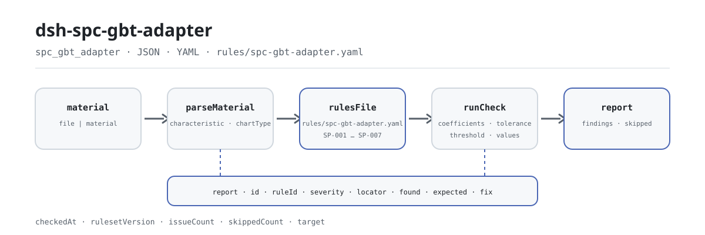

<div align="center">

<picture>
  <source media="(prefers-color-scheme: dark)" srcset="docs/assets/dsh-spc-gbt-adapter-flow-dark.svg">
  
</picture>

# dsh-spc-gbt-adapter

**Verifica el registro de cartas de control antes de que llegue a revisión: qué fila, qué columna, qué difiere, punto por punto.**

Un verificador de registros de cartas de control convencionales para DeepSeek Harness: lee un registro de cartas de control, aplica 7 reglas a la coherencia aritmética y de tabla de constantes de sus límites, línea central y Cp/Cpk, y solo enumera diferencias; nunca decide si un proceso está bajo control.

[Instalar](#instalación-en-tres-pasos) · [Configuración](#configuración) · [FAQ](#faq) · [简体中文](README.md) · [English](README.en.md) · [Español](README.es.md) · [Português](README.pt.md) · [हिन्दी](README.hi.md)

[](LICENSE)
[](#compatibilidad)
[](https://www.npmjs.com/package/dsh-spc-gbt-adapter)
[](https://github.com/PerryLink/dsh-spc-gbt-adapter/actions/workflows/ci.yml)
[](#compatibilidad)

[](https://github.com/PerryLink/dsh-spc-gbt-adapter/stargazers)
[](https://www.npmjs.com/package/dsh-spc-gbt-adapter)
[](https://dshfind.com/plugins/PerryLink/dsh-spc-gbt-adapter?ref=badge)
[](https://securityscorecards.dev/viewer/?uri=github.com/PerryLink/dsh-spc-gbt-adapter)
[](https://dsh.market/)
[](https://gitee.com/perrylink/dsh-spc-gbt-adapter)

```sh
dsh plugin --profile <name> add dsh-spc-gbt-adapter
```

</div>

<sub>Plugin de la comunidad, no afiliado a DeepSeek. Repositorio canónico: <https://github.com/PerryLink/dsh-spc-gbt-adapter> (Gitee es un espejo).</sub>

## Qué es

`dsh-spc-gbt-adapter` lee un registro de cartas de control —filas organizadas con los nombres de columna del propio registro, en chino o en inglés— y comprueba la coherencia aritmética y de tabla de constantes de ese registro: que se registren la característica y el tipo de carta, que los límites de control se sigan de la línea central, la amplitud y las constantes de carta que el paquete fija, que la línea central quede entre los límites, que el Cp y el Cpk registrados cumplan sus definiciones, que el tamaño del subgrupo sea uno de los cubiertos por la tabla de constantes y que la cabecera indique el producto y el proceso.

El material es JSON o YAML; la herramienta lee el `file` o el `material` que le pasas y nunca modifica el original. Excel puede convertirse antes a JSON/YAML, también en el chat si la plataforma lo permite.

## Instalación en tres pasos

1. **Instala** (elige un canal):

   ```sh
   # canal git (último main)
   dsh plugin --profile <name> add github:PerryLink/dsh-spc-gbt-adapter
   # canal npm (versiones publicadas)
   dsh plugin --profile <name> add dsh-spc-gbt-adapter
   # canal tarball: pnpm pack en este repo y luego
   dsh plugin --profile <name> add ./dsh-spc-gbt-adapter-<version>.tgz
   ```

   ¿Trabajas desde un checkout del código? Ejecuta antes `pnpm install && pnpm run build` (`prepare` ejecuta `tsdown` y genera `lib/`).

2. **Configuración mínima** (los valores por defecto ya funcionan; este ejemplo ejecuta solo tres reglas):

   ```yaml
   - insert:
       - id: dsh-spc-gbt-adapter
         name: dsh-spc-gbt-adapter
         config:
           onlyRules: [SP-001, SP-002, SP-004]
   ```

3. **Verifica que se monta**:

   ```sh
   dsh --profile <name> --dump-config | grep 'dsh-spc-gbt-adapter'
   ```

   Luego pide al modelo que llame una vez a la herramienta `spc_gbt_adapter` con la entrada mínima:

   ```json
   {"rows":[{"均值":"10.00","标准差":"0.215","上规格限":"10.60","下规格限":"9.40","Cp":"0.9302","Cpk":"1.50"}]}
   ```

   El informe lleva `issueCount`, `summary` y `skippedCount`; los hallazgos van en `markdown` y `reportJson`. Desde un checkout del código puedes ejecutar el ejemplo incluido (tras compilar): `node samples/quickstart/run.mjs --check`, con su entrada y salida esperada en `samples/quickstart/`; la captura de terminal está en [`docs/assets/quickstart.png`](docs/assets/quickstart.png).

**Desinstalar**: `dsh plugin --profile <name> remove dsh-spc-gbt-adapter`.

<details>
<summary>Formato del material (JSON / YAML)</summary>

```yaml
productNo: P-2026-001
processName: 精车外圆
rows:
  - { 控制图编号: Xbar-R-001, 特性名称: 外径, 控制图类型: Xbar-R, 子组大小: '5',
      均值: '10.00', 极差: '0.50', 标准差: '0.215', 中心线: '10.00',
      上控制限: '10.2885', 下控制限: '9.7115', 上规格限: '10.60', 下规格限: '9.40',
      Cp: '0.9302', Cpk: '0.9302' }
```

Los nombres de columna se comparan sin distinguir mayúsculas y ignorando espacios, guiones bajos y guiones, así que `上控制限` y `ucl` resuelven al mismo campo; se conservan los nombres de columna del propio registro, por lo que cada hallazgo nombra la columna que leyó. Las celdas numéricas pueden llevar unidades. Tanto la cabecera como las filas aceptan alias en chino y en inglés.

</details>

## Capacidades clave

`dsh-spc-gbt-adapter` convierte un registro de cartas de control en una lista de diferencias revisable punto por punto:

- **Verificación a nivel de registro** — solo lee el registro que le pasas; cada hallazgo lleva `locator` (fila/columna), `found`, `expected` y `fix`, y apunta a una fila y una columna concretas.
- **Siete reglas, el paquete de reglas es dato** — todas las comprobaciones se declaran en `rules/spc-gbt-adapter.yaml`; sustituir el YAML cambia la versión del conjunto de reglas sin tocar TypeScript.
- **Sin aprobación silenciosa** — las comprobaciones no configuradas, desactivadas o imposibles de ejecutar entran en `skipped` con su motivo; una lista de problemas vacía nunca puede leerse como «no hay nada mal».
- **Solo diferencias** — sin veredicto de cumplimiento, sin atribución de responsabilidad, sin sustituir al revisor; la conclusión queda en quien está facultado para tomarla.
- **Local y sin efectos secundarios** — sin red, sin llamadas al modelo, sin escrituras en el material; el análisis y la comprobación son funciones puras locales.

| Regla | Qué comprueba | Nivel | Base |
|---|---|---|---|
| `SP-001` | la característica y el tipo de carta están registrados | warn | principio |
| `SP-002` | los límites se siguen del centro, la dispersión y las constantes | warn | principio |
| `SP-003` | la línea central queda entre los límites | warn | principio |
| `SP-004` | Cp y Cpk cumplen sus definiciones | warn | principio |
| `SP-005` | la capacidad cumple tu criterio de aceptación (desactivada por defecto) | info | local |
| `SP-006` | la carta nombra su producto y su proceso | warn | principio |
| `SP-007` | el tamaño del subgrupo está cubierto por la tabla de constantes | warn | principio |

### Una ejecución real

**Herramienta** `spc_gbt_adapter`

**Entrada**

~~~json
{"rows":[{"均值":"10.00","标准差":"0.215","上规格限":"10.60","下规格限":"9.40","Cp":"0.9302","Cpk":"1.50"}]}
~~~

**Salida**

~~~json
{
  "id": "dsh-spc-gbt-adapter.SP-004.de09b5a6",
  "ruleId": "SP-004",
  "severity": "warn",
  "locator": {
    "row": 1,
    "field": "cpk"
  },
  "found": "第 1 行 Cpk 填报 1.5，按 min(USL − X̄, X̄ − LSL) / 3σ 应为 0.9302",
  "expected": "Cpk = min(USL − X̄, X̄ − LSL) / 3σ",
  "fix": "核对标准差口径与均值；本条只做算术核对，不判断能力是否足够"
}
~~~

*Observado en `dsh-spc-gbt-adapter/tests/fixtures/SP-004/SP-004-unsafe.json`*

### Seis preguntas y respuestas

| Usted pregunta | Qué responde |
|---|---|
| Una fila deja vacíos la característica y el tipo de carta. ¿Se informa de eso? | Sí. `SP-001` exige que, en toda fila que traiga una de esas dos columnas, se rellene al menos uno de `characteristic` y `chartType`, e informa de la fila cuando ambos están vacíos. Comprueba que uno de los dos esté registrado, no si esa característica debería llevarse en una carta ni si el tipo de carta se eligió bien. |
| Los límites de control registrados no coinciden con lo que dan la línea central, la amplitud y las constantes. | `SP-002` recalcula `ucl` y `lcl` a partir de `centerLine`, `range` y el coeficiente de ese `sampleSize`, con una tolerancia de 0.005, e informa de la fila con el par registrado y el esperado. Solo comprueba que esos números concuerden entre sí: no si los límites o la amplitud son correctos, y nunca si el proceso está bajo control. La tabla fijada es la de la carta X̄-R: una carta X̄-s, I-MR, p o c usa otros coeficientes, así que desactive la regla o sustituya `coefficients`. |
| La línea central está registrada por encima del límite de control superior. | `SP-003` exige `lcl` ≤ `centerLine` ≤ `ucl` en toda fila que rellene los tres, e informa de la fila cuyo orden falla. Solo comprueba el orden de los tres números, no si se calcularon bien. Un límite inferior de 0 es una forma normal en la carta de amplitudes y no se informa por ese motivo. |
| El registro trae Cp y Cpk, pero el informe no dice nada de ellos. ¿Por qué? | `SP-004` solo se ejecuta en filas que traigan `cp` o `cpk` junto con `usl`, `lsl`, `stdDev` y `mean`; cuando ninguna fila los trae todos, la regla informa `skipped` en lugar de pasar en silencio. Donde se ejecuta contrasta las dos definiciones, Cp = (USL − LSL) / 6σ y Cpk = min(USL − X̄, X̄ − LSL) / 3σ, con una tolerancia de 0.02. Una diferencia suele significar que se mezcló el criterio de σ: Cp/Cpk usan la desviación típica dentro del subgrupo y Pp/Ppk la global. No decide si la capacidad es suficiente. |
| ¿Es suficiente la capacidad de este proceso? | Eso no lo responde la comprobación. `SP-005` solo informa de un `cpk` registrado que queda por debajo del criterio que usted configure, y viene con `threshold: 0`, es decir sin configurar, de modo que pasa a `skipped` en vez de inventar un criterio; los habituales 1.33 y 1.67 dependen del sector, del cliente y de la importancia de la característica. Un hallazgo de esta regla significa que el valor está por debajo de su propio criterio, no que el proceso no sea apto, y se informa con severidad `info`. |
| Nuestros subgrupos tienen 15 mediciones cada uno. ¿Qué ocurre? | `SP-007` informa de la fila: la tabla de constantes fijada en el paquete solo cubre tamaños de subgrupo de 2 a 10. Sin entrada para ese tamaño, `SP-002` tampoco puede consultar los coeficientes, así que también lo informa en lugar de callar. La regla comprueba si el tamaño es un escalón listado, no si ese tamaño de subgrupo conviene al proceso. Para trabajar con subgrupos mayores, añada el escalón a los `coefficients` de `SP-002` y amplíe los `values` de esta regla: es una edición del paquete de reglas, no del código. |

## Configuración

Todos los parámetros ajustables son campos `Config` de Schemastery en `src/config.ts`, modificables desde `cordis.yml` sin tocar código; los umbrales por regla están en el paquete de reglas bajo `rules/`.

| Clave | Tipo | Predeterminado | Descripción |
|---|---|---|---|
| `rulesFile` | string | `rules/spc-gbt-adapter.yaml` | Ruta del paquete de reglas, relativa a la raíz del paquete |
| `disabledRules` | string[] | `[]` | Ids de reglas que se dejan de ejecutar; cada una aparece en `skipped` |
| `onlyRules` | string[] | `[]` | Ejecutar solo estas reglas; vacío ejecuta todas |
| `skipNotes` | string | `""` | Nota añadida a cada motivo de `skipped` |
| `timeoutMs` | number | `120000` | Presupuesto de tiempo de espera cooperativo de la herramienta |

Parámetros a nivel de regla:

- `SP-002` `coefficients` — la tabla de constantes, indexada por tamaño de subgrupo: `a2` para la carta de medias y `d3` / `d4` para la de dispersión. Por defecto cubre n = 2…10 para X̄-R; puede ampliarse o sustituirse por la tabla de otro tipo de carta. `tolerance` vale 0.005 por defecto.
- `SP-004` `tolerance` — 0.02 por defecto, suficiente para el redondeo de un registro.
- `SP-005` `threshold` — tu criterio de aceptación de Cpk. `0` significa que la regla no se ejecuta.
- `SP-007` `values` — los tamaños de subgrupo que tu registro puede usar.

Ejemplo de sustitución en el patch del perfil:

```yaml
- insert:
    - id: dsh-spc-gbt-adapter
      name: dsh-spc-gbt-adapter
      config:
        rulesFile: rules/spc-gbt-adapter.yaml
        onlyRules: [SP-002, SP-004, SP-006]
        skipNotes: reglas SPC de la institución, edición 2026
        timeoutMs: 60000
```

## FAQ

<details>
<summary>¿Se sube el material o se envía por la red?</summary>

No. `dsh-spc-gbt-adapter` es un verificador local: solo lee el material que se pasa a la herramienta (`file` o `material`) y no sube nada; no hace peticiones de red ni lleva telemetría, analítica o reporte en segundo plano; no escribe datos más allá del resultado de la herramienta y del almacenamiento de sesión/registro del propio host DSH. El host controla ese almacenamiento y su política de retención; este paquete no guarda una segunda copia.

</details>

<details>
<summary>Una lista de problemas vacía, ¿significa que no hay nada mal?</summary>

No necesariamente. Las comprobaciones que no pudieron ejecutarse entran una a una en `skipped` con su motivo — por ejemplo `SP-005` viene con `threshold: 0` y se registra a sí misma en `skipped` en lugar de pasar en silencio, y `SP-004` hace lo mismo cuando falta cualquiera de sus seis campos. Una lista vacía solo dice que las reglas que sí se ejecutaron no encontraron diferencias; lea `skippedCount` y `skipped` antes de `issueCount`.

</details>

<details>
<summary>¿Compite con otros plugins por nombres de herramienta, servicios o slots?</summary>

No. Registra una sola herramienta `spc_gbt_adapter`, no provee ninguna clave de servicio, no registra slots de cliente ni prefijos `webServer`, no escucha eventos compartidos y no modifica objetos globales. El registro de la herramienta es un effect de Cordis, que se retira al parar o recargar en caliente.

</details>

<details>
<summary>¿Cuánto cuesta en rendimiento? ¿Se agotará el tiempo?</summary>

El análisis y la comprobación son locales: sin peticiones de red, sin llamadas al modelo. La herramienta lleva un presupuesto cooperativo `timeoutMs` (120000 ms por defecto) y la comprobación es un recorrido lineal. El coste crece con el número de filas del registro, no con el modelo.

</details>

<details>
<summary>¿Puede sustituir al revisor?</summary>

No. Solo enumera las diferencias que pueden señalarse dentro del propio registro; no juzga el cumplimiento, no atribuye responsabilidad y no decide si el proceso está bajo control o si la capacidad es suficiente. Eso depende del criterio de aceptación del cliente, de las reglas SPC de su institución y del juicio del revisor.

</details>

## Normas que sigue

| Documento | Número | Reglas que lo citan |
|---|---|---|
| Cartas de control convencionales | GB/T 17989.2—2020 (Control charts — Part 2: Shewhart control charts; adopta ISO; sustituye a la derogada GB/T 4091—2001; números de cláusula no obtenidos en esta ronda) | SP-001, SP-002, SP-003, SP-004, SP-005, SP-006, SP-007 |

**Límite:** este plugin comprueba un **registro de cartas de control** en su coherencia aritmética y de tabla de constantes —que se registren la característica y el tipo de carta, que los límites se sigan de la línea central, la dispersión y las constantes, que la línea central quede entre los límites, que Cp y Cpk cumplan sus definiciones, que el tamaño del subgrupo esté cubierto por la tabla y que la carta nombre su producto y su proceso. **No** decide si un proceso está bajo control, si hay tendencia ni si la capacidad es suficiente. **Leer una carta exige las reglas de patrones; la suficiencia depende del criterio de aceptación del cliente.**

> ### ⚠️ Qué puede citar este paquete y qué no
>
> Los coeficientes de los límites de control (A₂, D₃, D₄) y las definiciones de los índices de capacidad sí tienen origen: **GB/T 17989.2—2020, *Control charts — Part 2: Shewhart control charts*** (adopta ISO; la misma materia que la serie ISO 7870; sustituye a la derogada GB/T 4091—2001). Esos coeficientes son *constantes matemáticas* que solo varían con el tamaño del subgrupo, por eso pueden fijarse en el paquete de reglas. **Pero la verificación no obtuvo el texto literal de esa norma** (adopta ISO/IEC y la plataforma pública no ofrece lectura en línea por derechos de autor), así que el `excerpt` de cada regla lo dice con claridad y cada regla se queda en `warn` o `info` en lugar de reclamar una cita.
>
> Tres límites conviene conocerlos antes de fiarse de un hallazgo:
>
> - **`SP-002` supone la carta X̄-R.** Una carta X̄-s, I-MR, p o c usa coeficientes completamente distintos, así que la regla informará diferencias. Desactívela o sustituya `coefficients` por la tabla correcta: es una edición del paquete de reglas, no del código.
> - **La tabla de coeficientes cubre n = 2…10.** `SP-007` informa de cualquier tamaño de subgrupo fuera de ese rango, de modo que «no se puede consultar» nunca se lee en silencio como «no hay problema».
> - **El criterio de `SP-005` viene como `0`, es decir «sin configurar».** Los valores típicos son 1.33 y 1.67, pero cuál es el correcto depende del sector, del cliente y de la importancia de la característica, así que la regla informa que no pudo ejecutarse en vez de inventar uno.
>
> El criterio de σ también importa: Cp/Cpk usan la desviación típica **dentro del subgrupo** y Pp/Ppk la **global**. Una σ que no concuerda con su índice es la causa más frecuente de un hallazgo de `SP-004`, y por eso el hallazgo lo dice.

**Los datos de las reglas están separados del código.** Viven en `rules/spc-gbt-adapter.yaml`. La cabecera registra la corrección del 2026-10-07: el número de norma pasó de la derogada GB/T 4091—2001 a la vigente GB/T 17989.2—2020, sin tocar `kind` ni `severity`, porque los coeficientes son constantes matemáticas. El cargador impone que cada regla lleve documento, número, cláusula, extracto y fuente (un extracto de menos de ocho caracteres falla al cargar) y prohíbe que una comprobación `derived-from-principle` o de configuración local se declare `error`. El registro de verificación por cláusula está en `rules/evidence/`.

## Límites de seguridad

- **Leer el material, nunca reescribirlo.** La herramienta lee el `file` o el `material` que le pasas; el registro en disco nunca se reescribe, se mueve ni se borra.
- **Sin red, sin llamadas al modelo, sin telemetría.** No hay peticiones de red ni analítica o reporte en segundo plano; no se escriben datos más allá del resultado de la herramienta y del almacenamiento de sesión/registro del host.
- **Sin conclusiones calificativas.** El informe solo enumera diferencias; no decide que un proceso esté bajo control, que la capacidad sea suficiente ni quién es responsable. Un guardián de redacción actúa sobre el informe renderizado, que siempre lleva la advertencia.
- **Sin citas inventadas.** El paquete de reglas se valida al cargar: cada regla debe llevar documento, número, cláusula, extracto y fuente, y el extracto debe ser una cita literal. Cuando no se obtuvo la cláusula literal, el paquete lo dice en lugar de parafrasearla; `derived-from-principle` se limita a `warn` e `institutional-configuration` a `info`.
- **Sin aprobación silenciosa.** Las comprobaciones no configuradas, desactivadas o imposibles de ejecutar entran en `skipped` con un motivo; una lista vacía nunca puede leerse como «no hay nada mal».
- **El paquete de reglas es dato.** Sustituir `rules/*.yaml` cambia la versión del conjunto de reglas sin tocar código; el paquete se valida al cargar, no se confía en él.

## Limitaciones conocidas

- **Un registro coherente no es un proceso controlado.** El plugin solo comprueba la coherencia aritmética y de tabla de constantes del registro; no lee la carta contra las reglas de patrones (rachas, tendencias, cadenas, puntos próximos a los límites) y nunca decide si un proceso está bajo control estadístico. Para eso hacen falta las reglas de patrones aplicadas a la carta.
- **La suficiencia de la capacidad la decides tú.** `SP-004` solo comprueba las definiciones de Cp/Cpk, y `SP-005` solo compara con el `threshold` que configures; los habituales 1.33 y 1.67 varían por sector, cliente y característica, así que no se codifica ningún criterio de aceptación.
- **`SP-002` supone la carta X̄-R.** Una carta X̄-s, I-MR, p o c usa coeficientes y algoritmos distintos; cuando el tipo de carta no es el supuesto informa diferencias con honestidad, y la solución es desactivar la regla o sustituir `coefficients`.
- **La tabla de coeficientes cubre n = 2…10.** `SP-007` informa de cualquier tamaño de subgrupo fuera de ese rango; `SP-002` no puede consultar los coeficientes e informa de ello también, en lugar de pasar en silencio.
- **`SP-005` se entrega sin criterio.** `threshold: 0` significa sin configurar, así que la regla pasa a `skipped`; solo empieza a comparar cuando fijas tu criterio institucional.
- **El criterio de σ es una fuente habitual de falsos positivos.** Cp/Cpk usan la desviación dentro del subgrupo y Pp/Ppk la global; cuando un registro mezcla ambas, `SP-004` informa una diferencia: unifica la fuente antes de tocar la tolerancia.
- **Solo aritmética dentro del registro.** No abre los registros de medición que hay detrás, no verifica que los datos brutos sean reales o que el muestreo fuera aleatorio, y no juzga si el tipo de carta se eligió bien.
- **Formato de material limitado.** Solo JSON o YAML; Excel debe convertirse antes. Los campos de la capa de lectura son opcionales, así que una exportación parcial produce hallazgos de campo ausente en lugar de un fallo.
- **Solo siete reglas.** El conjunto es sustituible, pero el predeterminado cubre característica/tipo de carta, límites, línea central, índices de capacidad, identificación de cabecera y escalones de subgrupo a nivel de registro.

### Comprobaciones habituales

- **El plugin se instala pero la herramienta no aparece.** Comprueba que `main` resuelve a `lib/index.mjs` y que `pnpm run build` lo generó; un `main` erróneo hace que el cargador omita la entrada en silencio.
- **`dsh plugin add` rechaza el paquete como incompatible.** El rango de peers cubre `0.1.x` y `0.2.x`; si tu runtime queda fuera, concede una exención explícita: `dsh plugin --profile <name> allow-version dsh-spc-gbt-adapter@0.1.0 --dsh-version <runtime> --accept-risk`.
- **`check` informa `manifest-peers` como fallo.** El verificador estático compara con un rango de peers codificado que es anterior a la línea 0.2; el runtime aplica la compatibilidad al instalar. Es un problema conocido de `dsh-plugin-dev`.
- **`SP-002` salta en cada fila de una carta X̄-s o I-MR.** Esas cartas usan otros coeficientes; desactiva la regla o sustituye `coefficients` por la tabla correcta.
- **`SP-007` salta con n = 15.** La tabla cubre n = 2…10; añade los coeficientes de los tamaños que uses y amplía `values`.
- **`SP-004` salta en una carta cuya capacidad parece correcta.** Revisa primero el criterio de σ (dentro del subgrupo frente a global); unifica la fuente antes de ajustar la tolerancia.
- **`SP-005` nunca se ejecuta.** Su criterio viene como `0`, es decir sin configurar; fija tu objetivo de Cpk para activarla.
- **Una regla no se ejecutó.** Lee el arreglo `skipped`: indica el id de la regla y el motivo.
- **Los horarios parecen desplazados.** Toda la aritmética es de hora local sobre las cadenas entregadas; no se hace conversión de zona horaria.

## Compatibilidad

| Superficie | Estado |
|---|---|
| Harness | Rango de peers `>=0.1.2-rc.1 <0.2.0 \|\| >=0.2.0-0 <0.3.0` — verificado para aceptar tanto `0.2.0-rc.2` como `0.2.1-rc.2`. `engines.dsh` se declara como `>=0.2.1-0 <0.3.0` y el host lo aplica desde 0.2.1 |
| Node | `^22.19.0 \|\| >=24.0.0` |
| Plataformas | Todas (ESM puro; sin código nativo, sin red, sin llamada al modelo) |
| Modo de herramienta | Funciona en `native` y `ptc`; con muchas características use `ptc` |

## Ecosistema y calidad

- [Espejo en Gitee](https://gitee.com/perrylink/dsh-spc-gbt-adapter) (espejo sincronizado; GitHub es el canónico)
- [Página del plugin en dshfind](https://dshfind.com/plugins/PerryLink/dsh-spc-gbt-adapter) (instalaciones y ranking)
- [Informe OpenSSF Scorecard](https://securityscorecards.dev/viewer/?uri=github.com/PerryLink/dsh-spc-gbt-adapter) (impulsado por [.github/workflows/scorecard.yml](.github/workflows/scorecard.yml))
- [DSH Market](https://dsh.market/) (listado)
- [Base de conocimiento del ecosistema](https://perrylink.github.io/dsh-plugin-guide/): datos medidos, no marketing · guía de desarrollo · datos de selección · criterios de mantenimiento

## Desarrollo

```sh
pnpm install                                   # node ^22.19 || >=24
pnpm run typecheck                             # tsc --noEmit
pnpm test                                      # vitest: suite compartida de plugins de tabla + fixtures emparejados
pnpm run build                                 # tsdown -> lib/index.mjs + lib/index.d.mts
pnpm run verify:self-contained                 # las dependencias resuelven desde el registry
pnpm run check:lockfile                        # comprobación de deriva del lockfile
pnpm run check:readmes                         # puerta de consistencia de los README
pnpm run check:citations                       # citas frente al registro de verificación
node ../scripts/sync-shared.mjs dsh-spc-gbt-adapter   # refresca src/shared desde ../_shared
node samples/quickstart/run.mjs --check        # ejemplo incluido (compilar antes)
```

`sync-shared` copia el kit compartido de `../_shared` a `src/shared/`; vuelve a ejecutarlo tras cada cambio compartido.

Estructura de directorios:

| Ruta | Función |
|---|---|
| `src/index.ts` | Contrato de plugin de función: registra la herramienta `spc_gbt_adapter` y resuelve la ruta del paquete de reglas |
| `src/config.ts` | Esquema Schemastery; todos los parámetros ajustables viven aquí |
| `src/model.ts` | Forma de tabla y contrato del material; alias de columnas y punto de entrada del análisis |
| `src/view.ts` | Proyección del informe para el modelo; `output.schema` se corresponde con ella |
| `src/shared/` | Kit compartido (cargador de reglas, forma del informe, subconjunto YAML, aritmética de calendario, guardián de redacción, ayudas de tabla), copiado para que el paquete sea autocontenido |
| `rules/spc-gbt-adapter.yaml` | El paquete de reglas, 7 reglas |
| `rules/evidence/` | El registro de verificación de cada cita que hace el paquete |
| `tests/` | vitest; cada regla tiene un par de fixtures conforme/violante |

El resultado del ejemplo incluido puede compararse con `samples/quickstart/expected/result.json`; la captura está en [`docs/assets/quickstart.png`](docs/assets/quickstart.png). Las imágenes del README se generan de forma programática con [`scripts/gen-readme-assets.py`](scripts/gen-readme-assets.py) (Python + Pillow) y se pueden volver a ejecutar; para un plugin sin UI el script solo emite los SVG de flujo claro/oscuro, compartidos por los cinco idiomas.

## Familia y agradecimientos

Este proyecto forma parte de la familia de plugins de DeepSeek Harness de [PerryLink](https://github.com/PerryLink) (todos Apache-2.0). Si te resulta útil, **una estrella ayuda a que la siguiente persona lo encuentre** — no desbloquea nada.

- [@PerryLink](https://github.com/PerryLink) — creador y mantenedor: las 7 reglas `SP-*` y el paquete de reglas, la herramienta `spc_gbt_adapter`, y la documentación en cinco idiomas y la cadena de imágenes.

<details>
<summary>Expandir todos los plugins</summary>

| Plugin | Estado |
|---|---|
| **[dsh-aqua-input-check](https://github.com/PerryLink/dsh-aqua-input-check)** |  |
| **[dsh-archive-check](https://github.com/PerryLink/dsh-archive-check)** |  |
| **[dsh-auto-review](https://github.com/PerryLink/dsh-auto-review)** |  |
| **[dsh-autotier](https://github.com/PerryLink/dsh-autotier)** | 🧊 CONGELADO — ver el README del repo |
| **[dsh-bid-ca-precheck](https://github.com/PerryLink/dsh-bid-ca-precheck)** |  |
| **[dsh-bid-qual-check](https://github.com/PerryLink/dsh-bid-qual-check)** |  |
| **[dsh-cert-mcp](https://github.com/PerryLink/dsh-cert-mcp)** | 🧊 CONGELADO — ver el README del repo |
| **[dsh-checkpoint-rewind](https://github.com/PerryLink/dsh-checkpoint-rewind)** |  |
| **[dsh-click](https://github.com/PerryLink/dsh-click)** |  |
| **[dsh-composer-history](https://github.com/PerryLink/dsh-composer-history)** |  |
| **[dsh-contract-stance](https://github.com/PerryLink/dsh-contract-stance)** |  |
| **[dsh-customs-doc-check](https://github.com/PerryLink/dsh-customs-doc-check)** |  |
| **[dsh-data-quality](https://github.com/PerryLink/dsh-data-quality)** | 🧊 CONGELADO — ver el README del repo |
| **[dsh-demurrage-ledger](https://github.com/PerryLink/dsh-demurrage-ledger)** |  |
| **[dsh-doublecheck](https://github.com/PerryLink/dsh-doublecheck)** |  |
| **[dsh-drill-script-check](https://github.com/PerryLink/dsh-drill-script-check)** |  |
| **[dsh-eia-guide-check](https://github.com/PerryLink/dsh-eia-guide-check)** |  |
| **[dsh-emergency-plan](https://github.com/PerryLink/dsh-emergency-plan)** |  |
| **[dsh-essay-rubric-check](https://github.com/PerryLink/dsh-essay-rubric-check)** |  |
| **[dsh-evidence-check](https://github.com/PerryLink/dsh-evidence-check)** |  |
| **[dsh-export-ctl-check](https://github.com/PerryLink/dsh-export-ctl-check)** |  |
| **[dsh-fast](https://github.com/PerryLink/dsh-fast)** |  |
| **[dsh-fmea-table-check](https://github.com/PerryLink/dsh-fmea-table-check)** |  |
| **[dsh-forecast-penalty](https://github.com/PerryLink/dsh-forecast-penalty)** |  |
| **[dsh-fund-research](https://github.com/PerryLink/dsh-fund-research)** |  |
| **[dsh-github](https://github.com/PerryLink/dsh-github)** |  |
| **[dsh-gongwen-flow-check](https://github.com/PerryLink/dsh-gongwen-flow-check)** |  |
| **[dsh-gongwen-word-check](https://github.com/PerryLink/dsh-gongwen-word-check)** |  |
| **[dsh-guard-plan-qc](https://github.com/PerryLink/dsh-guard-plan-qc)** |  |
| **[dsh-hazchem-check](https://github.com/PerryLink/dsh-hazchem-check)** |  |
| **[dsh-hazplan-check](https://github.com/PerryLink/dsh-hazplan-check)** |  |
| **[dsh-hidden-risk-map](https://github.com/PerryLink/dsh-hidden-risk-map)** |  |
| **[dsh-hs-classify](https://github.com/PerryLink/dsh-hs-classify)** |  |
| **[dsh-icd-rule-check](https://github.com/PerryLink/dsh-icd-rule-check)** |  |
| **[dsh-industry-research](https://github.com/PerryLink/dsh-industry-research)** |  |
| **[dsh-lawcite-adapter](https://github.com/PerryLink/dsh-lawcite-adapter)** |  |
| **[dsh-laya](https://github.com/PerryLink/dsh-laya)** |  |
| **[dsh-lc-doc-check](https://github.com/PerryLink/dsh-lc-doc-check)** |  |
| **[dsh-learning-gap-check](https://github.com/PerryLink/dsh-learning-gap-check)** |  |
| **[dsh-library](https://github.com/PerryLink/dsh-library)** |  |
| **[dsh-local-ai](https://github.com/PerryLink/dsh-local-ai)** |  |
| **[dsh-lsp-actions](https://github.com/PerryLink/dsh-lsp-actions)** |  |
| **[dsh-mask](https://github.com/PerryLink/dsh-mask)** |  |
| **[dsh-mcp-panel](https://github.com/PerryLink/dsh-mcp-panel)** |  |
| **[dsh-medrec-qc](https://github.com/PerryLink/dsh-medrec-qc)** |  |
| **[dsh-memento](https://github.com/PerryLink/dsh-memento)** | 🧊 CONGELADO — ver el README del repo |
| **[dsh-nsfc-form-check](https://github.com/PerryLink/dsh-nsfc-form-check)** |  |
| **[dsh-nurse-record-check](https://github.com/PerryLink/dsh-nurse-record-check)** |  |
| **[dsh-observe](https://github.com/PerryLink/dsh-observe)** |  |
| **[dsh-origin-rvc-check](https://github.com/PerryLink/dsh-origin-rvc-check)** |  |
| **[dsh-ota-review-check](https://github.com/PerryLink/dsh-ota-review-check)** |  |
| **[dsh-output-styles](https://github.com/PerryLink/dsh-output-styles)** |  |
| **[dsh-paper-doc-adapter](https://github.com/PerryLink/dsh-paper-doc-adapter)** |  |
| **[dsh-permission-rules](https://github.com/PerryLink/dsh-permission-rules)** |  |
| **[dsh-permit-report-check](https://github.com/PerryLink/dsh-permit-report-check)** |  |
| **[dsh-pipeline-check](https://github.com/PerryLink/dsh-pipeline-check)** |  |
| **[dsh-pleading-draft](https://github.com/PerryLink/dsh-pleading-draft)** |  |
| **[dsh-plugin-doctor](https://github.com/PerryLink/dsh-plugin-doctor)** | 🚫 RETIRADO (repo archivado) |
| **[dsh-plugin-guide](https://github.com/PerryLink/dsh-plugin-guide)** |  |
| **[dsh-plugin-kit](https://github.com/PerryLink/dsh-plugin-kit)** | 🚫 RETIRADO (repo archivado) |
| **[dsh-plugin-upgrade](https://github.com/PerryLink/dsh-plugin-upgrade)** | 🚫 RETIRADO (repo archivado) |
| **[dsh-policy-brief-draft](https://github.com/PerryLink/dsh-policy-brief-draft)** |  |
| **[dsh-power-loss-split](https://github.com/PerryLink/dsh-power-loss-split)** |  |
| **[dsh-power-ticket-check](https://github.com/PerryLink/dsh-power-ticket-check)** |  |
| **[dsh-ppap-check](https://github.com/PerryLink/dsh-ppap-check)** |  |
| **[dsh-protest-deadline](https://github.com/PerryLink/dsh-protest-deadline)** |  |
| **[dsh-railway-window](https://github.com/PerryLink/dsh-railway-window)** |  |
| **[dsh-repair-order-qc](https://github.com/PerryLink/dsh-repair-order-qc)** |  |
| **[dsh-research-report](https://github.com/PerryLink/dsh-research-report)** |  |
| **[dsh-review-reply-check](https://github.com/PerryLink/dsh-review-reply-check)** |  |
| **[dsh-rulefile-check](https://github.com/PerryLink/dsh-rulefile-check)** |  |
| **[dsh-safety-brief-check](https://github.com/PerryLink/dsh-safety-brief-check)** |  |
| **[dsh-score](https://github.com/PerryLink/dsh-score)** | 🧊 CONGELADO — ver el README del repo |
| **[dsh-session-sync](https://github.com/PerryLink/dsh-session-sync)** |  |
| **[dsh-site-log-check](https://github.com/PerryLink/dsh-site-log-check)** |  |
| **[dsh-skill-pack-security](https://github.com/PerryLink/dsh-skill-pack-security)** |  |
| **[dsh-soe-decision-check](https://github.com/PerryLink/dsh-soe-decision-check)** |  |
| **[dsh-soilwater-check](https://github.com/PerryLink/dsh-soilwater-check)** |  |
| **[dsh-sop-sync-check](https://github.com/PerryLink/dsh-sop-sync-check)** |  |
| **[dsh-spc-gbt-adapter](https://github.com/PerryLink/dsh-spc-gbt-adapter)** |  |
| **[dsh-talk](https://github.com/PerryLink/dsh-talk)** |  |
| **[dsh-tender-extract](https://github.com/PerryLink/dsh-tender-extract)** |  |
| **[dsh-tender-matrix](https://github.com/PerryLink/dsh-tender-matrix)** |  |
| **[dsh-test-drive](https://github.com/PerryLink/dsh-test-drive)** |  |
| **[dsh-ticktick](https://github.com/PerryLink/dsh-ticktick)** | 🚫 RETIRADO (repo archivado) |
| **[dsh-translate](https://github.com/PerryLink/dsh-translate)** |  |
| **[dsh-warranty-calc](https://github.com/PerryLink/dsh-warranty-calc)** |  |
| **[dsh-budget](https://github.com/PerryLink/dsh-budget)** | 🧊 CONGELADO — ver el README del repo |
| **[dsh-claude-move](https://github.com/PerryLink/dsh-claude-move)** | 🧊 CONGELADO — ver el README del repo |
| **[dsh-defend](https://github.com/PerryLink/dsh-defend)** | 🧊 CONGELADO — ver el README del repo |
| **[dsh-draw](https://github.com/PerryLink/dsh-draw)** | 🧊 CONGELADO — ver el README del repo |
| **[dsh-reach](https://github.com/PerryLink/dsh-reach)** | 🧊 CONGELADO — ver el README del repo |
| **[dsh-background-agents](https://github.com/PerryLink/dsh-background-agents)** | 🚫 RETIRADO (repo archivado) |
| **[dsh-session-pin](https://github.com/PerryLink/dsh-session-pin)** | 🚫 RETIRADO (repo archivado) |
| **[dsh-team-rooms](https://github.com/PerryLink/dsh-team-rooms)** | 🚫 RETIRADO (repo archivado) |

</details>

## Licencia

[LICENSE](LICENSE) (Apache License 2.0) © 2026 dsh-spc-gbt-adapter contributors

<p align="center"><sub>Apache-2.0 · Plugin de la comunidad, no afiliado a DeepSeek.</sub></p>
