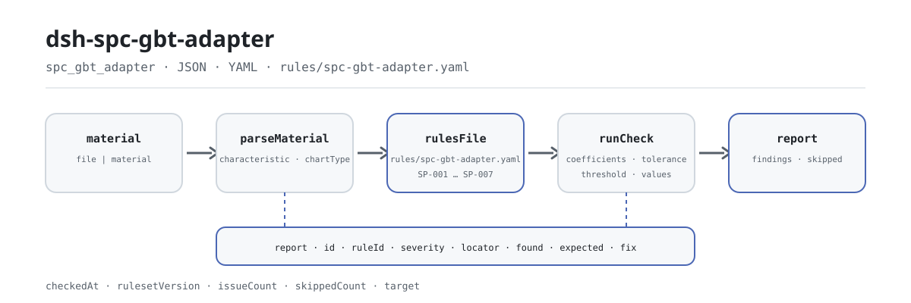

<div align="center">

<picture>
  <source media="(prefers-color-scheme: dark)" srcset="docs/assets/dsh-spc-gbt-adapter-flow-dark.svg">
  
</picture>

# dsh-spc-gbt-adapter

**नियंत्रण चार्ट रजिस्टर समीक्षा तक पहुँचने से पहले जाँचें — कौन-सी पंक्ति, कौन-सा कॉलम, क्या अंतर है, एक-एक करके।**

DeepSeek Harness के लिए पारंपरिक नियंत्रण चार्ट रजिस्टर जाँचकर्ता: एक नियंत्रण चार्ट रजिस्टर पढ़ता है, उसकी सीमाओं, केंद्र रेखा और Cp/Cpk की अंकगणितीय तथा स्थिरांक-सारणी संगति पर 7 नियम लागू करता है, और केवल अंतर सूचीबद्ध करता है; यह कभी तय नहीं करता कि कोई प्रक्रिया नियंत्रण में है या नहीं।

[इंस्टॉल](#तीन-चरणों-में-शुरुआत) · [कॉन्फ़िगरेशन](#कॉन्फ़िगरेशन) · [FAQ](#faq) · [简体中文](README.md) · [English](README.en.md) · [Español](README.es.md) · [Português](README.pt.md) · [हिन्दी](README.hi.md)

[](LICENSE)
[](#संगतता)
[](https://www.npmjs.com/package/dsh-spc-gbt-adapter)
[](https://github.com/PerryLink/dsh-spc-gbt-adapter/actions/workflows/ci.yml)
[](#संगतता)

[](https://github.com/PerryLink/dsh-spc-gbt-adapter/stargazers)
[](https://www.npmjs.com/package/dsh-spc-gbt-adapter)
[](https://dshfind.com/plugins/PerryLink/dsh-spc-gbt-adapter?ref=badge)
[](https://securityscorecards.dev/viewer/?uri=github.com/PerryLink/dsh-spc-gbt-adapter)
[](https://dsh.market/)
[](https://gitee.com/perrylink/dsh-spc-gbt-adapter)

```sh
dsh plugin --profile <name> add dsh-spc-gbt-adapter
```

</div>

<sub>सामुदायिक प्लगइन, DeepSeek से असंबद्ध। कैनोनिकल रिपॉज़िटरी: <https://github.com/PerryLink/dsh-spc-gbt-adapter> (Gitee एक मिरर है)।</sub>

## यह क्या है

`dsh-spc-gbt-adapter` एक नियंत्रण चार्ट रजिस्टर पढ़ता है — पंक्तियाँ रजिस्टर के अपने कॉलम नामों से बनी, चीनी या अंग्रेज़ी — और उसी रजिस्टर की अंकगणितीय तथा स्थिरांक-सारणी संगति की जाँच करता है: क्या विशेषता और चार्ट प्रकार दर्ज हैं, क्या नियंत्रण सीमाएँ केंद्र रेखा, परिसर और पैक में स्थिर किए गए चार्ट स्थिरांकों से निकलती हैं, क्या केंद्र रेखा सीमाओं के बीच है, क्या दर्ज Cp और Cpk अपनी परिभाषाओं के अनुरूप हैं, क्या उपसमूह आकार स्थिरांक-सारणी में शामिल है, और क्या हेडर उत्पाद तथा प्रक्रिया बताता है।

सामग्री JSON या YAML है; उपकरण आपके द्वारा दिए गए `file` या `material` को पढ़ता है और मूल फ़ाइल कभी नहीं बदलता। Excel को पहले JSON/YAML में बदला जा सकता है, चैट में भी अगर प्लेटफ़ॉर्म साथ दे।

## तीन चरणों में शुरुआत

1. **इंस्टॉल करें** (कोई एक चैनल चुनें):

   ```sh
   # git चैनल (नवीनतम main)
   dsh plugin --profile <name> add github:PerryLink/dsh-spc-gbt-adapter
   # npm चैनल (प्रकाशित संस्करण)
   dsh plugin --profile <name> add dsh-spc-gbt-adapter
   # tarball चैनल: इस रेपो में pnpm pack के बाद
   dsh plugin --profile <name> add ./dsh-spc-gbt-adapter-<version>.tgz
   ```

   सोर्स चेकआउट से काम कर रहे हैं? पहले `pnpm install && pnpm run build` चलाएँ (`prepare` `tsdown` चलाकर `lib/` बनाता है)।

2. **न्यूनतम कॉन्फ़िगरेशन** (डिफ़ॉल्ट सीधे काम करते हैं; यह उदाहरण केवल तीन नियम चलाता है):

   ```yaml
   - insert:
       - id: dsh-spc-gbt-adapter
         name: dsh-spc-gbt-adapter
         config:
           onlyRules: [SP-001, SP-002, SP-004]
   ```

3. **जाँचें कि माउंट हुआ**:

   ```sh
   dsh --profile <name> --dump-config | grep 'dsh-spc-gbt-adapter'
   ```

   फिर मॉडल से एक बार `spc_gbt_adapter` उपकरण चलवाएँ, न्यूनतम इनपुट:

   ```json
   {"rows":[{"均值":"10.00","标准差":"0.215","上规格限":"10.60","下规格限":"9.40","Cp":"0.9302","Cpk":"1.50"}]}
   ```

   रिपोर्ट में `issueCount`, `summary` और `skippedCount` होंगे; निष्कर्ष `markdown` और `reportJson` में मिलेंगे। सोर्स चेकआउट से साथ दिया नमूना चलाया जा सकता है (पहले build): `node samples/quickstart/run.mjs --check`, इनपुट और अपेक्षित आउटपुट `samples/quickstart/` में; टर्मिनल स्क्रीनशॉट [`docs/assets/quickstart.png`](docs/assets/quickstart.png) में है।

**अनइंस्टॉल**: `dsh plugin --profile <name> remove dsh-spc-gbt-adapter`।

<details>
<summary>सामग्री प्रारूप (JSON / YAML)</summary>

```yaml
productNo: P-2026-001
processName: 精车外圆
rows:
  - { 控制图编号: Xbar-R-001, 特性名称: 外径, 控制图类型: Xbar-R, 子组大小: '5',
      均值: '10.00', 极差: '0.50', 标准差: '0.215', 中心线: '10.00',
      上控制限: '10.2885', 下控制限: '9.7115', 上规格限: '10.60', 下规格限: '9.40',
      Cp: '0.9302', Cpk: '0.9302' }
```

कॉलम नाम केस-असंवेदी हैं और रिक्त स्थान, अंडरस्कोर तथा हाइफ़न छोड़कर मिलाए जाते हैं, इसलिए `上控制限` और `ucl` एक ही फ़ील्ड बनते हैं; रजिस्टर के अपने कॉलम नाम सुरक्षित रहते हैं, इसलिए हर निष्कर्ष उसी कॉलम का नाम लेता है जिसे पढ़ा गया। संख्यात्मक सेल में इकाई हो सकती है। हेडर और पंक्तियाँ दोनों चीनी तथा अंग्रेज़ी उपनाम स्वीकार करते हैं।

</details>

## मुख्य क्षमताएँ

`dsh-spc-gbt-adapter` एक नियंत्रण चार्ट रजिस्टर को एक-एक करके जाँचने योग्य अंतर-सूची में बदल देता है:

- **रजिस्टर-स्तरीय जाँच** — केवल आपका दिया रजिस्टर पढ़ता है; हर निष्कर्ष में `locator` (पंक्ति/कॉलम), `found`, `expected` और `fix` होते हैं और वह किसी एक पंक्ति व कॉलम पर इंगित करता है।
- **सात नियम, नियम-पैक ही डेटा** — सभी जाँचें `rules/spc-gbt-adapter.yaml` में घोषित हैं; YAML बदलने से नियम-समुच्चय का संस्करण बदल जाता है, TypeScript छूने की ज़रूरत नहीं।
- **चुपचाप पास नहीं** — अनकॉन्फ़िगर, बंद या चल न पाने वाली जाँचें कारण सहित `skipped` में जाती हैं; खाली समस्या-सूची को «कुछ गड़बड़ नहीं» नहीं पढ़ा जा सकता।
- **केवल अंतर** — अनुपालन का निर्णय नहीं, दायित्व का निर्धारण नहीं, समीक्षक का विकल्प नहीं; निष्कर्ष उसी के पास रहता है जिसे निर्णय लेने का अधिकार है।
- **स्थानीय, बिना दुष्प्रभाव** — नेटवर्क नहीं, मॉडल कॉल नहीं, सामग्री में लेखन नहीं; पठन और जाँच स्थानीय शुद्ध फ़ंक्शन हैं।

| नियम | क्या जाँचता है | स्तर | आधार |
|---|---|---|---|
| `SP-001` | विशेषता और चार्ट प्रकार दर्ज हैं | warn | सिद्धांत |
| `SP-002` | सीमाएँ केंद्र, परिसर और स्थिरांकों से निकलती हैं | warn | सिद्धांत |
| `SP-003` | केंद्र रेखा सीमाओं के बीच है | warn | सिद्धांत |
| `SP-004` | Cp और Cpk अपनी परिभाषाओं के अनुरूप हैं | warn | सिद्धांत |
| `SP-005` | क्षमता आपके स्वीकृति मानदंड को पूरा करती है (डिफ़ॉल्ट रूप से बंद) | info | स्थानीय |
| `SP-006` | चार्ट अपना उत्पाद और प्रक्रिया बताता है | warn | सिद्धांत |
| `SP-007` | उपसमूह आकार स्थिरांक-सारणी में शामिल है | warn | सिद्धांत |

### एक वास्तविक रन

**उपकरण** `spc_gbt_adapter`

**इनपुट**

~~~json
{"rows":[{"均值":"10.00","标准差":"0.215","上规格限":"10.60","下规格限":"9.40","Cp":"0.9302","Cpk":"1.50"}]}
~~~

**आउटपुट**

~~~json
{
  "id": "dsh-spc-gbt-adapter.SP-004.de09b5a6",
  "ruleId": "SP-004",
  "severity": "warn",
  "locator": {
    "row": 1,
    "field": "cpk"
  },
  "found": "第 1 行 Cpk 填报 1.5，按 min(USL − X̄, X̄ − LSL) / 3σ 应为 0.9302",
  "expected": "Cpk = min(USL − X̄, X̄ − LSL) / 3σ",
  "fix": "核对标准差口径与均值；本条只做算术核对，不判断能力是否足够"
}
~~~

*स्रोत `dsh-spc-gbt-adapter/tests/fixtures/SP-004/SP-004-unsafe.json`*

### छह सवाल और जवाब

| आपका सवाल | इसका जवाब |
|---|---|
| किसी पंक्ति में विशेषता और चार्ट प्रकार दोनों खाली हैं। क्या यह दर्ज होता है? | हाँ। `SP-001` कहता है कि जिस पंक्ति में इन दोनों में से कोई कॉलम मौजूद है, उसमें `characteristic` और `chartType` में से कम से कम एक भरा हो, और दोनों खाली होने पर वह पंक्ति दर्ज करता है। यह देखता है कि एक दर्ज है, यह नहीं कि उस विशेषता पर चार्ट बनना चाहिए या चार्ट प्रकार सही चुना गया। |
| रजिस्टर में दर्ज नियंत्रण सीमाएँ केंद्र रेखा, परिसर और स्थिरांकों से निकलने वाली सीमाओं से मेल नहीं खातीं। | `SP-002` उस `sampleSize` के गुणांक तथा `centerLine` और `range` से `ucl` और `lcl` दोबारा निकालता है (सहनशीलता 0.005) और दर्ज तथा अपेक्षित दोनों मानों के साथ पंक्ति दर्ज करता है। यह केवल यह देखता है कि ये संख्याएँ आपस में संगत हैं — यह नहीं कि सीमाएँ या परिसर सही हैं, और कभी यह नहीं कि प्रक्रिया नियंत्रण में है। स्थिर की गई सारणी X̄-R चार्ट की है: X̄-s, I-MR, p या c चार्ट के गुणांक भिन्न होते हैं, इसलिए नियम बंद करें या `coefficients` बदलें। |
| केंद्र रेखा ऊपरी नियंत्रण सीमा से ऊपर दर्ज है। | `SP-003` कहता है कि जिस पंक्ति में तीनों मान भरे हैं वहाँ `lcl` ≤ `centerLine` ≤ `ucl` हो, और जहाँ यह क्रम टूटता है वह पंक्ति दर्ज करता है। यह केवल तीनों संख्याओं का क्रम देखता है, यह नहीं कि वे सही गणना की गईं। परिसर चार्ट में निचली सीमा 0 होना सामान्य है और इस कारण कोई प्रविष्टि नहीं होती। |
| रजिस्टर में Cp और Cpk दर्ज हैं, पर रिपोर्ट उनके बारे में कुछ नहीं कहती। क्यों? | `SP-004` केवल उन्हीं पंक्तियों पर चलता है जिनमें `cp` या `cpk` के साथ `usl`, `lsl`, `stdDev` और `mean` भी भरे हों; जब कोई पंक्ति ये सब नहीं रखती, तो नियम चुपचाप पास होने के बजाय `skipped` दर्ज करता है। जहाँ चलता है वहाँ दोनों परिभाषाएँ जाँचता है: Cp = (USL − LSL) / 6σ तथा Cpk = min(USL − X̄, X̄ − LSL) / 3σ, सहनशीलता 0.02। अंतर प्रायः σ के मापदंड मिले होने का संकेत है: Cp/Cpk उपसमूह के भीतर का मानक विचलन लेते हैं, Pp/Ppk समग्र। यह तय नहीं करता कि क्षमता पर्याप्त है। |
| इस प्रक्रिया की क्षमता पर्याप्त है या नहीं? | इसका उत्तर यह जाँच नहीं देती। `SP-005` केवल उस `cpk` को दर्ज करता है जो आपके तय मानदंड से नीचे है, और वह `threshold: 0` के साथ आता है, यानी अनकॉन्फ़िगर, इसलिए वह मानदंड गढ़ने के बजाय `skipped` में चला जाता है; सामान्य 1.33 और 1.67 उद्योग, ग्राहक और विशेषता की महत्ता पर निर्भर हैं। इस नियम की प्रविष्टि का अर्थ केवल यह है कि मान आपके अपने मानदंड से नीचे है, यह नहीं कि प्रक्रिया अयोग्य है, और यह `info` गंभीरता के साथ दर्ज होती है। |
| हमारे प्रत्येक उपसमूह में 15 माप हैं। तब क्या होता है? | `SP-007` वह पंक्ति दर्ज करता है: पैक में स्थिर की गई स्थिरांक-सारणी केवल 2 से 10 तक के उपसमूह आकारों को कवर करती है। उस आकार के लिए प्रविष्टि न होने पर `SP-002` भी गुणांक नहीं देख पाता, इसलिए वह भी इसे दर्ज करता है, चुप नहीं रहता। यह नियम देखता है कि आकार सूचीबद्ध श्रेणी है या नहीं, यह नहीं कि वह उपसमूह आकार प्रक्रिया के लिए उपयुक्त है। बड़े उपसमूहों के लिए उस श्रेणी को `SP-002` के `coefficients` में जोड़ें और इस नियम के `values` बढ़ाएँ — यह नियम-पैक का संपादन है, कोड का नहीं। |

## कॉन्फ़िगरेशन

सभी समायोज्य पैरामीटर `src/config.ts` की Schemastery स्कीमा में `Config` फ़ील्ड हैं, जिन्हें कोड बदले बिना `cordis.yml` से बदला जा सकता है; प्रति-नियम सीमाएँ `rules/` के नियम-पैक में हैं।

| कुंजी | प्रकार | डिफ़ॉल्ट | विवरण |
|---|---|---|---|
| `rulesFile` | string | `rules/spc-gbt-adapter.yaml` | नियम-पैक का पथ, पैकेज रूट के सापेक्ष |
| `disabledRules` | string[] | `[]` | बंद करने वाले नियम id; प्रत्येक `skipped` में दिखता है |
| `onlyRules` | string[] | `[]` | केवल ये नियम चलाएँ; खाली होने पर सभी नियम चलते हैं |
| `skipNotes` | string | `""` | हर `skipped` कारण के आगे जोड़ी जाने वाली टिप्पणी |
| `timeoutMs` | number | `120000` | उपकरण का सहकारी समय-सीमा बजट |

नियम-स्तरीय पैरामीटर:

- `SP-002` `coefficients` — स्थिरांक-सारणी, उपसमूह आकार से अनुक्रमित: माध्य चार्ट के लिए `a2`, परिक्षेपण चार्ट के लिए `d3` / `d4`। डिफ़ॉल्ट X̄-R के लिए n = 2…10 कवर करता है; इसे बढ़ाया जा सकता है या किसी अन्य चार्ट प्रकार की सारणी से बदला जा सकता है। `tolerance` डिफ़ॉल्ट 0.005 है।
- `SP-004` `tolerance` — डिफ़ॉल्ट 0.02, किसी रजिस्टर के राउंडिंग के लिए पर्याप्त।
- `SP-005` `threshold` — आपका Cpk स्वीकृति मानदंड। `0` का अर्थ है नियम नहीं चलता।
- `SP-007` `values` — वे उपसमूह आकार जो आपका रजिस्टर उपयोग कर सकता है।

प्रोफ़ाइल पैच में ओवरराइड का उदाहरण:

```yaml
- insert:
    - id: dsh-spc-gbt-adapter
      name: dsh-spc-gbt-adapter
      config:
        rulesFile: rules/spc-gbt-adapter.yaml
        onlyRules: [SP-002, SP-004, SP-006]
        skipNotes: संस्था के SPC नियम, 2026 संस्करण
        timeoutMs: 60000
```

## FAQ

<details>
<summary>क्या सामग्री अपलोड होती है या नेटवर्क पर जाती है?</summary>

नहीं। `dsh-spc-gbt-adapter` एक स्थानीय जाँचकर्ता है: केवल उपकरण को दी गई सामग्री (`file` या `material`) पढ़ता है और कुछ अपलोड नहीं करता; कोई नेटवर्क अनुरोध नहीं करता, उसके साथ टेलीमेट्री, एनालिटिक्स या पृष्ठभूमि रिपोर्टिंग नहीं है; उपकरण परिणाम और DSH होस्ट के अपने सत्र/लॉग भंडार के अलावा कोई डेटा नहीं लिखता। वह भंडार और उसकी प्रतिधारण नीति होस्ट के नियंत्रण में है; यह पैकेज दूसरी प्रति नहीं रखता।

</details>

<details>
<summary>समस्या-सूची खाली है — क्या इसका मतलब कुछ गड़बड़ नहीं?</summary>

ज़रूरी नहीं। जो जाँचें नहीं चल सकीं वे कारण सहित एक-एक करके `skipped` में जाती हैं — उदाहरण के लिए `SP-005` `threshold: 0` के साथ आता है और चुपचाप पास होने के बजाय स्वयं को `skipped` में दर्ज करता है, और `SP-004` भी अपने छह में से कोई फ़ील्ड छूटने पर वैसा ही करता है। खाली सूची केवल यह बताती है कि जो नियम चले उन्हें कोई अंतर नहीं मिला; `issueCount` से पहले `skippedCount` और `skipped` पढ़ें।

</details>

<details>
<summary>क्या यह अन्य प्लगइनों से उपकरण नाम, सेवा या स्लॉट के लिए टकराता है?</summary>

नहीं। यह केवल एक `spc_gbt_adapter` उपकरण पंजीकृत करता है, कोई सेवा कुंजी नहीं देता, कोई क्लाइंट स्लॉट और कोई `webServer` उपसर्ग पंजीकृत नहीं करता, कोई साझा इवेंट नहीं सुनता और कोई ग्लोबल ऑब्जेक्ट नहीं बदलता। उपकरण पंजीकरण एक Cordis effect है, जो रोकने या हॉट-रीलोड पर हट जाता है।

</details>

<details>
<summary>प्रदर्शन लागत कितनी है? क्या समय-सीमा टूटेगी?</summary>

पठन और जाँच स्थानीय हैं: कोई नेटवर्क अनुरोध नहीं, कोई मॉडल कॉल नहीं। उपकरण के साथ सहकारी `timeoutMs` बजट (डिफ़ॉल्ट 120000 ms) है और जाँच एक रैखिक स्कैन है। लागत रजिस्टर की पंक्तियों के साथ बढ़ती है, मॉडल के साथ नहीं।

</details>

<details>
<summary>क्या यह समीक्षक का विकल्प बन सकता है?</summary>

नहीं। यह केवल उन अंतरों को सूचीबद्ध करता है जिन्हें रजिस्टर के भीतर ही इंगित किया जा सकता है; यह अनुपालन का निर्णय नहीं करता, दायित्व नहीं ठहराता और यह नहीं तय करता कि प्रक्रिया नियंत्रण में है या क्षमता पर्याप्त है। यह ग्राहक के स्वीकृति मानदंड, आपकी संस्था के SPC नियमों और समीक्षक के निर्णय पर निर्भर है।

</details>

## यह किन मानकों पर आधारित है

| दस्तावेज़ | संख्यांक | इन्हें उद्धृत करने वाले नियम |
|---|---|---|
| पारंपरिक नियंत्रण चार्ट | GB/T 17989.2—2020 (Control charts — Part 2: Shewhart control charts; ISO अपनाता है; रद्द हो चुके GB/T 4091—2001 का स्थान लेता है; इस दौर में धारा संख्याएँ प्राप्त नहीं हुईं) | SP-001, SP-002, SP-003, SP-004, SP-005, SP-006, SP-007 |

**सीमा:** यह प्लगइन एक **नियंत्रण चार्ट रजिस्टर** की अंकगणितीय और स्थिरांक-सारणी संगति जाँचता है — क्या विशेषता और चार्ट प्रकार दर्ज हैं, सीमाएँ केंद्र रेखा, परिक्षेपण और स्थिरांकों से निकलती हैं या नहीं, केंद्र रेखा सीमाओं के बीच है या नहीं, Cp और Cpk अपनी परिभाषाओं के अनुरूप हैं या नहीं, उपसमूह आकार सारणी में शामिल है या नहीं, और चार्ट अपना उत्पाद व प्रक्रिया बताता है या नहीं। यह **नहीं** तय करता कि प्रक्रिया नियंत्रण में है, कोई प्रवृत्ति है, या क्षमता पर्याप्त है। **चार्ट पढ़ने के लिए पैटर्न नियम चाहिए; पर्याप्तता ग्राहक के स्वीकृति मानदंड पर निर्भर है।**

> ### ⚠️ यह पैक क्या उद्धृत कर सकता है और क्या नहीं
>
> नियंत्रण-सीमा गुणांक (A₂, D₃, D₄) और क्षमता-सूचकांकों की परिभाषाओं का मूल है: **GB/T 17989.2—2020, *Control charts — Part 2: Shewhart control charts*** (ISO अपनाता है; ISO 7870 शृंखला के समान विषय; रद्द हो चुके GB/T 4091—2001 का स्थान लेता है)। ये गुणांक *गणितीय स्थिरांक* हैं जो केवल उपसमूह आकार के साथ बदलते हैं, इसलिए इन्हें नियम-पैक में स्थिर किया जा सकता है। **पर सत्यापन को उस मानक का शब्दशः पाठ नहीं मिला** (वह ISO/IEC अपनाता है और सार्वजनिक प्लेटफ़ॉर्म कॉपीराइट के कारण ऑनलाइन पठन नहीं देता), इसलिए हर नियम का `excerpt` यह स्पष्ट कहता है और हर नियम `warn` या `info` पर रहता है, उद्धरण का दावा नहीं करता।
>
> किसी निष्कर्ष पर भरोसा करने से पहले तीन सीमाएँ जानना ज़रूरी है:
>
> - **`SP-002` X̄-R चार्ट मान लेता है।** X̄-s, I-MR, p या c चार्ट पूरी तरह भिन्न गुणांक रखते हैं, इसलिए नियम अंतर दर्ज करेगा। उसे बंद करें, या `coefficients` को सही सारणी से बदलें — यह नियम-पैक का संपादन है, कोड का नहीं।
> - **गुणांक-सारणी n = 2…10 कवर करती है।** `SP-007` इस दायरे से बाहर का कोई भी उपसमूह आकार दर्ज करता है, इसलिए «नहीं देखा जा सकता» कभी चुपचाप «कोई समस्या नहीं» के रूप में नहीं पढ़ा जाता।
> - **`SP-005` का मानदंड `0` के रूप में आता है, यानी «अनकॉन्फ़िगर»।** सामान्य मान 1.33 और 1.67 हैं, पर कौन सही है यह उद्योग, ग्राहक और विशेषता की महत्ता पर निर्भर है, इसलिए नियम मानदंड गढ़ने के बजाय बताता है कि वह नहीं चल सका।
>
> σ का मापदंड भी महत्वपूर्ण है: Cp/Cpk **उपसमूह के भीतर** का मानक विचलन लेते हैं और Pp/Ppk **समग्र**। किसी रजिस्टर का σ और उसका सूचकांक मेल न खाना `SP-004` निष्कर्ष का सबसे आम कारण है, इसलिए निष्कर्ष यह बताता है।

**नियम-डेटा कोड से अलग है।** वह `rules/spc-gbt-adapter.yaml` में रहता है। उसका हेडर 2026-10-07 का सुधार दर्ज करता है: मानक संख्या रद्द हो चुके GB/T 4091—2001 से बदलकर वर्तमान GB/T 17989.2—2020 की गई, `kind` और `severity` में कोई परिवर्तन नहीं हुआ क्योंकि गुणांक गणितीय स्थिरांक हैं। लोडर अब भी हर नियम के लिए document, number, clause, excerpt और source अनिवार्य करता है (आठ अक्षर से छोटा excerpt लोड पर विफल होता है) और किसी `derived-from-principle` या स्थानीय कॉन्फ़िगरेशन जाँच को `error` बनाने से रोकता है। प्रति-धारा सत्यापन रिकॉर्ड `rules/evidence/` में है।

## सुरक्षा सीमाएँ

- **सामग्री पढ़ें, मूल कभी न लिखें।** उपकरण आपके दिए `file` या `material` को पढ़ता है; डिस्क पर रजिस्टर कभी वापस नहीं लिखा, न हटाया न मिटाया जाता।
- **नेटवर्क नहीं, मॉडल कॉल नहीं, टेलीमेट्री नहीं।** कोई नेटवर्क अनुरोध नहीं, कोई एनालिटिक्स या पृष्ठभूमि रिपोर्टिंग नहीं; उपकरण परिणाम और होस्ट के अपने सत्र/लॉग भंडार के अलावा कोई डेटा नहीं लिखा जाता।
- **कोई निर्णायक निष्कर्ष नहीं।** रिपोर्ट केवल अंतर सूचीबद्ध करती है; यह नहीं तय करती कि प्रक्रिया नियंत्रण में है, क्षमता पर्याप्त है या दायित्व किसका है। प्रस्तुत रिपोर्ट पर शब्द-रक्षक चलता है और रिपोर्ट हमेशा अस्वीकरण लेकर आती है।
- **कोई गढ़ा उद्धरण नहीं।** नियम-पैक लोड पर सत्यापित होता है: हर नियम में document, number, clause, excerpt और source होना चाहिए और excerpt शब्दशः उद्धरण होना चाहिए। जब शब्दशः धारा नहीं मिली, पैक यह कहता है, उसे घुमाकर उद्धरण नहीं बनाता; `derived-from-principle` अधिकतम `warn` और `institutional-configuration` अधिकतम `info` तक सीमित है।
- **चुपचाप पास नहीं।** अनकॉन्फ़िगर, बंद या चल न पाने वाली जाँचें कारण सहित `skipped` में जाती हैं; खाली समस्या-सूची को «कुछ गड़बड़ नहीं» नहीं पढ़ा जा सकता।
- **नियम-पैक डेटा है।** `rules/*.yaml` बदलने से नियम-समुच्चय का संस्करण बदल जाता है, कोड बदलने की ज़रूरत नहीं; पैक लोड पर सत्यापित होता है, उस पर भरोसा नहीं किया जाता।

## ज्ञात सीमाएँ

- **रजिस्टर की संगति ≠ नियंत्रित प्रक्रिया।** प्लगइन केवल रजिस्टर की अंकगणितीय और स्थिरांक-सारणी संगति जाँचता है; वह चार्ट को पैटर्न नियमों (लगातार बिंदु, प्रवृत्ति, शृंखला, सीमाओं के निकट बिंदु) पर नहीं पढ़ता और कभी नहीं तय करता कि प्रक्रिया सांख्यिकीय नियंत्रण में है। उसके लिए चार्ट पर पैटर्न नियम लागू करने पड़ते हैं।
- **क्षमता की पर्याप्तता आप तय करते हैं।** `SP-004` केवल Cp/Cpk की परिभाषाएँ जाँचता है और `SP-005` केवल आपके `threshold` से तुलना करता है; सामान्य 1.33 और 1.67 उद्योग, ग्राहक और विशेषता के अनुसार बदलते हैं, इसलिए कोई स्वीकृति मानदंड हार्ड-कोड नहीं किया गया।
- **`SP-002` X̄-R चार्ट मान लेता है।** X̄-s, I-MR, p या c चार्ट भिन्न गुणांक और एल्गोरिद्म रखते हैं; चार्ट प्रकार भिन्न होने पर यह ईमानदारी से अंतर दर्ज करता है, और हल है नियम बंद करना या `coefficients` बदलना।
- **गुणांक-सारणी n = 2…10 कवर करती है।** `SP-007` इस दायरे से बाहर का कोई भी उपसमूह आकार दर्ज करता है; `SP-002` गुणांक नहीं देख पाता और चुप रहने के बजाय वह भी दर्ज करता है।
- **`SP-005` बिना मानदंड के आता है।** `threshold: 0` का अर्थ अनकॉन्फ़िगर है, इसलिए नियम `skipped` में जाता है; आपके संस्थागत मानदंड के बाद ही तुलना शुरू होती है।
- **σ का मापदंड झूठे धनात्मक का सामान्य स्रोत है।** Cp/Cpk उपसमूह के भीतर का विचलन लेते हैं और Pp/Ppk समग्र; जब रजिस्टर दोनों मिलाता है, `SP-004` अंतर दर्ज करता है — सहनशीलता बदलने से पहले स्रोत एक करें।
- **केवल रजिस्टर के भीतर की अंकगणित।** यह रजिस्टर के पीछे के मापन रिकॉर्ड नहीं खोलता, कच्चा डेटा वास्तविक है या नमूना यादृच्छिक था यह नहीं जाँचता, और चार्ट प्रकार सही चुना गया या नहीं यह नहीं आँकता।
- **सामग्री प्रारूप सीमित।** केवल JSON या YAML; Excel पहले बदलना होगा। पठन-परत के फ़ील्ड वैकल्पिक हैं, इसलिए आंशिक निर्यात क्रैश के बजाय «फ़ील्ड अनुपस्थित» श्रेणी के निष्कर्ष देता है।
- **केवल सात नियम।** समुच्चय बदला जा सकता है, पर डिफ़ॉल्ट रजिस्टर-स्तर पर विशेषता/चार्ट प्रकार, नियंत्रण सीमाएँ, केंद्र रेखा, क्षमता सूचकांक, हेडर पहचान और उपसमूह श्रेणियाँ ही कवर करता है।

### सामान्य जाँचें

- **प्लगइन इंस्टॉल हो गया पर टूल दिखता नहीं।** जाँचें कि `main` `lib/index.mjs` पर जाता है और `pnpm run build` ने उसे बनाया है; गलत `main` लोडर को प्रविष्टि चुपचाप छोड़ने देता है।
- **`dsh plugin add` असंगत बताकर मना करता है।** peer रेंज `0.1.x` और `0.2.x` दोनों को कवर करती है; बाहर होने पर स्पष्ट छूट दें: `dsh plugin --profile <name> allow-version dsh-spc-gbt-adapter@0.1.0 --dsh-version <runtime> --accept-risk`.
- **`check` में `manifest-peers` विफल दिखता है।** स्थिर जाँचकर्ता 0.2 पंक्ति से पहले की हार्ड-कोडेड peer रेंज से तुलना करता है; रनटाइम इंस्टॉल के समय अनुकूलता लागू करता है। यह `dsh-plugin-dev` की ज्ञात अपस्ट्रीम समस्या है।
- **`SP-002` X̄-s या I-MR चार्ट की हर पंक्ति पर सक्रिय होता है।** उन चार्टों के गुणांक भिन्न हैं; नियम बंद करें या `coefficients` को सही सारणी से बदलें।
- **`SP-007` n = 15 पर सक्रिय होता है।** सारणी n = 2…10 कवर करती है; आपके उपयोग के आकारों के गुणांक जोड़ें और `values` बढ़ाएँ।
- **`SP-004` ऐसे चार्ट पर सक्रिय होता है जिसकी क्षमता ठीक दिखती है।** पहले σ का मापदंड देखें (उपसमूह के भीतर बनाम समग्र); सहनशीलता बदलने से पहले स्रोत एक करें।
- **`SP-005` कभी नहीं चलता।** उसका मानदंड `0` है, यानी अनकॉन्फ़िगर; सक्रिय करने के लिए अपना Cpk लक्ष्य तय करें।
- **कोई नियम नहीं चला।** `skipped` सरणी देखें: वह नियम id और कारण बताती है।
- **समय खिसका हुआ लगता है।** सारी गणना दिए गए स्ट्रिंग पर वॉल-क्लॉक है; कोई समय-क्षेत्र रूपांतरण नहीं होता।

## संगतता

| सतह | स्थिति |
|---|---|
| Harness | peer रेंज `>=0.1.2-rc.1 <0.2.0 \|\| >=0.2.0-0 <0.3.0` — `0.2.0-rc.2` और `0.2.1-rc.2` दोनों को स्वीकार करने के लिए सत्यापित। `engines.dsh` `>=0.2.1-0 <0.3.0` के रूप में घोषित है और 0.2.1 से होस्ट इसे लागू करता है |
| Node | `^22.19.0 \|\| >=24.0.0` |
| प्लेटफ़ॉर्म | सभी (शुद्ध ESM; कोई नेटिव कोड नहीं, कोई नेटवर्क नहीं, कोई मॉडल कॉल नहीं) |
| टूल मोड | `native` और `ptc` में काम करता है; अधिक विशेषताओं के लिए `ptc` चुनें |

## इकोसिस्टम और गुणवत्ता

- [Gitee मिरर](https://gitee.com/perrylink/dsh-spc-gbt-adapter) (सिंक मिरर; GitHub कैनोनिकल है)
- [dshfind प्लगइन पेज](https://dshfind.com/plugins/PerryLink/dsh-spc-gbt-adapter) (इंस्टॉल और रैंकिंग)
- [OpenSSF Scorecard रिपोर्ट](https://securityscorecards.dev/viewer/?uri=github.com/PerryLink/dsh-spc-gbt-adapter) ([.github/workflows/scorecard.yml](.github/workflows/scorecard.yml) द्वारा संचालित)
- [DSH Market](https://dsh.market/) (सूचीबद्ध)
- [इकोसिस्टम ज्ञानकोश](https://perrylink.github.io/dsh-plugin-guide/): मापा गया डेटा, मार्केटिंग नहीं · प्लगइन विकास गाइड · चयन डेटा · रखरखाव मानदंड

## डेवलपमेंट

```sh
pnpm install                                   # node ^22.19 || >=24
pnpm run typecheck                             # tsc --noEmit
pnpm test                                      # vitest: साझा टेबल-प्लगइन सूट + युग्मित फ़िक्स्चर
pnpm run build                                 # tsdown -> lib/index.mjs + lib/index.d.mts
pnpm run verify:self-contained                 # निर्भरताएँ registry से हल होती हैं
pnpm run check:lockfile                        # lockfile ड्रिफ्ट जाँच
pnpm run check:readmes                         # README संगति गेट
pnpm run check:citations                       # उद्धरण बनाम सत्यापन रिकॉर्ड
node ../scripts/sync-shared.mjs dsh-spc-gbt-adapter   # ../_shared से src/shared ताज़ा करें
node samples/quickstart/run.mjs --check        # साथ दिया नमूना (पहले build)
```

`sync-shared` `../_shared` का साझा किट `src/shared/` में कॉपी करता है; हर साझा बदलाव के बाद इसे दोबारा चलाएँ।

निर्देशिका संरचना:

| पथ | भूमिका |
|---|---|
| `src/index.ts` | फ़ंक्शन-प्लगइन अनुबंध: `spc_gbt_adapter` उपकरण पंजीकृत करता है और नियम-पैक पथ हल करता है |
| `src/config.ts` | Schemastery स्कीमा; सभी समायोज्य पैरामीटर यहीं |
| `src/model.ts` | तालिका आकार और सामग्री अनुबंध; कॉलम उपनाम और पठन प्रवेश |
| `src/view.ts` | मॉडल के लिए रिपोर्ट का प्रक्षेपण; `output.schema` इससे मेल खाता है |
| `src/shared/` | साझा किट (नियम लोडर, रिपोर्ट आकार, YAML उपसमुच्चय, कैलेंडर अंकगणित, शब्द-रक्षक, तालिका सहायक), पैकेज को आत्मनिर्भर रखने के लिए कॉपी किया गया |
| `rules/spc-gbt-adapter.yaml` | नियम-पैक, 7 नियम |
| `rules/evidence/` | पैक के हर उद्धरण का सत्यापन रिकॉर्ड |
| `tests/` | vitest; हर नियम के लिए अनुरूप/उल्लंघन फ़िक्स्चर की जोड़ी |

साथ दिए नमूने का परिणाम `samples/quickstart/expected/result.json` से मिलाया जा सकता है; स्क्रीनशॉट [`docs/assets/quickstart.png`](docs/assets/quickstart.png) में है। README की छवियाँ [`scripts/gen-readme-assets.py`](scripts/gen-readme-assets.py) (Python + Pillow) से क्रमादेशित रूप से बनती हैं और दोबारा चलाई जा सकती हैं; बिना UI वाले प्लगइन के लिए स्क्रिप्ट केवल हल्के/गहरे प्रवाह SVG बनाती है, जो पाँचों भाषाएँ साझा करती हैं।

## परिवार और आभार

यह परियोजना [PerryLink](https://github.com/PerryLink) के DeepSeek Harness प्लगइन परिवार का हिस्सा है (सभी Apache-2.0)। अगर यह उपयोगी हो, **एक स्टार अगले व्यक्ति को इसे खोजने में मदद करता है** — इससे कोई सुविधा खुलती या बंद होती नहीं।

- [@PerryLink](https://github.com/PerryLink) — निर्माता और अनुरक्षक: 7 `SP-*` नियम और नियम-पैक, `spc_gbt_adapter` उपकरण, और पाँच-भाषी दस्तावेज़ तथा चित्र पाइपलाइन।

<details>
<summary>सभी प्लगइन विस्तारित करें</summary>

| प्लगइन | स्थिति |
|---|---|
| **[dsh-aqua-input-check](https://github.com/PerryLink/dsh-aqua-input-check)** |  |
| **[dsh-archive-check](https://github.com/PerryLink/dsh-archive-check)** |  |
| **[dsh-auto-review](https://github.com/PerryLink/dsh-auto-review)** |  |
| **[dsh-autotier](https://github.com/PerryLink/dsh-autotier)** | 🧊 फ़्रोज़न — रेपो README देखें |
| **[dsh-bid-ca-precheck](https://github.com/PerryLink/dsh-bid-ca-precheck)** |  |
| **[dsh-bid-qual-check](https://github.com/PerryLink/dsh-bid-qual-check)** |  |
| **[dsh-cert-mcp](https://github.com/PerryLink/dsh-cert-mcp)** | 🧊 फ़्रोज़न — रेपो README देखें |
| **[dsh-checkpoint-rewind](https://github.com/PerryLink/dsh-checkpoint-rewind)** |  |
| **[dsh-click](https://github.com/PerryLink/dsh-click)** |  |
| **[dsh-composer-history](https://github.com/PerryLink/dsh-composer-history)** |  |
| **[dsh-contract-stance](https://github.com/PerryLink/dsh-contract-stance)** |  |
| **[dsh-customs-doc-check](https://github.com/PerryLink/dsh-customs-doc-check)** |  |
| **[dsh-data-quality](https://github.com/PerryLink/dsh-data-quality)** | 🧊 फ़्रोज़न — रेपो README देखें |
| **[dsh-demurrage-ledger](https://github.com/PerryLink/dsh-demurrage-ledger)** |  |
| **[dsh-doublecheck](https://github.com/PerryLink/dsh-doublecheck)** |  |
| **[dsh-drill-script-check](https://github.com/PerryLink/dsh-drill-script-check)** |  |
| **[dsh-eia-guide-check](https://github.com/PerryLink/dsh-eia-guide-check)** |  |
| **[dsh-emergency-plan](https://github.com/PerryLink/dsh-emergency-plan)** |  |
| **[dsh-essay-rubric-check](https://github.com/PerryLink/dsh-essay-rubric-check)** |  |
| **[dsh-evidence-check](https://github.com/PerryLink/dsh-evidence-check)** |  |
| **[dsh-export-ctl-check](https://github.com/PerryLink/dsh-export-ctl-check)** |  |
| **[dsh-fast](https://github.com/PerryLink/dsh-fast)** |  |
| **[dsh-fmea-table-check](https://github.com/PerryLink/dsh-fmea-table-check)** |  |
| **[dsh-forecast-penalty](https://github.com/PerryLink/dsh-forecast-penalty)** |  |
| **[dsh-fund-research](https://github.com/PerryLink/dsh-fund-research)** |  |
| **[dsh-github](https://github.com/PerryLink/dsh-github)** |  |
| **[dsh-gongwen-flow-check](https://github.com/PerryLink/dsh-gongwen-flow-check)** |  |
| **[dsh-gongwen-word-check](https://github.com/PerryLink/dsh-gongwen-word-check)** |  |
| **[dsh-guard-plan-qc](https://github.com/PerryLink/dsh-guard-plan-qc)** |  |
| **[dsh-hazchem-check](https://github.com/PerryLink/dsh-hazchem-check)** |  |
| **[dsh-hazplan-check](https://github.com/PerryLink/dsh-hazplan-check)** |  |
| **[dsh-hidden-risk-map](https://github.com/PerryLink/dsh-hidden-risk-map)** |  |
| **[dsh-hs-classify](https://github.com/PerryLink/dsh-hs-classify)** |  |
| **[dsh-icd-rule-check](https://github.com/PerryLink/dsh-icd-rule-check)** |  |
| **[dsh-industry-research](https://github.com/PerryLink/dsh-industry-research)** |  |
| **[dsh-lawcite-adapter](https://github.com/PerryLink/dsh-lawcite-adapter)** |  |
| **[dsh-laya](https://github.com/PerryLink/dsh-laya)** |  |
| **[dsh-lc-doc-check](https://github.com/PerryLink/dsh-lc-doc-check)** |  |
| **[dsh-learning-gap-check](https://github.com/PerryLink/dsh-learning-gap-check)** |  |
| **[dsh-library](https://github.com/PerryLink/dsh-library)** |  |
| **[dsh-local-ai](https://github.com/PerryLink/dsh-local-ai)** |  |
| **[dsh-lsp-actions](https://github.com/PerryLink/dsh-lsp-actions)** |  |
| **[dsh-mask](https://github.com/PerryLink/dsh-mask)** |  |
| **[dsh-mcp-panel](https://github.com/PerryLink/dsh-mcp-panel)** |  |
| **[dsh-medrec-qc](https://github.com/PerryLink/dsh-medrec-qc)** |  |
| **[dsh-memento](https://github.com/PerryLink/dsh-memento)** | 🧊 फ़्रोज़न — रेपो README देखें |
| **[dsh-nsfc-form-check](https://github.com/PerryLink/dsh-nsfc-form-check)** |  |
| **[dsh-nurse-record-check](https://github.com/PerryLink/dsh-nurse-record-check)** |  |
| **[dsh-observe](https://github.com/PerryLink/dsh-observe)** |  |
| **[dsh-origin-rvc-check](https://github.com/PerryLink/dsh-origin-rvc-check)** |  |
| **[dsh-ota-review-check](https://github.com/PerryLink/dsh-ota-review-check)** |  |
| **[dsh-output-styles](https://github.com/PerryLink/dsh-output-styles)** |  |
| **[dsh-paper-doc-adapter](https://github.com/PerryLink/dsh-paper-doc-adapter)** |  |
| **[dsh-permission-rules](https://github.com/PerryLink/dsh-permission-rules)** |  |
| **[dsh-permit-report-check](https://github.com/PerryLink/dsh-permit-report-check)** |  |
| **[dsh-pipeline-check](https://github.com/PerryLink/dsh-pipeline-check)** |  |
| **[dsh-pleading-draft](https://github.com/PerryLink/dsh-pleading-draft)** |  |
| **[dsh-plugin-doctor](https://github.com/PerryLink/dsh-plugin-doctor)** | 🚫 रिटायर्ड (रेपो संग्रहीत) |
| **[dsh-plugin-guide](https://github.com/PerryLink/dsh-plugin-guide)** |  |
| **[dsh-plugin-kit](https://github.com/PerryLink/dsh-plugin-kit)** | 🚫 रिटायर्ड (रेपो संग्रहीत) |
| **[dsh-plugin-upgrade](https://github.com/PerryLink/dsh-plugin-upgrade)** | 🚫 रिटायर्ड (रेपो संग्रहीत) |
| **[dsh-policy-brief-draft](https://github.com/PerryLink/dsh-policy-brief-draft)** |  |
| **[dsh-power-loss-split](https://github.com/PerryLink/dsh-power-loss-split)** |  |
| **[dsh-power-ticket-check](https://github.com/PerryLink/dsh-power-ticket-check)** |  |
| **[dsh-ppap-check](https://github.com/PerryLink/dsh-ppap-check)** |  |
| **[dsh-protest-deadline](https://github.com/PerryLink/dsh-protest-deadline)** |  |
| **[dsh-railway-window](https://github.com/PerryLink/dsh-railway-window)** |  |
| **[dsh-repair-order-qc](https://github.com/PerryLink/dsh-repair-order-qc)** |  |
| **[dsh-research-report](https://github.com/PerryLink/dsh-research-report)** |  |
| **[dsh-review-reply-check](https://github.com/PerryLink/dsh-review-reply-check)** |  |
| **[dsh-rulefile-check](https://github.com/PerryLink/dsh-rulefile-check)** |  |
| **[dsh-safety-brief-check](https://github.com/PerryLink/dsh-safety-brief-check)** |  |
| **[dsh-score](https://github.com/PerryLink/dsh-score)** | 🧊 फ़्रोज़न — रेपो README देखें |
| **[dsh-session-sync](https://github.com/PerryLink/dsh-session-sync)** |  |
| **[dsh-site-log-check](https://github.com/PerryLink/dsh-site-log-check)** |  |
| **[dsh-skill-pack-security](https://github.com/PerryLink/dsh-skill-pack-security)** |  |
| **[dsh-soe-decision-check](https://github.com/PerryLink/dsh-soe-decision-check)** |  |
| **[dsh-soilwater-check](https://github.com/PerryLink/dsh-soilwater-check)** |  |
| **[dsh-sop-sync-check](https://github.com/PerryLink/dsh-sop-sync-check)** |  |
| **[dsh-spc-gbt-adapter](https://github.com/PerryLink/dsh-spc-gbt-adapter)** |  |
| **[dsh-talk](https://github.com/PerryLink/dsh-talk)** |  |
| **[dsh-tender-extract](https://github.com/PerryLink/dsh-tender-extract)** |  |
| **[dsh-tender-matrix](https://github.com/PerryLink/dsh-tender-matrix)** |  |
| **[dsh-test-drive](https://github.com/PerryLink/dsh-test-drive)** |  |
| **[dsh-ticktick](https://github.com/PerryLink/dsh-ticktick)** | 🚫 रिटायर्ड (रेपो संग्रहीत) |
| **[dsh-translate](https://github.com/PerryLink/dsh-translate)** |  |
| **[dsh-warranty-calc](https://github.com/PerryLink/dsh-warranty-calc)** |  |
| **[dsh-budget](https://github.com/PerryLink/dsh-budget)** | 🧊 फ़्रोज़न — रेपो README देखें |
| **[dsh-claude-move](https://github.com/PerryLink/dsh-claude-move)** | 🧊 फ़्रोज़न — रेपो README देखें |
| **[dsh-defend](https://github.com/PerryLink/dsh-defend)** | 🧊 फ़्रोज़न — रेपो README देखें |
| **[dsh-draw](https://github.com/PerryLink/dsh-draw)** | 🧊 फ़्रोज़न — रेपो README देखें |
| **[dsh-reach](https://github.com/PerryLink/dsh-reach)** | 🧊 फ़्रोज़न — रेपो README देखें |
| **[dsh-background-agents](https://github.com/PerryLink/dsh-background-agents)** | 🚫 रिटायर्ड (रेपो संग्रहीत) |
| **[dsh-session-pin](https://github.com/PerryLink/dsh-session-pin)** | 🚫 रिटायर्ड (रेपो संग्रहीत) |
| **[dsh-team-rooms](https://github.com/PerryLink/dsh-team-rooms)** | 🚫 रिटायर्ड (रेपो संग्रहीत) |

</details>

## लाइसेंस

[LICENSE](LICENSE) (Apache License 2.0) © 2026 dsh-spc-gbt-adapter contributors

<p align="center"><sub>Apache-2.0 · सामुदायिक प्लगइन, DeepSeek से असंबद्ध।</sub></p>
