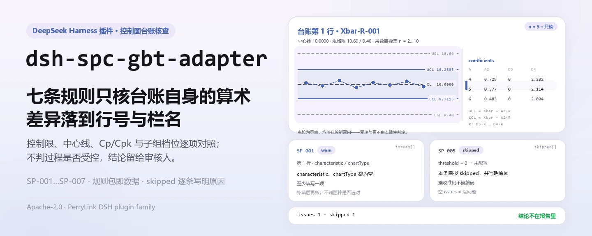
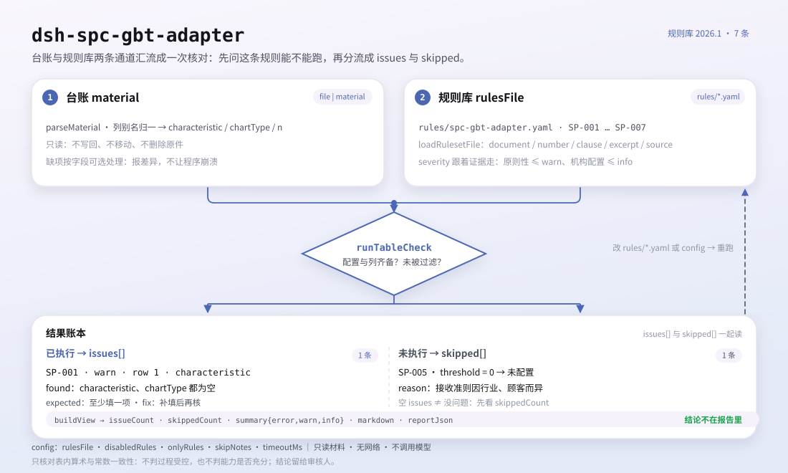

<div align="center">

<picture>
  <source media="(prefers-color-scheme: dark)" srcset="docs/assets/dsh-spc-gbt-adapter-hero-zh-dark.webp">
  
</picture>

# dsh-spc-gbt-adapter

**在控制图台账进入评审之前完成核对——哪一行、哪一栏、差什么，逐条指认。**

面向 DeepSeek Harness 的常规控制图台账检查器：读入一份控制图台账，按 7 条规则核对控制限、中心线与 Cp/Cpk 的算术与常数表自洽性，只列差异，不判过程是否受控。

[安装](#三步上手) · [配置](#配置) · [FAQ](#faq) · [简体中文](README.md) · [English](README.en.md) · [Español](README.es.md) · [Português](README.pt.md) · [हिन्दी](README.hi.md)

[](LICENSE)
[](#兼容性)
[](https://www.npmjs.com/package/dsh-spc-gbt-adapter)
[](https://github.com/PerryLink/dsh-spc-gbt-adapter/actions/workflows/ci.yml)
[](#兼容性)

[](https://github.com/PerryLink/dsh-spc-gbt-adapter/stargazers)
[](https://www.npmjs.com/package/dsh-spc-gbt-adapter)
[](https://dshfind.com/plugins/PerryLink/dsh-spc-gbt-adapter?ref=badge)
[](https://securityscorecards.dev/viewer/?uri=github.com/PerryLink/dsh-spc-gbt-adapter)
[](https://dsh.market/)
[](https://gitee.com/perrylink/dsh-spc-gbt-adapter)

```sh
dsh plugin --profile <name> add dsh-spc-gbt-adapter
```

</div>

<sub>社区插件，与 DeepSeek 官方无关。唯一仓库：<https://github.com/PerryLink/dsh-spc-gbt-adapter>（Gitee 为镜像）。</sub>

## 它是什么

`dsh-spc-gbt-adapter` 读取一份控制图台账——行按台账自身的列名组织，中英文列名均可——按版本化规则库核对这份台账自身的算术与常数表自洽性：特性名称与控制图类型是否填写、控制限是否由中心线、极差与规则库固化的控制图常数推出、中心线是否落在上下控制限之间、填报的 Cp 与 Cpk 是否符合定义式、子组大小是否落在常数表覆盖的档位内、表头是否写明产品与工序。

材料是 JSON 或 YAML；工具读取你传入的 `file` 或 `material`，原文件不会被修改。Excel 可先转成 JSON/YAML，对话里也能代转。

<picture>
  <source media="(prefers-color-scheme: dark)" srcset="docs/assets/dsh-spc-gbt-adapter-flow-v5-dark.svg">
  
</picture>

## 三步上手

1. **安装**（三选一）：

   ```sh
   # git 通道（最新 main）
   dsh plugin --profile <name> add github:PerryLink/dsh-spc-gbt-adapter
   # npm 通道（已发布版本）
   dsh plugin --profile <name> add dsh-spc-gbt-adapter
   # tarball 通道：本仓库 pnpm pack 后
   dsh plugin --profile <name> add ./dsh-spc-gbt-adapter-<version>.tgz
   ```

   从源码检出使用时先 `pnpm install && pnpm run build`（`prepare` 会执行 `tsdown` 构建出 `lib/`）。

2. **最小配置**（默认可直接用；下面只跑三条规则）：

   ```yaml
   - insert:
       - id: dsh-spc-gbt-adapter
         name: dsh-spc-gbt-adapter
         config:
           onlyRules: [SP-001, SP-002, SP-004]
   ```

3. **验证已生效**：

   ```sh
   dsh --profile <name> --dump-config | grep 'dsh-spc-gbt-adapter'
   ```

   然后让模型调用一次 `spc_gbt_adapter` 工具，最小输入：

   ```json
   {"rows":[{"均值":"10.00","标准差":"0.215","上规格限":"10.60","下规格限":"9.40","Cp":"0.9302","Cpk":"1.50"}]}
   ```

   报告里应有 `issueCount`、`summary` 与 `skippedCount`，逐条发现写在 `markdown` 与 `reportJson` 中。源码检出可直接跑自带样例（先构建）：`node samples/quickstart/run.mjs --check`，输入与期望输出在 `samples/quickstart/`；终端截图见 [`docs/assets/quickstart.png`](docs/assets/quickstart.png)。

**卸载**：`dsh plugin --profile <name> remove dsh-spc-gbt-adapter`。

<details>
<summary>材料格式（JSON / YAML）</summary>

```yaml
productNo: P-2026-001
processName: 精车外圆
rows:
  - { 控制图编号: Xbar-R-001, 特性名称: 外径, 控制图类型: Xbar-R, 子组大小: '5',
      均值: '10.00', 极差: '0.50', 标准差: '0.215', 中心线: '10.00',
      上控制限: '10.2885', 下控制限: '9.7115', 上规格限: '10.60', 下规格限: '9.40',
      Cp: '0.9302', Cpk: '0.9302' }
```

列名大小写不敏感，并忽略空格、下划线与连字符，因此 `上控制限` 与 `ucl` 解析为同一字段；台账自己的列名会被保留，所以每条发现都写明它读的是哪一栏。数值单元格可以带单位。表头与行都支持中英文别名。

</details>

## 核心能力

`dsh-spc-gbt-adapter` 把一份控制图台账读成可逐条复核的差异清单：

- **台账级核对** —— 只读你给的台账，每条发现带 `locator`（行/栏）、`found`、`expected` 与 `fix`，定位到具体一行一栏。
- **7 条规则，规则包即数据** —— 全部检查声明在 `rules/spc-gbt-adapter.yaml`；替换 YAML 即可切换规则集版本，不需要改 TypeScript。
- **不静默通过** —— 未配置、被停用或无法执行的检查都会进入 `skipped` 并写明原因；空的问题列表不能读成「没有问题」。
- **只列差异** —— 不判合规、不认定责任、不替代审核人；结论留给有权限的人。
- **本地、无副作用** —— 不联网、不调用模型、不写材料文件；解析与检查都是本地纯函数。

| 规则 | 核对内容 | 级别 | 依据 |
|---|---|---|---|
| `SP-001` | 特性名称与控制图类型已填写 | warn | 原则性 |
| `SP-002` | 控制限由中心线、极差与常数推出 | warn | 原则性 |
| `SP-003` | 中心线落在上下控制限之间 | warn | 原则性 |
| `SP-004` | Cp 与 Cpk 符合其定义式 | warn | 原则性 |
| `SP-005` | 能力满足你配置的接收准则（默认关闭） | info | 本机构配置 |
| `SP-006` | 控制图表头写明产品与工序 | warn | 原则性 |
| `SP-007` | 子组大小在常数表覆盖范围内 | warn | 原则性 |

### 一次真实运行

**工具** `spc_gbt_adapter`

**输入**

~~~json
{"rows":[{"均值":"10.00","标准差":"0.215","上规格限":"10.60","下规格限":"9.40","Cp":"0.9302","Cpk":"1.50"}]}
~~~

**输出**

~~~json
{
  "id": "dsh-spc-gbt-adapter.SP-004.de09b5a6",
  "ruleId": "SP-004",
  "severity": "warn",
  "locator": {
    "row": 1,
    "field": "cpk"
  },
  "found": "第 1 行 Cpk 填报 1.5，按 min(USL − X̄, X̄ − LSL) / 3σ 应为 0.9302",
  "expected": "Cpk = min(USL − X̄, X̄ − LSL) / 3σ",
  "fix": "核对标准差口径与均值；本条只做算术核对，不判断能力是否足够"
}
~~~

*Observed from `dsh-spc-gbt-adapter/tests/fixtures/SP-004/SP-004-unsafe.json`*

### 六个常见问与答

| 你会问 | 它怎么答 |
|---|---|
| 某行的特性名称与控制图类型都空着，会被报出吗？ | 会。`SP-001` 要求凡是带有这两列之一的行，`characteristic` 与 `chartType` 至少填写一项，两项都空即报出该行。它只核对是否填了一项，不判断该特性是否应当作控制图、图种是否选对。 |
| 台账里填的控制限，与中心线、极差和常数表算出来的对不上。 | `SP-002` 按 `centerLine`、`range` 与该行 `sampleSize` 对应的系数重算 `ucl` 与 `lcl`（容差 0.005），把填报的一组与应有的一组一并报出。它只核对这些数彼此是否自洽——不判断控制限或极差算得对不对，更不判断过程是否受控。固化的系数表是 X̄-R 图的：X̄-s 图、单值移动极差（I-MR）图、p 图或 c 图系数不同，此时请停用本条或替换 `coefficients`。 |
| 中心线填得比上控制限还高。 | `SP-003` 要求凡是三个数都填了的行满足 `lcl` ≤ `centerLine` ≤ `ucl`，次序不满足即报出该行。它只核对这三个数的次序，不判断这些数值算得是否正确。下控制限为 0 是极差图的正常形态，本条不会因此报差异。 |
| 台账里填了 Cp 和 Cpk，报告里却什么都没说，为什么？ | `SP-004` 只在同时填写 `cp` 或 `cpk` 与 `usl`、`lsl`、`stdDev`、`mean` 的行上执行；没有任何这样的行时，本条报告 `skipped`，而不是静默通过。执行时它核对两个定义式：Cp = (USL − LSL) / 6σ、Cpk = min(USL − X̄, X̄ − LSL) / 3σ，容差 0.02。出现差异通常意味着 σ 的口径混用了：Cp/Cpk 用组内标准差，Pp/Ppk 用总体标准差。本条不判断能力是否足够。 |
| 这个过程的能力够不够？ | 这个问题本条不作回答。`SP-005` 只报出低于你配置准则的 `cpk`，而它出厂是 `threshold: 0`，即未配置，因此进 `skipped`，而不是替你编一个准则；常见的 1.33、1.67 因行业、顾客与特性重要度而异。命中本条只表示低于你自己配置的准则，不表示过程能力不合格；本条以 `info` 级报出。 |
| 我们的子组每个有 15 个测量值，会怎样？ | `SP-007` 会报出该行：规则库固化的常数表只覆盖子组大小 2~10。该档位没有系数，`SP-002` 也查不到系数，因此同样报出，而不是静默通过。本条只核对档位是否在册，不判断子组大小选得是否恰当。要用更大的子组，请把该档位补进 `SP-002` 的 `coefficients` 并同步扩大本条的 `values`——改规则库即可，无需改代码。 |

## 配置

全部可调参数都在 `src/config.ts` 的 Schemastery schema 中，只改 `cordis.yml` 即可生效，无需改代码；逐条阈值在 `rules/` 下的规则库文件里。

| 键 | 类型 | 默认值 | 说明 |
|---|---|---|---|
| `rulesFile` | string | `rules/spc-gbt-adapter.yaml` | 规则库文件路径，相对插件包根目录 |
| `disabledRules` | string[] | `[]` | 要停用的规则 id 列表；每条都会出现在 `skipped` 中 |
| `onlyRules` | string[] | `[]` | 只执行这些规则 id；留空表示执行全部规则 |
| `skipNotes` | string | `""` | 附加到每条 `skipped` 说明后的备注 |
| `timeoutMs` | number | `120000` | 工具协作式超时预算（毫秒） |

规则级参数：

- `SP-002` `coefficients` —— 常数表，按子组大小索引：均值图用 `a2`，离散图用 `d3` / `d4`。默认覆盖 X̄-R 图的 n = 2…10；可扩展，也可整体换成其他图种的系数表。`tolerance` 默认 0.005。
- `SP-004` `tolerance` —— 默认 0.02，足够容纳台账四舍五入。
- `SP-005` `threshold` —— 你的 Cpk 接收准则。`0` 表示本条不运行。
- `SP-007` `values` —— 你的台账允许使用的子组大小档位。

profile patch 覆盖示例：

```yaml
- insert:
    - id: dsh-spc-gbt-adapter
      name: dsh-spc-gbt-adapter
      config:
        rulesFile: rules/spc-gbt-adapter.yaml
        onlyRules: [SP-002, SP-004, SP-006]
        skipNotes: 本机构 SPC 实施细则 2026 版
        timeoutMs: 60000
```

## FAQ

<details>
<summary>材料会被上传或联网吗？</summary>

不会。`dsh-spc-gbt-adapter` 是本地检查器：只读取传给工具的材料（`file` 或 `material`），不上传；不发起网络请求，不带遥测、分析或后台回传；除工具结果与 DSH 宿主自己的会话/日志存储外不写任何数据。宿主控制那份存储及其保留策略，本包不另存副本。

</details>

<details>
<summary>问题列表为空，是不是就代表没问题？</summary>

不能这么读。无法执行的检查会逐条进入 `skipped` 并写明原因——例如 `SP-005` 的 `threshold` 出厂为 `0`，它就把自己记进 `skipped`，而不是静默通过；`SP-004` 缺少六个字段中的任一项时同样如此。空的问题列表只说明已执行的那些规则没有发现差异；先看 `skippedCount` 与 `skipped`，再读 `issueCount`。

</details>

<details>
<summary>会不会和其他插件抢工具名、服务或 slot？</summary>

不会。它只注册一个 `spc_gbt_adapter` 工具，不提供服务键，不注册客户端 slot，不注册 `webServer` 前缀，不监听共享事件，也不修改全局对象。工具注册是 Cordis effect，停止或热重载即撤销。

</details>

<details>
<summary>性能开销多大？会超时吗？</summary>

解析与检查都在本地完成，无网络请求、无模型调用；工具带 `timeoutMs`（默认 120000 毫秒）的协作式预算，检查是一次线性扫描。开销随台账行数增长，与模型无关。

</details>

<details>
<summary>能替代审核人吗？</summary>

不能。它只列出台账内部能逐条指认的差异，不判合规、不认定责任、不判断过程是否受控或能力是否足够；这些取决于顾客的接收准则、本机构的 SPC 实施细则与审核人的判断。

</details>

## 依据的标准

| 文件 | 文号 | 引用它的规则 |
|---|---|---|
| 《常规控制图》 | GB/T 17989.2—2020（控制图 第2部分：常规控制图，采标 ISO；替代已废止的 GB/T 4091—2001；条号本次未取得） | SP-001, SP-002, SP-003, SP-004, SP-005, SP-006, SP-007 |

**边界：** 本插件核对一份 **控制图台账** 的算术与常数表一致性——是否记录特性与控制图类型，控制限是否由中心线、离散统计量与图常数推出，中心线是否落在控制限之间，Cp 与 Cpk 是否符合其定义，子组大小是否为常数表所覆盖的取值，以及控制图是否写明其产品与工序。它**不**判定过程是否处于受控状态、是否存在趋势，或过程能力是否充分。**读图需要模式规则；能力是否充分取决于顾客的验收准则。**

> ### ⚠️ 本规则库能引用什么、不能引用什么
>
> 控制限系数（A₂、D₃、D₄）与能力指数的定义确有出处：**GB/T 17989.2—2020《控制图 第2部分：常规控制图》**（采标 ISO，与 ISO 7870 系列同源；替代已废止的 GB/T 4091—2001）。这些系数是*数学常数*，只随子组大小变化，因此可以固化进规则库。**但核验环节未取得该标准的逐字原文**（该标准采标 ISO/IEC，公开平台因版权不提供在线阅读），所以每条规则的 `excerpt` 都照实写明这一点，每条规则都停留在 `warn` 或 `info`，而不去声称拥有引文。
>
> 在相信任何一条发现之前，有三项局限值得了解：
>
> - **`SP-002` 假定的是 X̄-R 控制图。** X̄-s、I-MR、p 或 c 控制图使用的系数完全不同，因此该条规则会报出差异。请停用它，或者把 `coefficients` 换成正确的系数表——这是改规则库，不是改代码。
> - **系数表覆盖 n = 2…10。** `SP-007` 会报出任何超出该范围的子组大小，所以「查不到」永远不会被静默读成「没有问题」。
> - **`SP-005` 的判定标准出厂为 `0`，含义是「未配置」。** 典型值是 1.33 与 1.67，但哪个才对取决于行业、顾客以及该特性的关键程度，因此该条规则会报告自己无法执行，而不会凭空编一个值。
>
> σ 的口径也很重要：Cp/Cpk 使用**组内**标准差，而 Pp/Ppk 使用**整体**标准差。台账中的 σ 与其指数不匹配，是 `SP-004` 发现的最常见成因，这也是该条发现会写明这一点的原因。

**规则数据与代码分离。** 规则数据在 `rules/spc-gbt-adapter.yaml`。规则库头部的更正说明写明：标准号已于 2026-10-07 从已废止的 GB/T 4091—2001 更正为现行的 GB/T 17989.2—2020，`kind` 与 `severity` 一律未动；系数是数学常数，因此可以固化。加载期仍强制每条规则带 document、number、clause、excerpt 与 source（摘录少于八个字符即加载期失败），并禁止把 `derived-from-principle` 或本机构配置的检查标为 `error`。逐条核验记录在 `rules/evidence/`。

## 安全边界

- **只读材料，不改原件。** 工具读取你传入的 `file` 或 `material`；台账原文件不会被写回、移动或删除。
- **不联网、不调用模型、无遥测。** 没有网络请求，没有分析或后台回传；除工具结果与宿主自己的会话/日志存储外不写数据。
- **不作出定性结论。** 报告只列差异，不判定过程受控、能力充分或责任归属；渲染层有措辞守卫，报告始终带免责声明。
- **不伪造依据。** 规则包加载期逐条校验：每条规则必须带 document、number、clause、excerpt 与 source；摘录必须是逐字引文。本次未取得逐字条文时明确写出，而不是编一段引文；`derived-from-principle` 封顶 `warn`，`institutional-configuration` 封顶 `info`。
- **不静默通过。** 未配置、被停用或无法执行的检查进入 `skipped` 并写明理由；空的问题列表不能被读成「没有问题」。
- **规则包是数据。** 替换 `rules/*.yaml` 即可切换规则集版本，无需改代码；规则包在加载期被校验，而不是被信任。

## 已知限制

- **台账自洽 ≠ 过程受控。** 本插件只读台账本身的算术与常数一致性，不判读控制图的判异准则（连续点、趋势、链、接近控制限等），也不判定过程是否处于统计受控状态。要判断受控，需要模式规则逐条判读控制图。
- **能力充分性取决于你。** `SP-004` 只核对 Cp/Cpk 的定义式，`SP-005` 只对照你配置的 `threshold`；常见 1.33、1.67 因行业、顾客与特性重要度而异，本插件不硬编码任何接收准则。
- **`SP-002` 假定 X̄-R 图。** X̄-s、I-MR、p 或 c 图使用不同的系数与算法；用错图种时它会如实报差异，此时应停用该条或替换 `coefficients`。
- **系数表覆盖 n = 2…10。** `SP-007` 会报出任何超出该范围的子组大小；`SP-002` 因查不到系数也会报出，而不是静默通过。
- **`SP-005` 出厂不配置准则。** `threshold: 0` 表示未配置，本条进入 `skipped`；填入本机构准则后才开始比对。
- **σ 的口径是常见误报源。** Cp/Cpk 用组内标准差，Pp/Ppk 用总体标准差；台账混用两种口径时，`SP-004` 会报差异——应先统一 σ 的取法，而不是改容差。
- **只核对表内算术，不验证数据真实性。** 它不打开台账指向的测量记录，不核对原始数据是否真实、抽样是否随机，也不判断控制图类型选得是否恰当。
- **材料格式有限。** 只接受 JSON 或 YAML；Excel 需先转换。读取层字段是可选的，部分导出会产出「缺项」类差异，而不是让程序崩溃。
- **只覆盖 7 条规则。** 规则集可以替换，但默认只核对台账层面的特性/图种、控制限、中心线、能力指数、图头标识与子组档位。

### 常见排查

- **插件装上了但工具不出现**：确认 `main` 指向 `lib/index.mjs` 且 `pnpm run build` 已生成该文件；`main` 写错会让加载器静默跳过该条目。
- **`dsh plugin add` 报版本不兼容**：peer 范围覆盖 `0.1.x` 与 `0.2.x`；若运行时在其之外，可显式豁免：`dsh plugin --profile <name> allow-version dsh-spc-gbt-adapter@0.1.0 --dsh-version <runtime> --accept-risk`。
- **`check` 报 `manifest-peers` 失败**：静态检查器比对的是一份早于 0.2 世代的硬编码 peer 范围；安装期的 peer 校验以运行时为准。这是 `dsh-plugin-dev` 的已知上游问题。
- **`SP-002` 在 X̄-s 或 I-MR 图的每一行都报**：这两种图使用的系数不同；停用该条，或把 `coefficients` 换成对应图种的系数表。
- **`SP-007` 在 n = 15 上报出**：常数表只覆盖 n = 2…10；把所需档位的系数补进 `SP-002` 的 `coefficients`，并同步扩大本条的 `values`。
- **`SP-004` 在能力看起来正常时报出**：先核对 σ 的口径（组内 vs 整体）；统一数据源之后再考虑是否调整容差。
- **`SP-005` 从不运行**：它的准则出厂为 `0`，即未配置；设置你的 Cpk 目标后才会执行。
- **某条规则没有执行**：查看 `skipped` 数组，其中写明了规则 id 与原因。
- **时间看起来偏移**：全部计算都是对输入字符串做墙上时钟运算，不做时区换算。

## 兼容性

| 维度 | 状态 |
|---|---|
| Harness | Peer 范围 `>=0.1.2-rc.1 <0.2.0 \|\| >=0.2.0-0 <0.3.0` —— 已实测同时接受 `0.2.0-rc.2` 与 `0.2.1-rc.2`。`engines.dsh` 声明为 `>=0.2.1-0 <0.3.0`，0.2.1 起由宿主单独裁决 |
| Node | `^22.19.0 \|\| >=24.0.0` |
| 平台 | 全平台（纯 ESM；无原生代码、无联网、不调用模型） |
| 工具模式 | `native` / `ptc` 均可；特性较多时建议 `ptc`，schema 成本只付一次 |

## 生态与质量

- [Gitee 镜像](https://gitee.com/perrylink/dsh-spc-gbt-adapter)（同步镜像，以 GitHub 为准）
- [dshfind 插件页](https://dshfind.com/plugins/PerryLink/dsh-spc-gbt-adapter)（安装量与排名）
- [OpenSSF Scorecard 报告](https://securityscorecards.dev/viewer/?uri=github.com/PerryLink/dsh-spc-gbt-adapter)（由 [.github/workflows/scorecard.yml](.github/workflows/scorecard.yml) 驱动）
- [DSH Market](https://dsh.market/)（已上架）
- [生态知识库](https://perrylink.github.io/zh/checkers/choose/)：按材料选核查器 · 选型实测数据 · 维护取舍判据

## 开发

```sh
pnpm install                                   # node ^22.19 || >=24
pnpm run typecheck                             # tsc --noEmit
pnpm test                                      # vitest：共享表插件套件 + 成对夹具
pnpm run build                                 # tsdown -> lib/index.mjs + lib/index.d.mts
pnpm run verify:self-contained                 # 依赖 spec 均来自 registry
pnpm run check:lockfile                        # lockfile 漂移检查
pnpm run check:readmes                         # README 一致性门禁
pnpm run check:citations                       # 引文与核验记录对照
node ../scripts/sync-shared.mjs dsh-spc-gbt-adapter   # 从 ../_shared 刷新 src/shared
node samples/quickstart/run.mjs --check        # 自带样例（先 build）
```

`sync-shared` 把 `../_shared` 的共享件同步进 `src/shared/`；每次改动共享件后都要重跑。

目录布局：

| 路径 | 作用 |
|---|---|
| `src/index.ts` | 函数插件契约：注册 `spc_gbt_adapter` 工具，解析规则包路径 |
| `src/config.ts` | Schemastery schema；全部可调项都在这里 |
| `src/model.ts` | 表形状与材料契约；列别名与解析入口 |
| `src/view.ts` | 报告对模型的投影；`output.schema` 与之对应 |
| `src/shared/` | 共享件（规则加载、报告形状、YAML 子集、日历算术、措辞守卫、表助手），随包自包含 |
| `rules/spc-gbt-adapter.yaml` | 规则包，7 条规则 |
| `rules/evidence/` | 每条引文的核验记录 |
| `tests/` | vitest；每条规则一对合规/违规夹具 |

自带样例的运行结果可对照 `samples/quickstart/expected/result.json`，截图见 [`docs/assets/quickstart.png`](docs/assets/quickstart.png)。配图由 [`scripts/gen-readme-assets.py`](scripts/gen-readme-assets.py) 程序化生成，可重复执行——hero 横幅用 Pillow 画、结构图用手写 SVG 画；旧版流程图与演示图保留在 `docs/assets/` 供外链使用，README 只引用新的 hero 与 flow-v5 结构图（各含深浅双版）。

## 家族与致谢

本项目是 [PerryLink](https://github.com/PerryLink) 维护的 DeepSeek Harness 插件家族成员（全部 Apache-2.0）。如果这个插件帮到了你，**给个 star**——它不解锁任何功能，但会让下一个人更容易找到它。

- [@PerryLink](https://github.com/PerryLink) —— 创建者与维护者：7 条 `SP-*` 规则与规则包、`spc_gbt_adapter` 工具、五语文档与配图流水线。

<details>
<summary>展开全部插件</summary>

| 插件 | 状态 |
|---|---|
| **[dsh-aqua-input-check](https://github.com/PerryLink/dsh-aqua-input-check)** |  |
| **[dsh-archive-check](https://github.com/PerryLink/dsh-archive-check)** |  |
| **[dsh-auto-review](https://github.com/PerryLink/dsh-auto-review)** |  |
| **[dsh-autotier](https://github.com/PerryLink/dsh-autotier)** | 🧊 已冻结 — 见仓库 README |
| **[dsh-bid-ca-precheck](https://github.com/PerryLink/dsh-bid-ca-precheck)** |  |
| **[dsh-bid-qual-check](https://github.com/PerryLink/dsh-bid-qual-check)** |  |
| **[dsh-cert-mcp](https://github.com/PerryLink/dsh-cert-mcp)** | 🧊 已冻结 — 见仓库 README |
| **[dsh-checkpoint-rewind](https://github.com/PerryLink/dsh-checkpoint-rewind)** |  |
| **[dsh-click](https://github.com/PerryLink/dsh-click)** |  |
| **[dsh-composer-history](https://github.com/PerryLink/dsh-composer-history)** |  |
| **[dsh-contract-stance](https://github.com/PerryLink/dsh-contract-stance)** |  |
| **[dsh-customs-doc-check](https://github.com/PerryLink/dsh-customs-doc-check)** |  |
| **[dsh-data-quality](https://github.com/PerryLink/dsh-data-quality)** | 🧊 已冻结 — 见仓库 README |
| **[dsh-demurrage-ledger](https://github.com/PerryLink/dsh-demurrage-ledger)** |  |
| **[dsh-doublecheck](https://github.com/PerryLink/dsh-doublecheck)** |  |
| **[dsh-drill-script-check](https://github.com/PerryLink/dsh-drill-script-check)** |  |
| **[dsh-eia-guide-check](https://github.com/PerryLink/dsh-eia-guide-check)** |  |
| **[dsh-emergency-plan](https://github.com/PerryLink/dsh-emergency-plan)** |  |
| **[dsh-essay-rubric-check](https://github.com/PerryLink/dsh-essay-rubric-check)** |  |
| **[dsh-evidence-check](https://github.com/PerryLink/dsh-evidence-check)** |  |
| **[dsh-export-ctl-check](https://github.com/PerryLink/dsh-export-ctl-check)** |  |
| **[dsh-fast](https://github.com/PerryLink/dsh-fast)** |  |
| **[dsh-fmea-table-check](https://github.com/PerryLink/dsh-fmea-table-check)** |  |
| **[dsh-forecast-penalty](https://github.com/PerryLink/dsh-forecast-penalty)** |  |
| **[dsh-fund-research](https://github.com/PerryLink/dsh-fund-research)** |  |
| **[dsh-github](https://github.com/PerryLink/dsh-github)** |  |
| **[dsh-gongwen-flow-check](https://github.com/PerryLink/dsh-gongwen-flow-check)** |  |
| **[dsh-gongwen-word-check](https://github.com/PerryLink/dsh-gongwen-word-check)** |  |
| **[dsh-guard-plan-qc](https://github.com/PerryLink/dsh-guard-plan-qc)** |  |
| **[dsh-hazchem-check](https://github.com/PerryLink/dsh-hazchem-check)** |  |
| **[dsh-hazplan-check](https://github.com/PerryLink/dsh-hazplan-check)** |  |
| **[dsh-hidden-risk-map](https://github.com/PerryLink/dsh-hidden-risk-map)** |  |
| **[dsh-hs-classify](https://github.com/PerryLink/dsh-hs-classify)** |  |
| **[dsh-icd-rule-check](https://github.com/PerryLink/dsh-icd-rule-check)** |  |
| **[dsh-industry-research](https://github.com/PerryLink/dsh-industry-research)** |  |
| **[dsh-lawcite-adapter](https://github.com/PerryLink/dsh-lawcite-adapter)** |  |
| **[dsh-laya](https://github.com/PerryLink/dsh-laya)** |  |
| **[dsh-lc-doc-check](https://github.com/PerryLink/dsh-lc-doc-check)** |  |
| **[dsh-learning-gap-check](https://github.com/PerryLink/dsh-learning-gap-check)** |  |
| **[dsh-library](https://github.com/PerryLink/dsh-library)** |  |
| **[dsh-local-ai](https://github.com/PerryLink/dsh-local-ai)** |  |
| **[dsh-lsp-actions](https://github.com/PerryLink/dsh-lsp-actions)** |  |
| **[dsh-mask](https://github.com/PerryLink/dsh-mask)** |  |
| **[dsh-mcp-panel](https://github.com/PerryLink/dsh-mcp-panel)** |  |
| **[dsh-medrec-qc](https://github.com/PerryLink/dsh-medrec-qc)** |  |
| **[dsh-memento](https://github.com/PerryLink/dsh-memento)** | 🧊 已冻结 — 见仓库 README |
| **[dsh-nsfc-form-check](https://github.com/PerryLink/dsh-nsfc-form-check)** |  |
| **[dsh-nurse-record-check](https://github.com/PerryLink/dsh-nurse-record-check)** |  |
| **[dsh-observe](https://github.com/PerryLink/dsh-observe)** |  |
| **[dsh-origin-rvc-check](https://github.com/PerryLink/dsh-origin-rvc-check)** |  |
| **[dsh-ota-review-check](https://github.com/PerryLink/dsh-ota-review-check)** |  |
| **[dsh-output-styles](https://github.com/PerryLink/dsh-output-styles)** |  |
| **[dsh-paper-doc-adapter](https://github.com/PerryLink/dsh-paper-doc-adapter)** |  |
| **[dsh-permission-rules](https://github.com/PerryLink/dsh-permission-rules)** |  |
| **[dsh-permit-report-check](https://github.com/PerryLink/dsh-permit-report-check)** |  |
| **[dsh-pipeline-check](https://github.com/PerryLink/dsh-pipeline-check)** |  |
| **[dsh-pleading-draft](https://github.com/PerryLink/dsh-pleading-draft)** |  |
| **[dsh-plugin-doctor](https://github.com/PerryLink/dsh-plugin-doctor)** | 🚫 已退役（仓库已归档） |
| **[dsh-plugin-guide](https://github.com/PerryLink/dsh-plugin-guide)** |  |
| **[dsh-plugin-kit](https://github.com/PerryLink/dsh-plugin-kit)** | 🚫 已退役（仓库已归档） |
| **[dsh-plugin-upgrade](https://github.com/PerryLink/dsh-plugin-upgrade)** | 🚫 已退役（仓库已归档） |
| **[dsh-policy-brief-draft](https://github.com/PerryLink/dsh-policy-brief-draft)** |  |
| **[dsh-power-loss-split](https://github.com/PerryLink/dsh-power-loss-split)** |  |
| **[dsh-power-ticket-check](https://github.com/PerryLink/dsh-power-ticket-check)** |  |
| **[dsh-ppap-check](https://github.com/PerryLink/dsh-ppap-check)** |  |
| **[dsh-protest-deadline](https://github.com/PerryLink/dsh-protest-deadline)** |  |
| **[dsh-railway-window](https://github.com/PerryLink/dsh-railway-window)** |  |
| **[dsh-repair-order-qc](https://github.com/PerryLink/dsh-repair-order-qc)** |  |
| **[dsh-research-report](https://github.com/PerryLink/dsh-research-report)** |  |
| **[dsh-review-reply-check](https://github.com/PerryLink/dsh-review-reply-check)** |  |
| **[dsh-rulefile-check](https://github.com/PerryLink/dsh-rulefile-check)** |  |
| **[dsh-safety-brief-check](https://github.com/PerryLink/dsh-safety-brief-check)** |  |
| **[dsh-score](https://github.com/PerryLink/dsh-score)** | 🧊 已冻结 — 见仓库 README |
| **[dsh-session-sync](https://github.com/PerryLink/dsh-session-sync)** |  |
| **[dsh-site-log-check](https://github.com/PerryLink/dsh-site-log-check)** |  |
| **[dsh-skill-pack-security](https://github.com/PerryLink/dsh-skill-pack-security)** |  |
| **[dsh-soe-decision-check](https://github.com/PerryLink/dsh-soe-decision-check)** |  |
| **[dsh-soilwater-check](https://github.com/PerryLink/dsh-soilwater-check)** |  |
| **[dsh-sop-sync-check](https://github.com/PerryLink/dsh-sop-sync-check)** |  |
| **[dsh-spc-gbt-adapter](https://github.com/PerryLink/dsh-spc-gbt-adapter)** |  |
| **[dsh-talk](https://github.com/PerryLink/dsh-talk)** |  |
| **[dsh-tender-extract](https://github.com/PerryLink/dsh-tender-extract)** |  |
| **[dsh-tender-matrix](https://github.com/PerryLink/dsh-tender-matrix)** |  |
| **[dsh-test-drive](https://github.com/PerryLink/dsh-test-drive)** |  |
| **[dsh-ticktick](https://github.com/PerryLink/dsh-ticktick)** | 🚫 已退役（仓库已归档） |
| **[dsh-translate](https://github.com/PerryLink/dsh-translate)** |  |
| **[dsh-warranty-calc](https://github.com/PerryLink/dsh-warranty-calc)** |  |
| **[dsh-budget](https://github.com/PerryLink/dsh-budget)** | 🧊 已冻结 — 见仓库 README |
| **[dsh-claude-move](https://github.com/PerryLink/dsh-claude-move)** | 🧊 已冻结 — 见仓库 README |
| **[dsh-defend](https://github.com/PerryLink/dsh-defend)** | 🧊 已冻结 — 见仓库 README |
| **[dsh-draw](https://github.com/PerryLink/dsh-draw)** | 🧊 已冻结 — 见仓库 README |
| **[dsh-reach](https://github.com/PerryLink/dsh-reach)** | 🧊 已冻结 — 见仓库 README |
| **[dsh-background-agents](https://github.com/PerryLink/dsh-background-agents)** | 🚫 已退役（仓库已归档） |
| **[dsh-session-pin](https://github.com/PerryLink/dsh-session-pin)** | 🚫 已退役（仓库已归档） |
| **[dsh-team-rooms](https://github.com/PerryLink/dsh-team-rooms)** | 🚫 已退役（仓库已归档） |

</details>

## License

[LICENSE](LICENSE)（Apache License 2.0）© 2026 dsh-spc-gbt-adapter contributors

<p align="center"><sub>Apache-2.0 · 社区插件，与 DeepSeek 无关。</sub></p>
