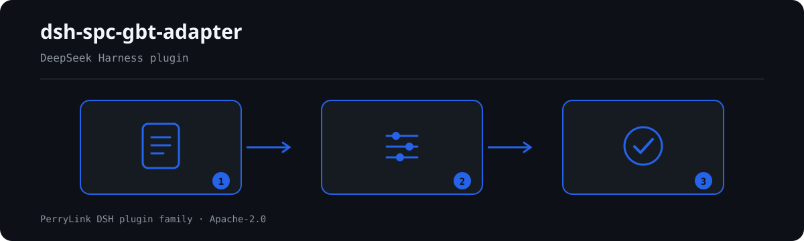

# dsh-spc-gbt-adapter — Control chart constants and process capability index consistency check

[English](README.md) · [简体中文](README-zh.md) · [Español](README-es.md) · [Português](README-pt.md) · [हिन्दी](README-hi.md)

[](https://dsh.market/)
[](https://dshfind.com/en/plugins/PerryLink/dsh-spc-gbt-adapter?ref=badge)

`dsh-spc-gbt-adapter` reads one control-chart register — rows keyed by the register's own column names, in Chinese or English — and checks that register's own arithmetic and constant-table consistency: that the characteristic and the chart type are recorded, that the control limits follow from the centre line, the dispersion statistic and the chart constants the pack freezes, that the centre line sits between the limits, that the stored Cp and Cpk follow their definitions, that the subgroup size is one the constant table covers, and that the header names the product and the process.

## Install

```sh
dsh plugin --profile <name> add dsh-spc-gbt-adapter
dsh --profile <name> --dump-config | grep 'dsh-spc-gbt-adapter'
```

## What it looks like



*Workflow overview: call → plugin → result. The examples below use the real command surface.*


## What it answers

### Examples

The table below is the example set: the first row is the detailed walkthrough, the remaining rows are short cases.

| You ask | What it answers |
|---|---|
| A chart row leaves both the characteristic and the chart type blank. Is that reported? | Yes. `SP-001` requires at least one of `characteristic` and `chartType` to be filled on every row that carries either column, and reports the row when both are empty. It checks that one of them is recorded, not whether that characteristic ought to be charted or whether the chart type was chosen correctly. |
| The stored control limits do not match what the centre line, the range and the chart constants give. | `SP-002` recomputes `ucl` and `lcl` from `centerLine`, `range` and the coefficient entry for that `sampleSize`, within a tolerance of 0.005, and reports the row with the stored pair and the expected pair. It checks only that those numbers agree with one another — not that the limits or the range are correct, and never whether the process is in control. The frozen table is the X̄-R one: an X̄-s, I-MR, p or c chart has different coefficients, so disable the rule or replace `coefficients`. |
| The centre line is stored above the upper control limit. | `SP-003` requires `lcl` ≤ `centerLine` ≤ `ucl` on every row that fills all three, and reports the row where that order fails. It checks the order of the three numbers only, not whether they were computed correctly. A lower limit of 0 is a normal shape for the range chart and is not reported on that account. |
| Cp and Cpk are in the register, but the report says nothing about them. Why? | `SP-004` runs only on rows that carry `cp` or `cpk` together with `usl`, `lsl`, `stdDev` and `mean`; when no row carries all of them, the rule reports `skipped` rather than passing silently. Where it runs it tests the two definitions, Cp = (USL − LSL) / 6σ and Cpk = min(USL − X̄, X̄ − LSL) / 3σ, within a tolerance of 0.02. A difference usually means the σ convention is mixed up: Cp/Cpk take the within-subgroup standard deviation, Pp/Ppk the overall one. It does not decide whether capability is sufficient. |
| Is the process capability good enough? | The check does not answer that. `SP-005` only reports a stored `cpk` that falls below the criterion you configure, and it ships with `threshold: 0`, meaning not configured, so it goes to `skipped` instead of inventing a criterion; the usual 1.33 and 1.67 depend on the industry, the customer and how critical the characteristic is. A finding under this rule means the value is below your own criterion, not that the process is unqualified, and the rule is reported at `info` severity. |
| Our subgroups hold 15 measurements each. What happens? | `SP-007` reports the row: the constant table frozen into the pack covers subgroup sizes 2 to 10 only. With no entry for that size, `SP-002` cannot look the coefficients up either, so it reports that rather than staying silent. The rule checks whether the size is a listed tier, not whether that subgroup size suits the process. To work with larger subgroups, add the tier to `SP-002`'s `coefficients` and widen this rule's `values` — a rule-pack edit, not a code change. |

## Standards it follows

| Document | Number | Cited by rules |
|---|---|---|
| 《常规控制图》 | GB/T 17989.2—2020（控制图 第2部分：常规控制图，采标 ISO；替代已废止的 GB/T 4091—2001；条号本次未取得） | SP-001, SP-002, SP-003, SP-004, SP-005, SP-006, SP-007 |

**Boundary:** this plugin checks a **控制图台账** for arithmetic and constant-table consistency — that the
characteristic and chart type are recorded, that the control limits follow from the centre line, the
dispersion statistic and the chart constants, that the centre line sits between the limits, that Cp and Cpk
follow their definitions, that the subgroup size is one the constant table covers, and that the chart names
its product and process. It does **not** decide whether a process is in control, whether a trend is present,
or whether capability is sufficient. **Reading a chart needs the pattern rules; sufficiency depends on the
customer's acceptance criterion.**

> ### ⚠️ What this pack can and cannot cite
>
> The control-limit coefficients (A₂, D₃, D₄) and the capability-index definitions do have a home:
> **GB/T 4091《常规控制图》** (identical to the ISO 7870 series). Those coefficients are *mathematical
> constants* that vary only with subgroup size, which is why they can be frozen into the rule pack. **But the
> verification pass did not obtain GB/T 4091's verbatim text**, so every rule's `excerpt` says so plainly and
> every rule stays at `warn` or `info` rather than claiming a quotation.
>
> Three limits are worth knowing before trusting a finding:
>
> - **`SP-002` assumes the X̄-R chart.** An X̄-s, I-MR, p or c chart uses entirely different coefficients, so
>   the rule will report differences. Disable it, or replace `coefficients` with the right table — a rule-pack
>   edit, not a code change.
> - **The coefficient table covers n = 2…10.** `SP-007` reports any subgroup size outside that range, so
>   "cannot look it up" is never silently read as "no problem".
> - **`SP-005`'s criterion ships as `0`, meaning "not configured".** Typical values are 1.33 and 1.67, but the
>   right one depends on the industry, the customer and how critical the characteristic is, so the rule
>   reports that it could not run rather than inventing one.
>
> The σ convention matters too: Cp/Cpk use the **within-subgroup** standard deviation while Pp/Ppk use the
> **overall** one. A mismatch between a ledger's σ and its index is the commonest cause of a `SP-004` finding,
> which is why the finding says so.

## Compatibility

| Surface | Status |
|---|---|
| Harness | Peer range `>=0.1.2-rc.1 <0.2.0 \|\| >=0.2.0-0 <0.3.0` — verified to accept both `0.2.0-rc.2` and `0.2.1-rc.2`. `engines.dsh` is declared as `>=0.2.1-0 <0.3.0` and is enforced by the host since 0.2.1 |
| Node | `^22.19.0 || >=24.0.0` |
| Platforms | All (plain ESM; no native code, no network, no model call) |
| Tool mode | Works in `native` and `ptc`; for many characteristics use `ptc` |

## What it does

Registers the `spc_gbt_adapter` tool. It reads one control-chart register — rows keyed by the register's own
column names, in Chinese or English — applies a versioned rule pack, and returns a report.

| Rule | Check | Severity | Basis kind |
|---|---|---|---|
| `SP-001` | the characteristic and chart type are recorded | warn | principle |
| `SP-002` | the limits follow from the centre, dispersion and constants | warn | principle |
| `SP-003` | the centre line sits between the limits | warn | principle |
| `SP-004` | Cp and Cpk follow their definitions | warn | principle |
| `SP-005` | capability meets your acceptance criterion (off by default) | info | local |
| `SP-006` | the chart names its product and process | warn | principle |
| `SP-007` | the subgroup size is one the constant table covers | warn | principle |

## Configuration

| Key | Type | Default | Description |
|---|---|---|---|
| `rulesFile` | string | `rules/spc-gbt-adapter.yaml` | Rule-pack path, relative to the package root |
| `disabledRules` | string[] | `[]` | Rule ids to stop running; each appears in `skipped` |
| `onlyRules` | string[] | `[]` | Run only these rule ids; empty runs every rule |
| `skipNotes` | string | `""` | Note appended to every `skipped` reason |
| `timeoutMs` | number | `120000` | Cooperative tool timeout budget |

Rule-level parameters worth knowing:

- `SP-002` `coefficients` — the constant table, keyed by subgroup size, with `a2` for a mean chart and `d3` /
  `d4` for a dispersion chart. The default covers n = 2…10 for X̄-R; extend it or swap it for another chart
  type's table. `tolerance` defaults to `0.005`.
- `SP-004` `tolerance` — defaults to `0.02`, enough for rounding in a ledger.
- `SP-005` `threshold` — your Cpk acceptance criterion. `0` means the rule does not run.
- `SP-007` `values` — the subgroup sizes your register may use.

## Material format

The tool accepts JSON or YAML:

```yaml
productNo: P-2026-001
processName: 精车外圆
rows:
  - { 控制图编号: Xbar-R-001, 特性名称: 外径, 控制图类型: Xbar-R, 子组大小: '5',
      均值: '10.00', 极差: '0.50', 标准差: '0.215', 中心线: '10.00',
      上控制限: '10.2885', 下控制限: '9.7115', 上规格限: '10.60', 下规格限: '9.40',
      Cp: '0.9302', Cpk: '0.9302' }
```

Column names are matched case-insensitively and ignoring spaces, underscores and hyphens, so `上控制限` and
`ucl` resolve to the same field; the register's own column names are kept, so a finding names the column it
read. Numeric cells may carry units.

## Rule sources

Rule data lives in `rules/spc-gbt-adapter.yaml`. The pack's header explains that the coefficients are
mathematical constants from the conventional control-chart tables whose standard text was not obtained, and
that the citation is therefore stated as a gap rather than paraphrased. The load-time guard still requires a
document, clause, excerpt and source per rule, and still forbids a `derived-from-principle` or locally
configured check from being `error`.

## Troubleshooting

- **`SP-002` fires on every row of an X̄-s or I-MR chart.** Those charts use different coefficients.
  Disable the rule, or replace `coefficients` with the right table.
- **`SP-007` fires on n = 15.** The table covers n = 2…10. Add the coefficients for the sizes you use and
  extend `values`.
- **`SP-004` fires on a chart whose capability looks fine.** Check the σ convention: Cp/Cpk take the
  within-subgroup deviation, Pp/Ppk the overall one. Unify the source before changing the tolerance.
- **`SP-005` never runs.** Its criterion is `0`; set your Cpk target.
- **The plugin installs but the tool never appears.** Check that `main` resolves to `lib/index.mjs` and
  that `pnpm run build` produced it; a wrong `main` makes the loader skip the entry silently.
- **`dsh plugin add` refuses the package as incompatible.** The peer range covers `0.1.x` and `0.2.x`; if
  your runtime sits outside it, grant an explicit exemption:
  `dsh plugin --profile <name> allow-version dsh-spc-gbt-adapter@0.1.0 --dsh-version <runtime> --accept-risk`
- **`check` reports `manifest-peers` as failed.** The static checker compares against a hard-coded peer
  range that predates the 0.2 line. The runtime enforces peer compatibility at install time, so the
  declared range is the correct one; this is a known upstream issue in `dsh-plugin-dev`.

## Development

```sh
pnpm install
pnpm run typecheck   # tsc --noEmit
pnpm test            # vitest, the shared table-plugin suite plus paired fixtures
pnpm run build       # tsdown -> lib/index.mjs + lib/index.d.mts
node ../scripts/sync-shared.mjs dsh-spc-gbt-adapter   # refresh src/shared from ../_shared
```

The plugin is **data-only**: `src/model.ts` declares the table shape, the shared kit supplies the reader and
the check engine, and the rule pack declares every check.

## PerryLink DSH Plugin Family

This project is part of the DeepSeek Harness plugin family from [PerryLink](https://github.com/PerryLink). The roster stays collapsed below so every README keeps a short first screen; expand it to see every row and its status.

<details>
<summary>Expand all plugins</summary>

| Plugin | Status |
|---|---|
| **[dsh-aqua-input-check](https://github.com/PerryLink/dsh-aqua-input-check)** |  |
| **[dsh-archive-check](https://github.com/PerryLink/dsh-archive-check)** |  |
| **[dsh-auto-review](https://github.com/PerryLink/dsh-auto-review)** |  |
| **[dsh-autotier](https://github.com/PerryLink/dsh-autotier)** |  |
| **[dsh-bid-ca-precheck](https://github.com/PerryLink/dsh-bid-ca-precheck)** |  |
| **[dsh-bid-qual-check](https://github.com/PerryLink/dsh-bid-qual-check)** |  |
| **[dsh-cert-mcp](https://github.com/PerryLink/dsh-cert-mcp)** |  |
| **[dsh-checkpoint-rewind](https://github.com/PerryLink/dsh-checkpoint-rewind)** |  |
| **[dsh-click](https://github.com/PerryLink/dsh-click)** |  |
| **[dsh-composer-history](https://github.com/PerryLink/dsh-composer-history)** |  |
| **[dsh-contract-stance](https://github.com/PerryLink/dsh-contract-stance)** |  |
| **[dsh-customs-doc-check](https://github.com/PerryLink/dsh-customs-doc-check)** |  |
| **[dsh-data-quality](https://github.com/PerryLink/dsh-data-quality)** |  |
| **[dsh-demurrage-ledger](https://github.com/PerryLink/dsh-demurrage-ledger)** |  |
| **[dsh-doublecheck](https://github.com/PerryLink/dsh-doublecheck)** |  |
| **[dsh-drill-script-check](https://github.com/PerryLink/dsh-drill-script-check)** |  |
| **[dsh-eia-guide-check](https://github.com/PerryLink/dsh-eia-guide-check)** |  |
| **[dsh-emergency-plan](https://github.com/PerryLink/dsh-emergency-plan)** |  |
| **[dsh-essay-rubric-check](https://github.com/PerryLink/dsh-essay-rubric-check)** |  |
| **[dsh-evidence-check](https://github.com/PerryLink/dsh-evidence-check)** |  |
| **[dsh-export-ctl-check](https://github.com/PerryLink/dsh-export-ctl-check)** |  |
| **[dsh-fast](https://github.com/PerryLink/dsh-fast)** |  |
| **[dsh-fmea-table-check](https://github.com/PerryLink/dsh-fmea-table-check)** |  |
| **[dsh-forecast-penalty](https://github.com/PerryLink/dsh-forecast-penalty)** |  |
| **[dsh-fund-research](https://github.com/PerryLink/dsh-fund-research)** |  |
| **[dsh-github](https://github.com/PerryLink/dsh-github)** |  |
| **[dsh-gongwen-flow-check](https://github.com/PerryLink/dsh-gongwen-flow-check)** |  |
| **[dsh-gongwen-word-check](https://github.com/PerryLink/dsh-gongwen-word-check)** |  |
| **[dsh-guard-plan-qc](https://github.com/PerryLink/dsh-guard-plan-qc)** |  |
| **[dsh-hazchem-check](https://github.com/PerryLink/dsh-hazchem-check)** |  |
| **[dsh-hazplan-check](https://github.com/PerryLink/dsh-hazplan-check)** |  |
| **[dsh-hidden-risk-map](https://github.com/PerryLink/dsh-hidden-risk-map)** |  |
| **[dsh-hs-classify](https://github.com/PerryLink/dsh-hs-classify)** |  |
| **[dsh-icd-rule-check](https://github.com/PerryLink/dsh-icd-rule-check)** |  |
| **[dsh-industry-research](https://github.com/PerryLink/dsh-industry-research)** |  |
| **[dsh-lawcite-adapter](https://github.com/PerryLink/dsh-lawcite-adapter)** |  |
| **[dsh-laya](https://github.com/PerryLink/dsh-laya)** |  |
| **[dsh-lc-doc-check](https://github.com/PerryLink/dsh-lc-doc-check)** |  |
| **[dsh-learning-gap-check](https://github.com/PerryLink/dsh-learning-gap-check)** |  |
| **[dsh-library](https://github.com/PerryLink/dsh-library)** |  |
| **[dsh-local-ai](https://github.com/PerryLink/dsh-local-ai)** |  |
| **[dsh-lsp-actions](https://github.com/PerryLink/dsh-lsp-actions)** |  |
| **[dsh-mask](https://github.com/PerryLink/dsh-mask)** |  |
| **[dsh-mcp-panel](https://github.com/PerryLink/dsh-mcp-panel)** |  |
| **[dsh-medrec-qc](https://github.com/PerryLink/dsh-medrec-qc)** |  |
| **[dsh-memento](https://github.com/PerryLink/dsh-memento)** |  |
| **[dsh-nsfc-form-check](https://github.com/PerryLink/dsh-nsfc-form-check)** |  |
| **[dsh-nurse-record-check](https://github.com/PerryLink/dsh-nurse-record-check)** |  |
| **[dsh-observe](https://github.com/PerryLink/dsh-observe)** |  |
| **[dsh-origin-rvc-check](https://github.com/PerryLink/dsh-origin-rvc-check)** |  |
| **[dsh-ota-review-check](https://github.com/PerryLink/dsh-ota-review-check)** |  |
| **[dsh-output-styles](https://github.com/PerryLink/dsh-output-styles)** |  |
| **[dsh-paper-doc-adapter](https://github.com/PerryLink/dsh-paper-doc-adapter)** |  |
| **[dsh-permission-rules](https://github.com/PerryLink/dsh-permission-rules)** |  |
| **[dsh-permit-report-check](https://github.com/PerryLink/dsh-permit-report-check)** |  |
| **[dsh-pipeline-check](https://github.com/PerryLink/dsh-pipeline-check)** |  |
| **[dsh-pleading-draft](https://github.com/PerryLink/dsh-pleading-draft)** |  |
| **[dsh-plugin-doctor](https://github.com/PerryLink/dsh-plugin-doctor)** |  |
| **[dsh-plugin-guide](https://github.com/PerryLink/dsh-plugin-guide)** |  |
| **[dsh-plugin-kit](https://github.com/PerryLink/dsh-plugin-kit)** |  |
| **[dsh-plugin-upgrade](https://github.com/PerryLink/dsh-plugin-upgrade)** |  |
| **[dsh-policy-brief-draft](https://github.com/PerryLink/dsh-policy-brief-draft)** |  |
| **[dsh-power-loss-split](https://github.com/PerryLink/dsh-power-loss-split)** |  |
| **[dsh-power-ticket-check](https://github.com/PerryLink/dsh-power-ticket-check)** |  |
| **[dsh-ppap-check](https://github.com/PerryLink/dsh-ppap-check)** |  |
| **[dsh-protest-deadline](https://github.com/PerryLink/dsh-protest-deadline)** |  |
| **[dsh-railway-window](https://github.com/PerryLink/dsh-railway-window)** |  |
| **[dsh-repair-order-qc](https://github.com/PerryLink/dsh-repair-order-qc)** |  |
| **[dsh-research-report](https://github.com/PerryLink/dsh-research-report)** |  |
| **[dsh-review-reply-check](https://github.com/PerryLink/dsh-review-reply-check)** |  |
| **[dsh-rulefile-check](https://github.com/PerryLink/dsh-rulefile-check)** |  |
| **[dsh-safety-brief-check](https://github.com/PerryLink/dsh-safety-brief-check)** |  |
| **[dsh-score](https://github.com/PerryLink/dsh-score)** |  |
| **[dsh-session-sync](https://github.com/PerryLink/dsh-session-sync)** |  |
| **[dsh-site-log-check](https://github.com/PerryLink/dsh-site-log-check)** |  |
| **[dsh-skill-pack-security](https://github.com/PerryLink/dsh-skill-pack-security)** |  |
| **[dsh-soe-decision-check](https://github.com/PerryLink/dsh-soe-decision-check)** |  |
| **[dsh-soilwater-check](https://github.com/PerryLink/dsh-soilwater-check)** |  |
| **[dsh-sop-sync-check](https://github.com/PerryLink/dsh-sop-sync-check)** |  |
| **[dsh-spc-gbt-adapter](https://github.com/PerryLink/dsh-spc-gbt-adapter)** |  |
| **[dsh-talk](https://github.com/PerryLink/dsh-talk)** |  |
| **[dsh-tender-extract](https://github.com/PerryLink/dsh-tender-extract)** |  |
| **[dsh-tender-matrix](https://github.com/PerryLink/dsh-tender-matrix)** |  |
| **[dsh-test-drive](https://github.com/PerryLink/dsh-test-drive)** |  |
| **[dsh-ticktick](https://github.com/PerryLink/dsh-ticktick)** |  |
| **[dsh-translate](https://github.com/PerryLink/dsh-translate)** |  |
| **[dsh-warranty-calc](https://github.com/PerryLink/dsh-warranty-calc)** |  |
| **[dsh-budget](https://github.com/PerryLink/dsh-budget)** | 🧊 FROZEN — see the repo README |
| **[dsh-claude-move](https://github.com/PerryLink/dsh-claude-move)** | 🧊 FROZEN — see the repo README |
| **[dsh-defend](https://github.com/PerryLink/dsh-defend)** | 🧊 FROZEN — see the repo README |
| **[dsh-draw](https://github.com/PerryLink/dsh-draw)** | 🧊 FROZEN — see the repo README |
| **[dsh-reach](https://github.com/PerryLink/dsh-reach)** | 🧊 FROZEN — see the repo README |
| **[dsh-background-agents](https://github.com/PerryLink/dsh-background-agents)** | 🚫 RETIRED — see the repo README |
| **[dsh-session-pin](https://github.com/PerryLink/dsh-session-pin)** | 🚫 RETIRED — see the repo README |
| **[dsh-team-rooms](https://github.com/PerryLink/dsh-team-rooms)** | 🚫 RETIRED — see the repo README |

</details>

## License

[Apache License 2.0](LICENSE) © 2026 dsh-spc-gbt-adapter contributors.
