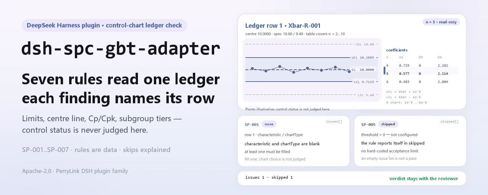
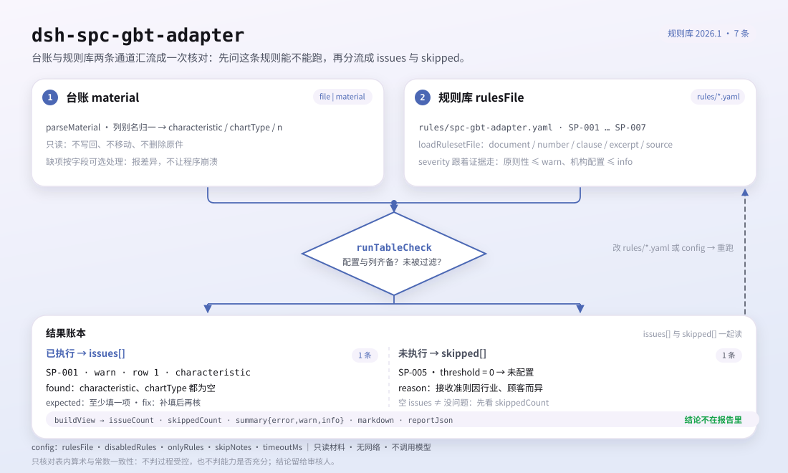

<div align="center">

<picture>
  <source media="(prefers-color-scheme: dark)" srcset="docs/assets/dsh-spc-gbt-adapter-hero-en-dark.webp">
  
</picture>

# dsh-spc-gbt-adapter

**Verifique o registro de cartas de controlo antes de ele chegar à revisão: qual linha, qual coluna, o que difere, item por item.**

Um verificador de registros de cartas de controlo convencionais para o DeepSeek Harness: lê um registro de cartas de controlo, aplica 7 regras à coerência aritmética e de tabela de constantes dos seus limites, linha central e Cp/Cpk, e apenas enumera diferenças; nunca decide se um processo está sob controlo.

[Instalar](#instalação-em-três-passos) · [Configuração](#configuração) · [FAQ](#faq) · [简体中文](README.md) · [English](README.en.md) · [Español](README.es.md) · [Português](README.pt.md) · [हिन्दी](README.hi.md)

[](LICENSE)
[](#compatibilidade)
[](https://www.npmjs.com/package/dsh-spc-gbt-adapter)
[](https://github.com/PerryLink/dsh-spc-gbt-adapter/actions/workflows/ci.yml)
[](#compatibilidade)

[](https://github.com/PerryLink/dsh-spc-gbt-adapter/stargazers)
[](https://www.npmjs.com/package/dsh-spc-gbt-adapter)
[](https://dshfind.com/plugins/PerryLink/dsh-spc-gbt-adapter?ref=badge)
[](https://securityscorecards.dev/viewer/?uri=github.com/PerryLink/dsh-spc-gbt-adapter)
[](https://dsh.market/)
[](https://gitee.com/perrylink/dsh-spc-gbt-adapter)

```sh
dsh plugin --profile <name> add dsh-spc-gbt-adapter
```

</div>

<sub>Plugin da comunidade, sem afiliação com a DeepSeek. Repositório canônico: <https://github.com/PerryLink/dsh-spc-gbt-adapter> (o Gitee é um espelho).</sub>

## O que é

`dsh-spc-gbt-adapter` lê um registro de cartas de controlo —linhas organizadas pelos nomes de coluna do próprio registro, em chinês ou em inglês— e verifica a coerência aritmética e de tabela de constantes desse registro: se a característica e o tipo de carta estão registados, se os limites de controlo decorrem da linha central, da amplitude e das constantes de carta que o pacote fixa, se a linha central fica entre os limites, se o Cp e o Cpk registados cumprem as suas definições, se a dimensão do subgrupo é uma das cobertas pela tabela de constantes e se o cabeçalho indica o produto e o processo.

O material é JSON ou YAML; a ferramenta lê o `file` ou o `material` que lhe passa e nunca modifica o original. O Excel pode ser convertido antes para JSON/YAML, também no chat se a plataforma o permitir.

<picture>
  <source media="(prefers-color-scheme: dark)" srcset="docs/assets/dsh-spc-gbt-adapter-flow-v5-dark.svg">
  
</picture>

## Instalação em três passos

1. **Instale** (escolha um canal):

   ```sh
   # canal git (último main)
   dsh plugin --profile <name> add github:PerryLink/dsh-spc-gbt-adapter
   # canal npm (versões publicadas)
   dsh plugin --profile <name> add dsh-spc-gbt-adapter
   # canal tarball: pnpm pack neste repositório e depois
   dsh plugin --profile <name> add ./dsh-spc-gbt-adapter-<version>.tgz
   ```

   A trabalhar a partir de um checkout do código? Execute antes `pnpm install && pnpm run build` (`prepare` executa `tsdown` e gera `lib/`).

2. **Configuração mínima** (os valores por defeito já funcionam; este exemplo executa apenas três regras):

   ```yaml
   - insert:
       - id: dsh-spc-gbt-adapter
         name: dsh-spc-gbt-adapter
         config:
           onlyRules: [SP-001, SP-002, SP-004]
   ```

3. **Verifique que monta**:

   ```sh
   dsh --profile <name> --dump-config | grep 'dsh-spc-gbt-adapter'
   ```

   Depois peça ao modelo que chame a ferramenta `spc_gbt_adapter` uma vez com a entrada mínima:

   ```json
   {"rows":[{"均值":"10.00","标准差":"0.215","上规格限":"10.60","下规格限":"9.40","Cp":"0.9302","Cpk":"1.50"}]}
   ```

   O relatório traz `issueCount`, `summary` e `skippedCount`; os achados ficam em `markdown` e `reportJson`. A partir de um checkout do código pode executar o exemplo incluído (após compilar): `node samples/quickstart/run.mjs --check`, com a entrada e a saída esperada em `samples/quickstart/`; a captura de terminal está em [`docs/assets/quickstart.png`](docs/assets/quickstart.png).

**Desinstalar**: `dsh plugin --profile <name> remove dsh-spc-gbt-adapter`.

<details>
<summary>Formato do material (JSON / YAML)</summary>

```yaml
productNo: P-2026-001
processName: 精车外圆
rows:
  - { 控制图编号: Xbar-R-001, 特性名称: 外径, 控制图类型: Xbar-R, 子组大小: '5',
      均值: '10.00', 极差: '0.50', 标准差: '0.215', 中心线: '10.00',
      上控制限: '10.2885', 下控制限: '9.7115', 上规格限: '10.60', 下规格限: '9.40',
      Cp: '0.9302', Cpk: '0.9302' }
```

Os nomes de coluna são comparados sem distinguir maiúsculas e ignorando espaços, sublinhados e hífenes, por isso `上控制限` e `ucl` resolvem para o mesmo campo; os nomes de coluna do próprio registro são preservados, pelo que cada achado nomeia a coluna que leu. As células numéricas podem trazer unidades. Tanto o cabeçalho como as linhas aceitam aliases em chinês e em inglês.

</details>

## Capacidades principais

`dsh-spc-gbt-adapter` transforma um registo de cartas de controlo numa lista de diferenças revisível item por item:

- **Verificação ao nível do registo** — lê apenas o registo que lhe passa; cada achado traz `locator` (linha/coluna), `found`, `expected` e `fix`, apontando a uma linha e a uma coluna concretas.
- **Sete regras, o pacote de regras é dado** — todas as verificações são declaradas em `rules/spc-gbt-adapter.yaml`; substituir o YAML muda a versão do conjunto de regras sem tocar em TypeScript.
- **Sem aprovação silenciosa** — verificações não configuradas, desativadas ou impossíveis de executar entram em `skipped` com o motivo; uma lista de problemas vazia nunca pode ser lida como «não há nada de errado».
- **Apenas diferenças** — sem veredicto de conformidade, sem atribuição de responsabilidade, sem substituir o revisor; a conclusão fica com quem tem competência para a tirar.
- **Local e sem efeitos secundários** — sem rede, sem chamadas ao modelo, sem escritas no material; a análise e a verificação são funções puras locais.

| Regra | O que verifica | Nível | Base |
|---|---|---|---|
| `SP-001` | a característica e o tipo de carta estão registados | warn | princípio |
| `SP-002` | os limites decorrem do centro, da dispersão e das constantes | warn | princípio |
| `SP-003` | a linha central fica entre os limites | warn | princípio |
| `SP-004` | Cp e Cpk cumprem as suas definições | warn | princípio |
| `SP-005` | a capacidade cumpre o seu critério de aceitação (desligada por defeito) | info | local |
| `SP-006` | a carta nomeia o seu produto e o seu processo | warn | princípio |
| `SP-007` | a dimensão do subgrupo é coberta pela tabela de constantes | warn | princípio |

### Uma execução real

**Ferramenta** `spc_gbt_adapter`

**Entrada**

~~~json
{"rows":[{"均值":"10.00","标准差":"0.215","上规格限":"10.60","下规格限":"9.40","Cp":"0.9302","Cpk":"1.50"}]}
~~~

**Saída**

~~~json
{
  "id": "dsh-spc-gbt-adapter.SP-004.de09b5a6",
  "ruleId": "SP-004",
  "severity": "warn",
  "locator": {
    "row": 1,
    "field": "cpk"
  },
  "found": "第 1 行 Cpk 填报 1.5，按 min(USL − X̄, X̄ − LSL) / 3σ 应为 0.9302",
  "expected": "Cpk = min(USL − X̄, X̄ − LSL) / 3σ",
  "fix": "核对标准差口径与均值；本条只做算术核对，不判断能力是否足够"
}
~~~

*Observado em `dsh-spc-gbt-adapter/tests/fixtures/SP-004/SP-004-unsafe.json`*

### Seis perguntas e respostas

| Você pergunta | O que ele responde |
|---|---|
| Uma linha deixa vazios a característica e o tipo de carta. Isso é registado? | Sim. `SP-001` exige que, em toda a linha que traga uma dessas duas colunas, seja preenchido ao menos um de `characteristic` e `chartType`, e regista a linha quando ambos estão vazios. Verifica que um deles está registado, não se essa característica deveria ser levada numa carta nem se o tipo de carta foi bem escolhido. |
| Os limites de controlo registados não coincidem com o que dão a linha central, a amplitude e as constantes. | `SP-002` recalcula `ucl` e `lcl` a partir de `centerLine`, `range` e do coeficiente desse `sampleSize`, com uma tolerância de 0.005, e regista a linha com o par registado e o esperado. Verifica apenas que esses números concordam entre si — não se os limites ou a amplitude estão corretos, e nunca se o processo está sob controlo. A tabela fixada é a da carta X̄-R: uma carta X̄-s, I-MR, p ou c usa outros coeficientes, por isso desative a regra ou substitua `coefficients`. |
| A linha central está registada acima do limite de controlo superior. | `SP-003` exige `lcl` ≤ `centerLine` ≤ `ucl` em toda a linha que preencha os três, e regista a linha cuja ordem falha. Verifica apenas a ordem dos três números, não se foram calculados corretamente. Um limite inferior de 0 é a forma normal da carta de amplitudes e não é registado por esse motivo. |
| O registo traz Cp e Cpk, mas o relatório não diz nada sobre eles. Porquê? | `SP-004` só é executado em linhas que tragam `cp` ou `cpk` junto com `usl`, `lsl`, `stdDev` e `mean`; quando nenhuma linha os traz todos, a regra regista `skipped` em vez de passar em silêncio. Onde é executado contrasta as duas definições, Cp = (USL − LSL) / 6σ e Cpk = min(USL − X̄, X̄ − LSL) / 3σ, com uma tolerância de 0.02. Uma diferença costuma significar que o critério de σ foi misturado: Cp/Cpk usam o desvio-padrão dentro do subgrupo e Pp/Ppk o global. Não decide se a capacidade é suficiente. |
| A capacidade deste processo é suficiente? | Isso não é respondido pela verificação. `SP-005` apenas regista um `cpk` que fica abaixo do critério que configurar, e vem com `threshold: 0`, ou seja, não configurado, pelo que passa a `skipped` em vez de inventar um critério; os habituais 1.33 e 1.67 dependem do setor, do cliente e da importância da característica. Um achado desta regra significa que o valor está abaixo do seu próprio critério, não que o processo seja inapto, e é registado com severidade `info`. |
| Os nossos subgrupos têm 15 medições cada. O que acontece? | `SP-007` regista a linha: a tabela de constantes fixada no pacote cobre apenas dimensões de subgrupo de 2 a 10. Sem entrada para essa dimensão, `SP-002` também não consegue consultar os coeficientes, pelo que também o regista em vez de calar. A regra verifica se a dimensão é um escalão listado, não se essa dimensão de subgrupo convém ao processo. Para trabalhar com subgrupos maiores, acrescente o escalão aos `coefficients` de `SP-002` e alargue os `values` desta regra: é uma edição do pacote de regras, não do código. |

## Configuração

Todos os parâmetros ajustáveis são campos `Config` do Schemastery em `src/config.ts`, alteráveis a partir de `cordis.yml` sem tocar no código; os limiares por regra estão no pacote de regras em `rules/`.

| Chave | Tipo | Predefinição | Descrição |
|---|---|---|---|
| `rulesFile` | string | `rules/spc-gbt-adapter.yaml` | Caminho do pacote de regras, relativo à raiz do pacote |
| `disabledRules` | string[] | `[]` | Ids de regras que deixam de ser executadas; cada uma aparece em `skipped` |
| `onlyRules` | string[] | `[]` | Executar apenas estas regras; vazio executa todas |
| `skipNotes` | string | `""` | Nota acrescentada a cada motivo de `skipped` |
| `timeoutMs` | number | `120000` | Orçamento de tempo de espera cooperativo da ferramenta |

Parâmetros ao nível da regra:

- `SP-002` `coefficients` — a tabela de constantes, indexada pela dimensão do subgrupo: `a2` para a carta de médias e `d3` / `d4` para a de dispersão. Por predefinição cobre n = 2…10 para X̄-R; pode ser alargada ou substituída pela tabela de outro tipo de carta. `tolerance` vale 0.005 por predefinição.
- `SP-004` `tolerance` — 0.02 por predefinição, suficiente para o arredondamento de um registo.
- `SP-005` `threshold` — o seu critério de aceitação de Cpk. `0` significa que a regra não é executada.
- `SP-007` `values` — as dimensões de subgrupo que o seu registo pode usar.

Exemplo de substituição no patch do perfil:

```yaml
- insert:
    - id: dsh-spc-gbt-adapter
      name: dsh-spc-gbt-adapter
      config:
        rulesFile: rules/spc-gbt-adapter.yaml
        onlyRules: [SP-002, SP-004, SP-006]
        skipNotes: regras SPC da instituição, edição 2026
        timeoutMs: 60000
```

## FAQ

<details>
<summary>O material é enviado ou transmitido pela rede?</summary>

Não. `dsh-spc-gbt-adapter` é um verificador local: lê apenas o material passado à ferramenta (`file` ou `material`) e não envia nada; não faz pedidos de rede nem leva telemetria, analítica ou reporte em segundo plano; não escreve dados além do resultado da ferramenta e do armazenamento de sessão/registo do próprio host DSH. O host controla esse armazenamento e a sua política de retenção; este pacote não guarda uma segunda cópia.

</details>

<details>
<summary>Uma lista de problemas vazia significa que não há nada de errado?</summary>

Não necessariamente. As verificações que não puderam ser executadas entram uma a uma em `skipped` com o motivo — por exemplo `SP-005` vem com `threshold: 0` e regista-se a si mesma em `skipped` em vez de passar em silêncio, e `SP-004` faz o mesmo quando falta qualquer um dos seus seis campos. Uma lista vazia diz apenas que as regras que correram não encontraram diferenças; leia `skippedCount` e `skipped` antes de `issueCount`.

</details>

<details>
<summary>Compete com outros plugins por nomes de ferramenta, serviços ou slots?</summary>

Não. Regista uma única ferramenta `spc_gbt_adapter`, não fornece nenhuma chave de serviço, não regista slots de cliente nem prefixos `webServer`, não escuta eventos partilhados e não altera objetos globais. O registo da ferramenta é um effect de Cordis, removido ao parar ou recarregar a quente.

</details>

<details>
<summary>Qual é o custo de desempenho? Vai expirar o tempo?</summary>

A análise e a verificação são locais: sem pedidos de rede, sem chamadas ao modelo. A ferramenta leva um orçamento cooperativo `timeoutMs` (120000 ms por predefinição) e a verificação é uma varredura linear. O custo cresce com o número de linhas do registo, não com o modelo.

</details>

<details>
<summary>Pode substituir o revisor?</summary>

Não. Apenas enumera as diferenças que podem ser apontadas dentro do próprio registo; não julga a conformidade, não atribui responsabilidade e não decide se o processo está sob controlo ou se a capacidade é suficiente. Isso depende do critério de aceitação do cliente, das regras SPC da sua instituição e do julgamento do revisor.

</details>

## Normas que segue

| Documento | Número | Regras que o citam |
|---|---|---|
| Cartas de controlo convencionais | GB/T 17989.2—2020 (Control charts — Part 2: Shewhart control charts; adota ISO; substitui a revogada GB/T 4091—2001; números de cláusula não obtidos nesta ronda) | SP-001, SP-002, SP-003, SP-004, SP-005, SP-006, SP-007 |

**Limite:** este plugin verifica um **registo de cartas de controlo** na sua coerência aritmética e de tabela de constantes — se a característica e o tipo de carta estão registados, se os limites decorrem da linha central, da dispersão e das constantes, se a linha central fica entre os limites, se Cp e Cpk cumprem as suas definições, se a dimensão do subgrupo é coberta pela tabela e se a carta nomeia o seu produto e processo. **Não** decide se um processo está sob controlo, se há tendência nem se a capacidade é suficiente. **Ler uma carta exige as regras de padrões; a suficiência depende do critério de aceitação do cliente.**

> ### ⚠️ O que este pacote pode e não pode citar
>
> Os coeficientes dos limites de controlo (A₂, D₃, D₄) e as definições dos índices de capacidade têm origem: **GB/T 17989.2—2020, *Control charts — Part 2: Shewhart control charts*** (adota ISO; a mesma matéria da série ISO 7870; substitui a revogada GB/T 4091—2001). Esses coeficientes são *constantes matemáticas* que só variam com a dimensão do subgrupo, por isso podem ser fixados no pacote de regras. **Mas a verificação não obteve o texto literal dessa norma** (adota ISO/IEC e a plataforma pública não oferece leitura em linha por direitos de autor), pelo que o `excerpt` de cada regra o diz claramente e cada regra fica em `warn` ou `info`, em vez de reclamar uma citação.
>
> Três limites convém conhecer antes de confiar num achado:
>
> - **`SP-002` pressupõe a carta X̄-R.** Uma carta X̄-s, I-MR, p ou c usa coeficientes completamente diferentes, pelo que a regra registará diferenças. Desative-a ou substitua `coefficients` pela tabela correta: é uma edição do pacote de regras, não do código.
> - **A tabela de coeficientes cobre n = 2…10.** `SP-007` regista qualquer dimensão de subgrupo fora desse intervalo, pelo que «não se consegue consultar» nunca é lido em silêncio como «não há problema».
> - **O critério de `SP-005` vem como `0`, ou seja, «não configurado».** Os valores típicos são 1.33 e 1.67, mas qual é o correto depende do setor, do cliente e da importância da característica, por isso a regra regista que não conseguiu executar-se em vez de inventar um.
>
> O critério de σ também importa: Cp/Cpk usam o desvio-padrão **dentro do subgrupo** e Pp/Ppk o **global**. Um σ que não concorda com o seu índice é a causa mais frequente de um achado de `SP-004`, e é por isso que o achado o diz.

**Os dados das regras estão separados do código.** Vivem em `rules/spc-gbt-adapter.yaml`. O cabeçalho regista a correção de 2026-10-07: o número da norma passou da revogada GB/T 4091—2001 para a vigente GB/T 17989.2—2020, sem tocar em `kind` nem `severity`, porque os coeficientes são constantes matemáticas. O carregador impõe que cada regra traga documento, número, cláusula, extrato e fonte (um extrato com menos de oito caracteres falha ao carregar) e proíbe que uma verificação `derived-from-principle` ou de configuração local se declare `error`. O registo de verificação por cláusula está em `rules/evidence/`.

## Limites de segurança

- **Ler o material, nunca reescrevê-lo.** A ferramenta lê o `file` ou o `material` que lhe passa; o registo em disco nunca é reescrito, movido ou apagado.
- **Sem rede, sem chamadas ao modelo, sem telemetria.** Não há pedidos de rede nem analítica ou reporte em segundo plano; não se escrevem dados além do resultado da ferramenta e do armazenamento de sessão/registo do host.
- **Sem conclusões qualificativas.** O relatório apenas enumera diferenças; não decide que um processo está sob controlo, que a capacidade é suficiente nem quem é responsável. Um guardião de redação atua sobre o relatório renderizado, que leva sempre o aviso.
- **Sem citações inventadas.** O pacote de regras é validado ao carregar: cada regra deve trazer documento, número, cláusula, extrato e fonte, e o extrato deve ser uma citação literal. Quando a cláusula literal não foi obtida, o pacote di-lo em vez de a parafrasear; `derived-from-principle` fica limitado a `warn` e `institutional-configuration` a `info`.
- **Sem aprovação silenciosa.** Verificações não configuradas, desativadas ou impossíveis de executar entram em `skipped` com um motivo; uma lista vazia nunca pode ser lida como «não há nada de errado».
- **O pacote de regras é dado.** Substituir `rules/*.yaml` muda a versão do conjunto de regras sem tocar no código; o pacote é validado ao carregar, não é confiado.

## Limitações conhecidas

- **Um registo coerente não é um processo controlado.** O plugin verifica apenas a coerência aritmética e de tabela de constantes do registo; não lê a carta contra as regras de padrões (sequências, tendências, cadeias, pontos próximos dos limites) e nunca decide se um processo está sob controlo estatístico. Para isso são precisas as regras de padrões aplicadas à carta.
- **A suficiência da capacidade é decidida por si.** `SP-004` verifica apenas as definições de Cp/Cpk, e `SP-005` compara apenas com o `threshold` que configurar; os habituais 1.33 e 1.67 variam por setor, cliente e característica, por isso não se codifica qualquer critério de aceitação.
- **`SP-002` pressupõe a carta X̄-R.** Uma carta X̄-s, I-MR, p ou c usa coeficientes e algoritmos diferentes; quando o tipo de carta não é o pressuposto, regista diferenças com honestidade, e a solução é desativar a regra ou substituir `coefficients`.
- **A tabela de coeficientes cobre n = 2…10.** `SP-007` regista qualquer dimensão de subgrupo fora desse intervalo; `SP-002` não consegue consultar os coeficientes e também o regista, em vez de passar em silêncio.
- **`SP-005` é entregue sem critério.** `threshold: 0` significa não configurado, pelo que a regra passa a `skipped`; só começa a comparar quando fixar o seu critério institucional.
- **O critério de σ é uma fonte habitual de falsos positivos.** Cp/Cpk usam o desvio dentro do subgrupo e Pp/Ppk o global; quando um registo mistura ambos, `SP-004` regista uma diferença: unifique a fonte antes de mexer na tolerância.
- **Apenas aritmética dentro do registo.** Não abre os registos de medição por trás, não verifica se os dados brutos são reais ou se a amostragem foi aleatória, e não julga se o tipo de carta foi bem escolhido.
- **Formato de material limitado.** Apenas JSON ou YAML; o Excel tem de ser convertido antes. Os campos da camada de leitura são opcionais, pelo que uma exportação parcial produz achados de campo em falta em vez de uma falha.
- **Apenas sete regras.** O conjunto é substituível, mas o predefinido cobre característica/tipo de carta, limites, linha central, índices de capacidade, identificação do cabeçalho e escalões de subgrupo ao nível do registo.

### Verificações habituais

- **O plugin instala-se mas a ferramenta não aparece.** Confirme que `main` resolve para `lib/index.mjs` e que `pnpm run build` o gerou; um `main` errado faz o carregador ignorar a entrada em silêncio.
- **`dsh plugin add` rejeita o pacote como incompatível.** O intervalo de peers cobre `0.1.x` e `0.2.x`; se o seu runtime estiver fora, conceda uma isenção explícita: `dsh plugin --profile <name> allow-version dsh-spc-gbt-adapter@0.1.0 --dsh-version <runtime> --accept-risk`.
- **`check` regista `manifest-peers` como falha.** O verificador estático compara com um intervalo de peers codificado anterior à linha 0.2; o runtime aplica a compatibilidade na instalação. É um problema conhecido do `dsh-plugin-dev`.
- **`SP-002` dispara em cada linha de uma carta X̄-s ou I-MR.** Essas cartas usam outros coeficientes; desative a regra ou substitua `coefficients` pela tabela correta.
- **`SP-007` dispara com n = 15.** A tabela cobre n = 2…10; acrescente os coeficientes das dimensões que usa e alargue `values`.
- **`SP-004` dispara numa carta cuja capacidade parece correta.** Verifique primeiro o critério de σ (dentro do subgrupo vs global); unifique a fonte antes de ajustar a tolerância.
- **`SP-005` nunca é executada.** O critério vem como `0`, ou seja, não configurado; defina o seu objetivo de Cpk para a ativar.
- **Uma regra não foi executada.** Leia o array `skipped`: indica o id da regra e o motivo.
- **Os horários parecem deslocados.** Toda a aritmética é de hora local sobre as cadeias entregues; não há conversão de fuso horário.

## Compatibilidade

| Superfície | Estado |
|---|---|
| Harness | Intervalo de peers `>=0.1.2-rc.1 <0.2.0 \|\| >=0.2.0-0 <0.3.0` — verificado para aceitar tanto `0.2.0-rc.2` como `0.2.1-rc.2`. `engines.dsh` é declarado como `>=0.2.1-0 <0.3.0` e o host aplica-o desde 0.2.1 |
| Node | `^22.19.0 \|\| >=24.0.0` |
| Plataformas | Todas (ESM puro; sem código nativo, sem rede, sem chamada ao modelo) |
| Modo de ferramenta | Funciona em `native` e `ptc`; com muitas características use `ptc` |

## Ecossistema e qualidade

- [Espelho no Gitee](https://gitee.com/perrylink/dsh-spc-gbt-adapter) (espelho sincronizado; o GitHub é o canônico)
- [Página do plugin no dshfind](https://dshfind.com/plugins/PerryLink/dsh-spc-gbt-adapter) (instalações e ranking)
- [Relatório OpenSSF Scorecard](https://securityscorecards.dev/viewer/?uri=github.com/PerryLink/dsh-spc-gbt-adapter) (impulsionado por [.github/workflows/scorecard.yml](.github/workflows/scorecard.yml))
- [DSH Market](https://dsh.market/) (listado)
- [Base de conhecimento do ecossistema](https://perrylink.github.io/dsh-plugin-guide/): dados medidos, não marketing · guia de desenvolvimento · dados de seleção · critérios de manutenção

## Desenvolvimento

```sh
pnpm install                                   # node ^22.19 || >=24
pnpm run typecheck                             # tsc --noEmit
pnpm test                                      # vitest: suíte partilhada de plugins de tabela + fixtures emparelhados
pnpm run build                                 # tsdown -> lib/index.mjs + lib/index.d.mts
pnpm run verify:self-contained                 # as dependências resolvem a partir do registry
pnpm run check:lockfile                        # verificação de deriva do lockfile
pnpm run check:readmes                         # portão de consistência dos README
pnpm run check:citations                       # citações face ao registo de verificação
node ../scripts/sync-shared.mjs dsh-spc-gbt-adapter   # atualiza src/shared a partir de ../_shared
node samples/quickstart/run.mjs --check        # exemplo incluído (compilar antes)
```

`sync-shared` copia o kit partilhado de `../_shared` para `src/shared/`; volte a executá-lo após cada alteração partilhada.

Estrutura de diretórios:

| Caminho | Função |
|---|---|
| `src/index.ts` | Contrato de plugin de função: regista a ferramenta `spc_gbt_adapter` e resolve o caminho do pacote de regras |
| `src/config.ts` | Esquema Schemastery; todos os parâmetros ajustáveis vivem aqui |
| `src/model.ts` | Forma da tabela e contrato do material; aliases de colunas e ponto de entrada da análise |
| `src/view.ts` | Projeção do relatório para o modelo; `output.schema` corresponde-lhe |
| `src/shared/` | Kit partilhado (carregador de regras, forma do relatório, subconjunto YAML, aritmética de calendário, guardião de redação, ajudas de tabela), copiado para o pacote ser autossuficiente |
| `rules/spc-gbt-adapter.yaml` | O pacote de regras, 7 regras |
| `rules/evidence/` | O registo de verificação de cada citação que o pacote faz |
| `tests/` | vitest; cada regra tem um par de fixtures conforme/violador |

O resultado do exemplo incluído pode ser comparado com `samples/quickstart/expected/result.json`; a captura está em [`docs/assets/quickstart.png`](docs/assets/quickstart.png). As imagens do README são geradas programaticamente por [`scripts/gen-readme-assets.py`](scripts/gen-readme-assets.py) e podem ser executadas de novo —Pillow para o banner hero, SVG escrito à mão para o diagrama de estrutura; o antigo diagrama de fluxo de uma só variante e as imagens de demonstração ficam em `docs/assets/` para ligações externas, enquanto os README só referenciam o novo hero e o diagrama flow-v5, cada um em claro e escuro.

## Família e agradecimentos

Este projeto faz parte da família de plugins DeepSeek Harness da [PerryLink](https://github.com/PerryLink) (todos Apache-2.0). Se for útil, **uma estrela ajuda a próxima pessoa a encontrá-lo** — não desbloqueia nada.

- [@PerryLink](https://github.com/PerryLink) — criador e mantenedor: as 7 regras `SP-*` e o pacote de regras, a ferramenta `spc_gbt_adapter`, e a documentação em cinco idiomas e a cadeia de imagens.

<details>
<summary>Expandir todos os plugins</summary>

| Plugin | Estado |
|---|---|
| **[dsh-aqua-input-check](https://github.com/PerryLink/dsh-aqua-input-check)** |  |
| **[dsh-archive-check](https://github.com/PerryLink/dsh-archive-check)** |  |
| **[dsh-auto-review](https://github.com/PerryLink/dsh-auto-review)** |  |
| **[dsh-autotier](https://github.com/PerryLink/dsh-autotier)** | 🧊 CONGELADO — ver o README do repo |
| **[dsh-bid-ca-precheck](https://github.com/PerryLink/dsh-bid-ca-precheck)** |  |
| **[dsh-bid-qual-check](https://github.com/PerryLink/dsh-bid-qual-check)** |  |
| **[dsh-cert-mcp](https://github.com/PerryLink/dsh-cert-mcp)** | 🧊 CONGELADO — ver o README do repo |
| **[dsh-checkpoint-rewind](https://github.com/PerryLink/dsh-checkpoint-rewind)** |  |
| **[dsh-click](https://github.com/PerryLink/dsh-click)** |  |
| **[dsh-composer-history](https://github.com/PerryLink/dsh-composer-history)** |  |
| **[dsh-contract-stance](https://github.com/PerryLink/dsh-contract-stance)** |  |
| **[dsh-customs-doc-check](https://github.com/PerryLink/dsh-customs-doc-check)** |  |
| **[dsh-data-quality](https://github.com/PerryLink/dsh-data-quality)** | 🧊 CONGELADO — ver o README do repo |
| **[dsh-demurrage-ledger](https://github.com/PerryLink/dsh-demurrage-ledger)** |  |
| **[dsh-doublecheck](https://github.com/PerryLink/dsh-doublecheck)** |  |
| **[dsh-drill-script-check](https://github.com/PerryLink/dsh-drill-script-check)** |  |
| **[dsh-eia-guide-check](https://github.com/PerryLink/dsh-eia-guide-check)** |  |
| **[dsh-emergency-plan](https://github.com/PerryLink/dsh-emergency-plan)** |  |
| **[dsh-essay-rubric-check](https://github.com/PerryLink/dsh-essay-rubric-check)** |  |
| **[dsh-evidence-check](https://github.com/PerryLink/dsh-evidence-check)** |  |
| **[dsh-export-ctl-check](https://github.com/PerryLink/dsh-export-ctl-check)** |  |
| **[dsh-fast](https://github.com/PerryLink/dsh-fast)** |  |
| **[dsh-fmea-table-check](https://github.com/PerryLink/dsh-fmea-table-check)** |  |
| **[dsh-forecast-penalty](https://github.com/PerryLink/dsh-forecast-penalty)** |  |
| **[dsh-fund-research](https://github.com/PerryLink/dsh-fund-research)** |  |
| **[dsh-github](https://github.com/PerryLink/dsh-github)** |  |
| **[dsh-gongwen-flow-check](https://github.com/PerryLink/dsh-gongwen-flow-check)** |  |
| **[dsh-gongwen-word-check](https://github.com/PerryLink/dsh-gongwen-word-check)** |  |
| **[dsh-guard-plan-qc](https://github.com/PerryLink/dsh-guard-plan-qc)** |  |
| **[dsh-hazchem-check](https://github.com/PerryLink/dsh-hazchem-check)** |  |
| **[dsh-hazplan-check](https://github.com/PerryLink/dsh-hazplan-check)** |  |
| **[dsh-hidden-risk-map](https://github.com/PerryLink/dsh-hidden-risk-map)** |  |
| **[dsh-hs-classify](https://github.com/PerryLink/dsh-hs-classify)** |  |
| **[dsh-icd-rule-check](https://github.com/PerryLink/dsh-icd-rule-check)** |  |
| **[dsh-industry-research](https://github.com/PerryLink/dsh-industry-research)** |  |
| **[dsh-lawcite-adapter](https://github.com/PerryLink/dsh-lawcite-adapter)** |  |
| **[dsh-laya](https://github.com/PerryLink/dsh-laya)** |  |
| **[dsh-lc-doc-check](https://github.com/PerryLink/dsh-lc-doc-check)** |  |
| **[dsh-learning-gap-check](https://github.com/PerryLink/dsh-learning-gap-check)** |  |
| **[dsh-library](https://github.com/PerryLink/dsh-library)** |  |
| **[dsh-local-ai](https://github.com/PerryLink/dsh-local-ai)** |  |
| **[dsh-lsp-actions](https://github.com/PerryLink/dsh-lsp-actions)** |  |
| **[dsh-mask](https://github.com/PerryLink/dsh-mask)** |  |
| **[dsh-mcp-panel](https://github.com/PerryLink/dsh-mcp-panel)** |  |
| **[dsh-medrec-qc](https://github.com/PerryLink/dsh-medrec-qc)** |  |
| **[dsh-memento](https://github.com/PerryLink/dsh-memento)** | 🧊 CONGELADO — ver o README do repo |
| **[dsh-nsfc-form-check](https://github.com/PerryLink/dsh-nsfc-form-check)** |  |
| **[dsh-nurse-record-check](https://github.com/PerryLink/dsh-nurse-record-check)** |  |
| **[dsh-observe](https://github.com/PerryLink/dsh-observe)** |  |
| **[dsh-origin-rvc-check](https://github.com/PerryLink/dsh-origin-rvc-check)** |  |
| **[dsh-ota-review-check](https://github.com/PerryLink/dsh-ota-review-check)** |  |
| **[dsh-output-styles](https://github.com/PerryLink/dsh-output-styles)** |  |
| **[dsh-paper-doc-adapter](https://github.com/PerryLink/dsh-paper-doc-adapter)** |  |
| **[dsh-permission-rules](https://github.com/PerryLink/dsh-permission-rules)** |  |
| **[dsh-permit-report-check](https://github.com/PerryLink/dsh-permit-report-check)** |  |
| **[dsh-pipeline-check](https://github.com/PerryLink/dsh-pipeline-check)** |  |
| **[dsh-pleading-draft](https://github.com/PerryLink/dsh-pleading-draft)** |  |
| **[dsh-plugin-doctor](https://github.com/PerryLink/dsh-plugin-doctor)** | 🚫 APOSENTADO (repo arquivado) |
| **[dsh-plugin-guide](https://github.com/PerryLink/dsh-plugin-guide)** |  |
| **[dsh-plugin-kit](https://github.com/PerryLink/dsh-plugin-kit)** | 🚫 APOSENTADO (repo arquivado) |
| **[dsh-plugin-upgrade](https://github.com/PerryLink/dsh-plugin-upgrade)** | 🚫 APOSENTADO (repo arquivado) |
| **[dsh-policy-brief-draft](https://github.com/PerryLink/dsh-policy-brief-draft)** |  |
| **[dsh-power-loss-split](https://github.com/PerryLink/dsh-power-loss-split)** |  |
| **[dsh-power-ticket-check](https://github.com/PerryLink/dsh-power-ticket-check)** |  |
| **[dsh-ppap-check](https://github.com/PerryLink/dsh-ppap-check)** |  |
| **[dsh-protest-deadline](https://github.com/PerryLink/dsh-protest-deadline)** |  |
| **[dsh-railway-window](https://github.com/PerryLink/dsh-railway-window)** |  |
| **[dsh-repair-order-qc](https://github.com/PerryLink/dsh-repair-order-qc)** |  |
| **[dsh-research-report](https://github.com/PerryLink/dsh-research-report)** |  |
| **[dsh-review-reply-check](https://github.com/PerryLink/dsh-review-reply-check)** |  |
| **[dsh-rulefile-check](https://github.com/PerryLink/dsh-rulefile-check)** |  |
| **[dsh-safety-brief-check](https://github.com/PerryLink/dsh-safety-brief-check)** |  |
| **[dsh-score](https://github.com/PerryLink/dsh-score)** | 🧊 CONGELADO — ver o README do repo |
| **[dsh-session-sync](https://github.com/PerryLink/dsh-session-sync)** |  |
| **[dsh-site-log-check](https://github.com/PerryLink/dsh-site-log-check)** |  |
| **[dsh-skill-pack-security](https://github.com/PerryLink/dsh-skill-pack-security)** |  |
| **[dsh-soe-decision-check](https://github.com/PerryLink/dsh-soe-decision-check)** |  |
| **[dsh-soilwater-check](https://github.com/PerryLink/dsh-soilwater-check)** |  |
| **[dsh-sop-sync-check](https://github.com/PerryLink/dsh-sop-sync-check)** |  |
| **[dsh-spc-gbt-adapter](https://github.com/PerryLink/dsh-spc-gbt-adapter)** |  |
| **[dsh-talk](https://github.com/PerryLink/dsh-talk)** |  |
| **[dsh-tender-extract](https://github.com/PerryLink/dsh-tender-extract)** |  |
| **[dsh-tender-matrix](https://github.com/PerryLink/dsh-tender-matrix)** |  |
| **[dsh-test-drive](https://github.com/PerryLink/dsh-test-drive)** |  |
| **[dsh-ticktick](https://github.com/PerryLink/dsh-ticktick)** | 🚫 APOSENTADO (repo arquivado) |
| **[dsh-translate](https://github.com/PerryLink/dsh-translate)** |  |
| **[dsh-warranty-calc](https://github.com/PerryLink/dsh-warranty-calc)** |  |
| **[dsh-budget](https://github.com/PerryLink/dsh-budget)** | 🧊 CONGELADO — ver o README do repo |
| **[dsh-claude-move](https://github.com/PerryLink/dsh-claude-move)** | 🧊 CONGELADO — ver o README do repo |
| **[dsh-defend](https://github.com/PerryLink/dsh-defend)** | 🧊 CONGELADO — ver o README do repo |
| **[dsh-draw](https://github.com/PerryLink/dsh-draw)** | 🧊 CONGELADO — ver o README do repo |
| **[dsh-reach](https://github.com/PerryLink/dsh-reach)** | 🧊 CONGELADO — ver o README do repo |
| **[dsh-background-agents](https://github.com/PerryLink/dsh-background-agents)** | 🚫 APOSENTADO (repo arquivado) |
| **[dsh-session-pin](https://github.com/PerryLink/dsh-session-pin)** | 🚫 APOSENTADO (repo arquivado) |
| **[dsh-team-rooms](https://github.com/PerryLink/dsh-team-rooms)** | 🚫 APOSENTADO (repo arquivado) |

</details>

## Licença

[LICENSE](LICENSE) (Apache License 2.0) © 2026 dsh-spc-gbt-adapter contributors

<p align="center"><sub>Apache-2.0 · Plugin da comunidade, sem afiliação com a DeepSeek.</sub></p>
